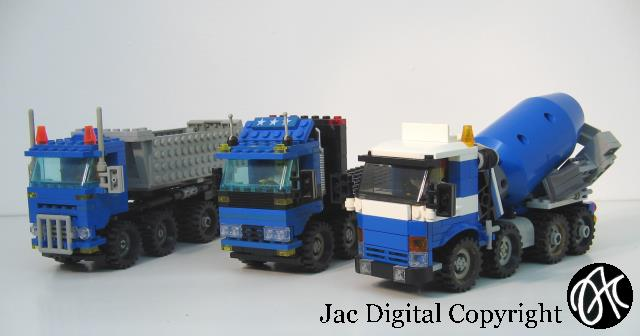
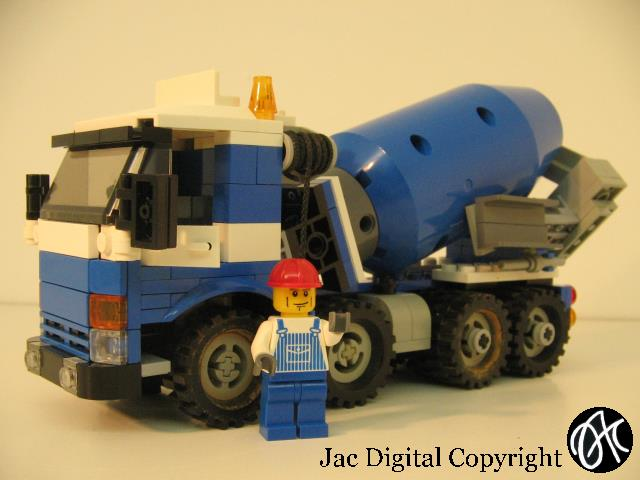
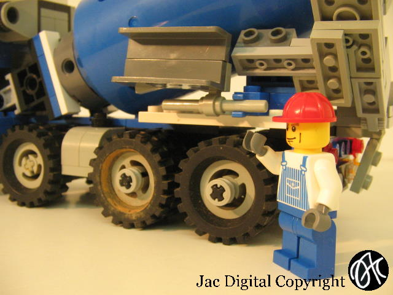
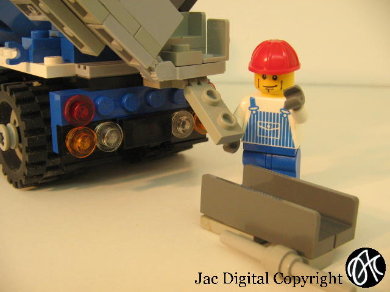
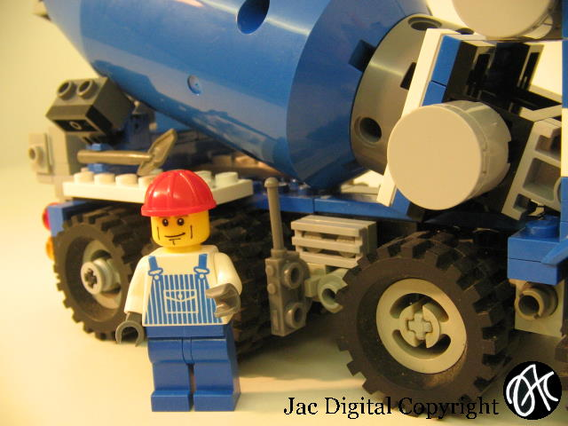
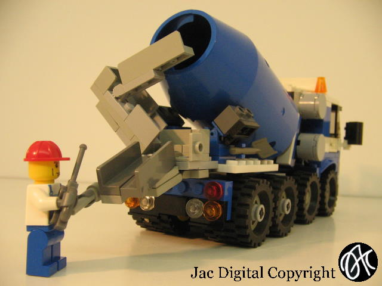
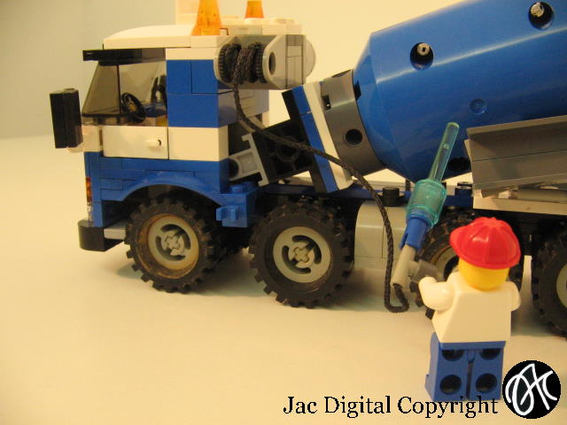

Une fois n’est pas coutume, c’est la description d’un modèle mi-commerce, mi-MOC qui va suivre dans ces quelques lignes.

De part nos discussions, il ressort deux types de collectionneurs principaux de briques LEGO. Les collectionneurs de sets officiels, et les "MOCeurs", pour My Own Creations, francisé pour la fin. Dans cette deuxième catégorie, dont je fais partie, il y a soit les constructions entièrement personnelles, inventées ou inspirées de choses réelles, soit la modification de sets officiels. J’aime bien oeuvrer dans cette deuxième partie. Et j’ai travaillé dernièrement sur la modification de la très belle bétonnière sortie sous la référence 7990. Pour vous dire, c’est comme un maquettiste qui trouve sa maquette très jolie, mais qui apportera tout de même sa touche personnelle...

Je ne parlerais pas plus de ce modèle que vous avez peut être monté, [qui a déjà fait l’objet d’une revue](/articles/625/) et qui est bien connu dans nos magasin maintenant, mais plutôt des modifications apportées pour que ce véhicule spécial ressemble réellement à un véhicule entrant dans les chantiers.

C’est après une discussion avec Loys alias Chimère, que j’ai eu l’idée de cette modification. Je trouvais les roues de [l’ensemble articulé 7733](http://www.brickset.com/detail.aspx?Set=7733-1) et des nouveaux camions de la gamme LEGO en général trop petites. Il est vrai qu’aujourd’hui, pour les grands volumes, les véhicules industriels sont chaussés de roues ridiculement basses. Mais, cela ne se fait pas pour les véhicules de chantier. Du coup, je pouvais adapter la bétonnière sur un de mes châssis préféré, le 8 roues, et ainsi augmenter ma collection de ce genre de véhicule.

**Trois camions de chantier**

J’avais déjà un châssis existant. Mais il a fallu le modifier pour recevoir la bétonnière et la nouvelle cabine. Du coup, j’ai du supprimer les nouveaux garde-boues, que je trouve très jolis, mais pas adaptés. Et cela tombe bien, car mes camions avaient besoin d’un "relifting" facial, car la gamme vieillissait.

**La nouvelle bétonnière "JAC"**

Cela m’a aussi permis de rajouter des détails, et de placer les choses où elles devaient être. J’ai rajouté la goulotte qui sert à dirigé le ciment à l’endroit voulu...

**La goulotte à sa place, pour le transport.**

**L’emplacement qui va recevoir la goulotte, pour le versement.**

Ensuite, j’ai replacé l’outil indispensable : la pelle, et mis à disposition une télécommande qui permet de contrôler le versement du ciment.

**La pelle et la télécommande de la toupie.**

Voilà, il n’y a plus qu’à couler le ciment...

**Y’a plus qu’à !!!**

Derrière la cabine, il y a un réservoir d’eau. Elle sert a tenir le ciment en humidité lors du transport, et aussi au nettoyage de l’ensemble après une livraison. Justement, le camion en a bien besoin. Surtout les pneus !

**Nettoyage**

Voilà, pour le reste, des heures d’amusement, et de construction, je vous laisse imaginer...
