Première grue du genre dans la gamme City, cet engin est une nouveauté attendue pour 2009. Découvrons ensemble un peu avant l’heure le contenu de cette boîte.

## La boîte

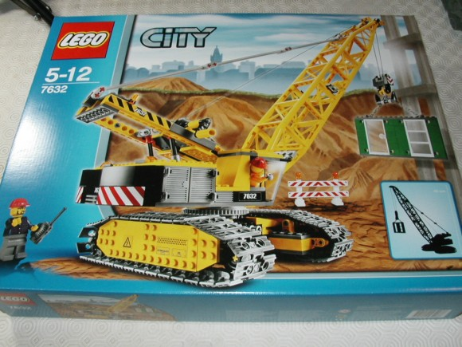

_Résumé :_  
**–** Nombre de pièces : 481  
**–** Prix : environ 50 euro  
**–** Année : 2009  
**–** Gamme : City Construction

La boîte, de taille convenable, met en avant la grue portant une paroi d’immeuble et annonce la hauteur maximale de la flèche : 41cm. Point d’extravagance au niveau du design, l’emballage reste dans le standard de la gamme City.

## Le contenu

Le contenu est le suivant : 6 sachets, répartis en 4 étapes-modules de montage (dont un uniquement avec les maillons de chenilles), une (seule) notice et une planche d’autocollants.

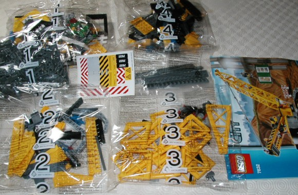

## Etape 1 : la base

Les sachet de l’étape 1 contiennent les deux figurines, un grutier et un conducteur de travaux.

L’assemblage de la base se fait facilement, la plus grosse part du travail étant d’assembler les 2 x 30 maillons.

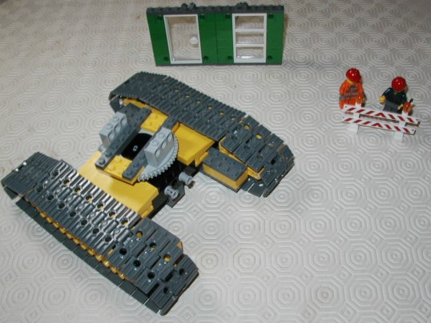

## Etape 2 : structure et enrouleur

L’étape 2 consiste en l’assemblage de la structure de la partie supérieure de la grue.

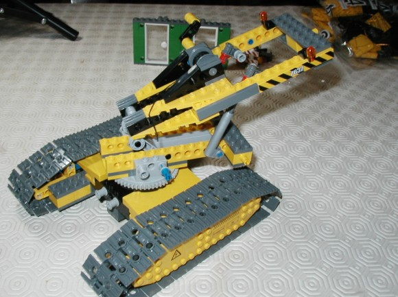

On notera la technique simplissime du système de blocage de l’enrouleur. L’axe de l’enrouleur est en liaison via deux roues dentées à un connecteur à friction. Cette friction se ressent lorsqu’il s’agit d’enrouler pour la première fois les deux mètres de ficelle :)

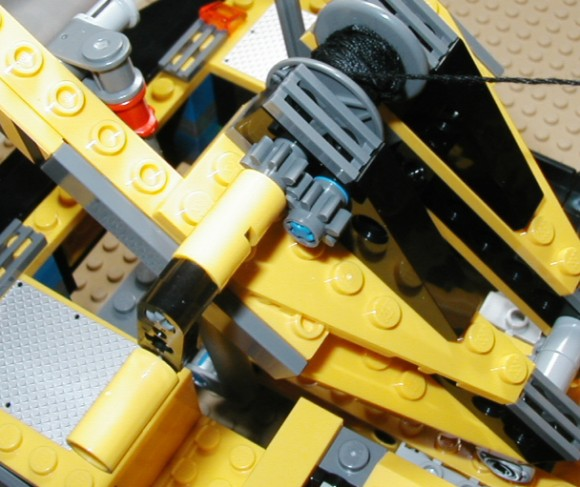

## Etape 3 : la flèche

Voila sans doute tout l’attrait de cette boîte : les nouveaux éléments tubulaires de la flèche.

Que les esprits chagrins se consolent, il ne s’agit pas d’une énorme et unique métapièce comme certains pouvaient l’imaginer, mais bien d’un ensemble de deux nouveaux éléments.

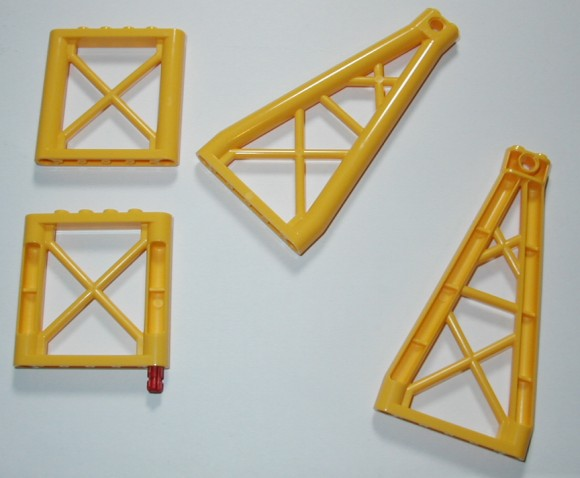

La connexion entre les éléments est effectuée par des axes Technic en chaque extrémité. La présence des tenons permet d’empiler les éléments ou d’y fixer des accessoires, comme ici des projecteurs.

Il est fort à parier que ces éléments seront rapidement utilisés dans de nombreuses créations, System ou Technic.

Le crochet de la grue est bien sympathique même si le design nous ferait davantage penser à une ancre de bateau.

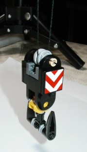

Au final, la flèche prend place sur la structure. L’attache à la base par deux simples connecteurs Technic peut poser la question de la résistance au poids.

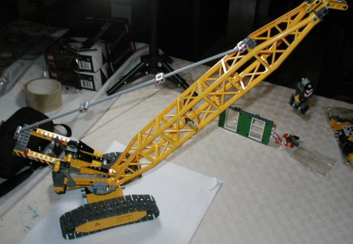

## Etape 4 : la cabine et contre-poids

Dernière étape, le sachet 4 nous propose la construction de la cabine et des contre-poids.

Pas particulièrement friand du nouveau design des volets (beaucoup trop grossiers à mon goût), ils offrent pourtant ici un bel effet de solidité aux gonds des portes des coffrets, comme les équipements de chantier se doivent de l’être.

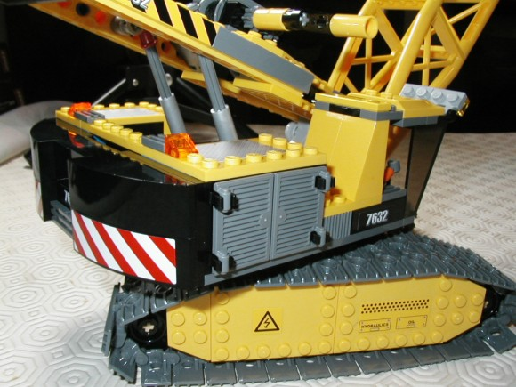

## Montage final

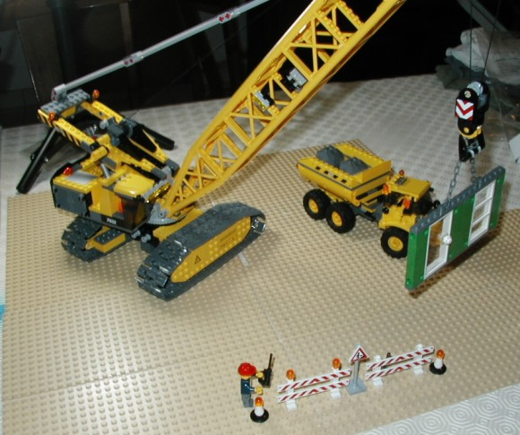

Au final, c’est une belle grue originale que nous propose LEGO, ici en compagnie du [nouveau camion-benne 7631](http://www.brickset.com/detail.aspx?Set=7631-1).

La variation d’angle d’inclinaison de la flèche n’est pas excessif.

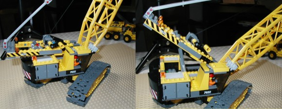

J’apprécie particulièrement le montage complètement modulaire dont chaque élément est simplement fixé par des connecteurs, à l’image des modèles de la gamme Technic.

Je regrette cependant l’intérêt quasi-nul que présente la paroi d’immeuble. Il aurait été plus intéressant de proposer un module complémentaire pour [l’immeuble de la boîte du chantier 7633](http://www.brickset.com/detail.aspx?Set=7633-1)

Je n’ai pas fait de tests de charge, mais il ne faut pas s’attendre à des miracles. La structure tubulaire reste légèrement fragile, une fixation par connecteurs à friction aurait apporté plus de solidité à mon avis. Mais l’usage plus universel des axes a sans doute été la raison de ce choix, seuls les designers pourront nous le dire. L’absence de véritable contre-poids (briques lestées par exemple) contribue à la limitation de ce modèle.

Ca n’en reste pas moins un modèle original et nous ne pouvons que remercier LEGO de savoir se renouveler.
