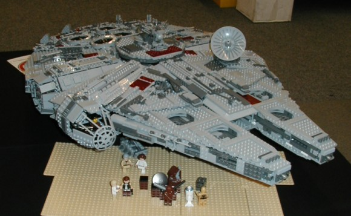
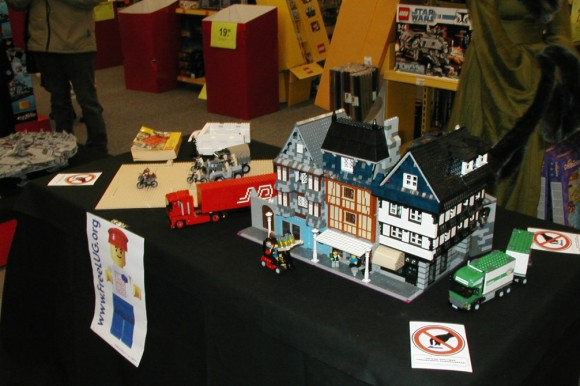

Pour la seconde année, le rendez-vous était à nouveau pris pour la période des fêtes de Noël en ce samedi 13 décembre.

Manu est venu équipé du Faucon Millenium UCS, terminé la veille au soir qui a impressionné bon nombre de clients.

De mon côté, j’ai apporté la reproduction des fameuses maisons de Lannion déjà présentées à Kidexpo, quelques véhicules Indiana Jones, une petite scène SW (l’attaque des Storm troopers pour envahir le Rebel Blockade Runner) qui mettait en scène les figurines des battle packs récents et une petite scène Castle pour présenter quelques produits de la gamme.

David, plus connu sous le nom de Guss, venu tout droit de Suisse, a apporté dans ses bagages, en plus de quelques chocolats, un petit MOC à étage sur le thème Castle.

Comme à l’accoutumée, l’accueil fut sympathique.

Christophe et Jean-Louis sont venus en simples visiteurs et sont repartis les bras plus ou moins chargés de nouveautés 2009 que le magasin venait de réceptionner.

## Photos

Nos quelques photos :  
**–** [Guss](http://guss.teammu.com/modules/extgallery/public-album.php?id=50)  
**–** [Erik](http://photos.freelug.org/main.php/v/brickerik/expositions/2008/maxitoys2008/)
