Revue du tracto-pelle et du camion benne de chantier.

En allant faire un tour à l’[exposition du MaxiToys a Garges Les Gonesses](/articles/837/), j’ai trouvé des nouveautés 2009 avant le début de l’année.

Je suis tombé sur 2 petites boîtes qui vont bien ensembles,  
le tracto-pelle (réf 7630) et le camion benne (ref 7631).

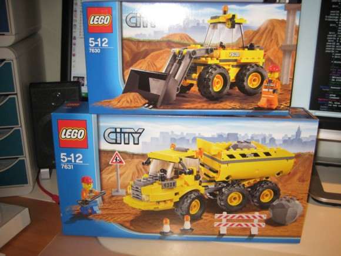

_Résumé :_  
**–** Nombre de pièces : 109  
**–** Prix : 15 euros environ  
**–** Année : 2009  
**–** Gamme : City construction

Après ouverture de la boîte (set 7630) du tracto-pelle, je trouve 2 sachets, une notice, 3 pièces en vrac, et une plaque d’autocollants.

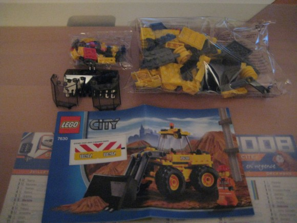

Première étape du montage : la minifig (alias max).  
Une fois construite, elle vous aidera à monter l’engin et elle tournera les pages avec vous tout au long de ce montage.

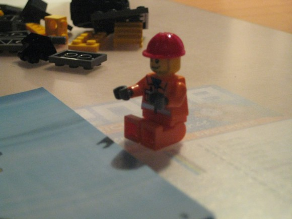

Au fur et à mesure du montage, la petite plaque LEGO prends forme. Ainsi, on arrive a un beau engin de chantier.

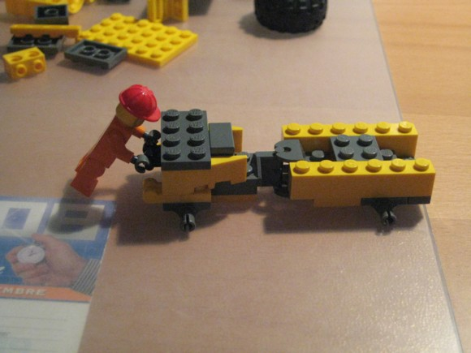

Sur la notice en page 16, vous trouverez le montage d’un faux vérin.

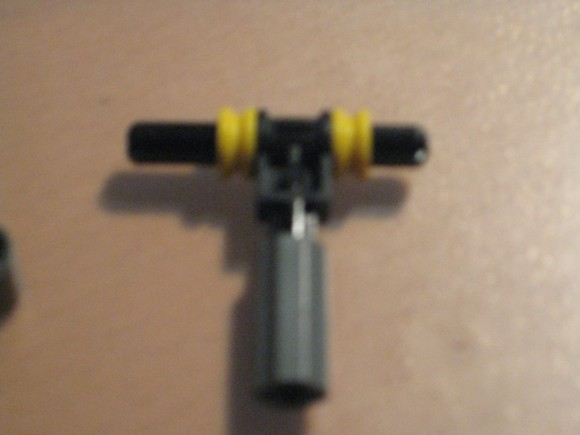

A la fin de la notice j’ai eu du mal à voir où la pièce du bas aller être fixée, (merci manu pour la fin du montage), je n’arrivais pas à savoir où elle était fixée.

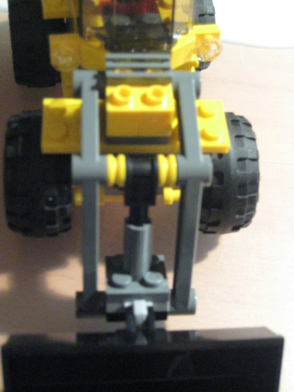

Bon une fois tout fini, voici ce que cela donne :

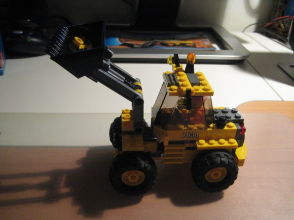

J’ai l’ancien modèle (set [6658](http://www.brickset.com/detail/?Set=6658-1)) mais où il est ? je sais pas !

Bon, passons au camion benne (set 7631) ! _tiens les chiffres se suivent !_, il aurait pu faire un lot de deux pour l’ensemble.

_Résumé :_  
**–** Nombre de pièces : 189  
**–** Prix : 15 euros environ  
**–** Année : 2009  
**–** Gamme : City construction

Je trouve deux sachets avec la même méthode de montage (sachets numérotés) la notice et une plaque d’autocollants.

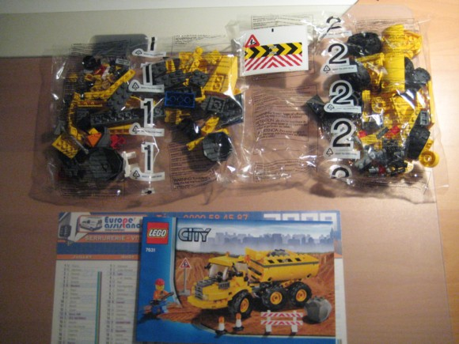

Le montage de la minifig toujours au début.

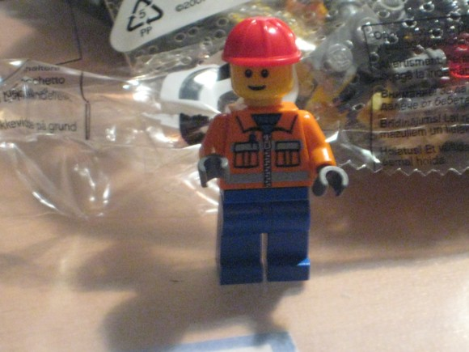

Le sachet n°1 vous permettra de monter la cabine et les accessoires qui vont avec. Le sachet n° 2 est plus pour la benne et les roues.

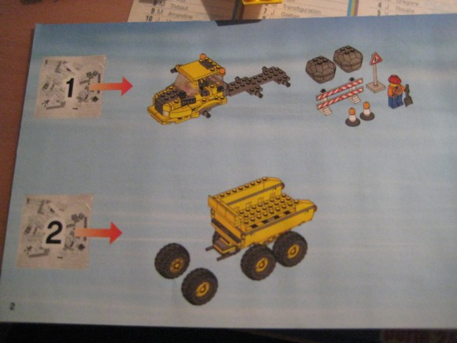

_Tiens une pièce que je ne connais pas_. Forcément cela vient des racers ! (info : je n’ai pas de racers, désolé)

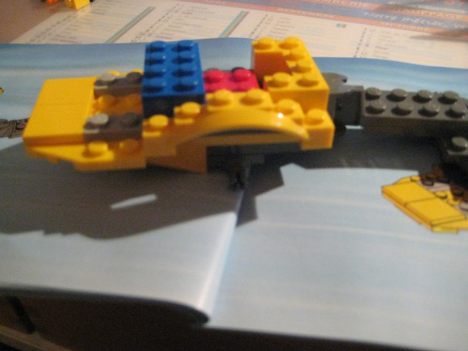

Le montage avance bien.

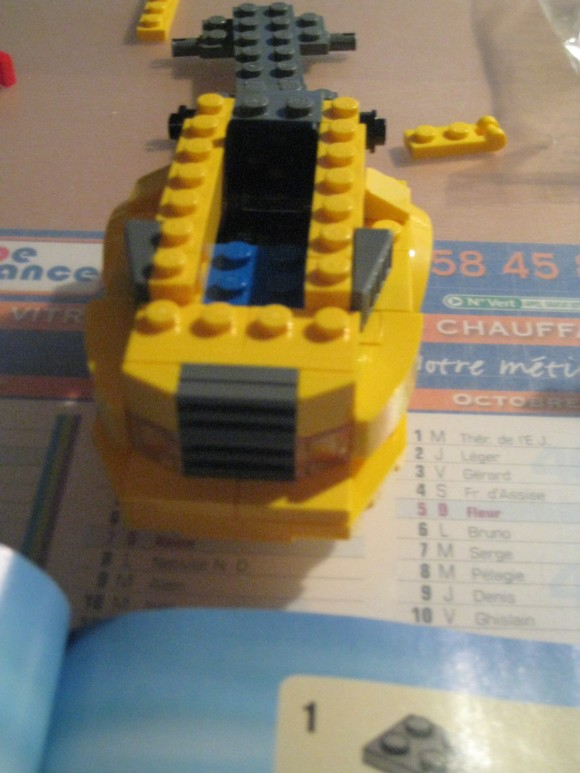

La deuxième partie, la benne.

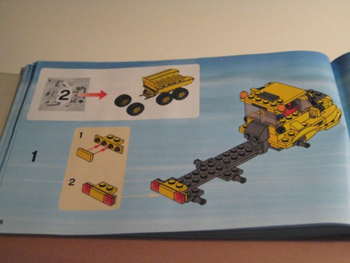

La benne se monte assez facilement.

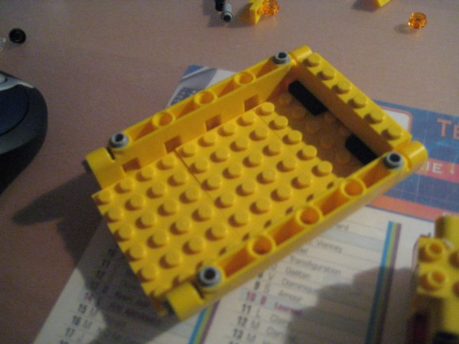

La fixation _je regrette les faux vérins_.

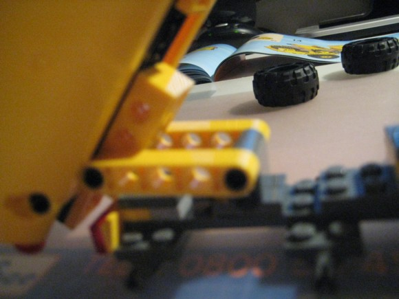

L’ensemble monté est prêt à jouer, il faut compter au moins 1 heure pour assembler les deux.

Voilà c’est bon ! Juste un défaut,la pelle est baissée à fond.

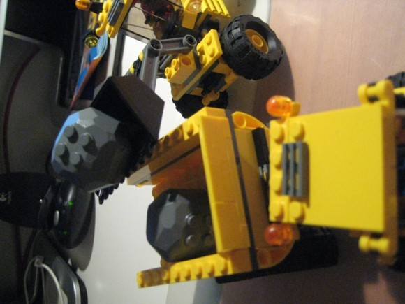

Photo de l’ensemble avec les accessoires.

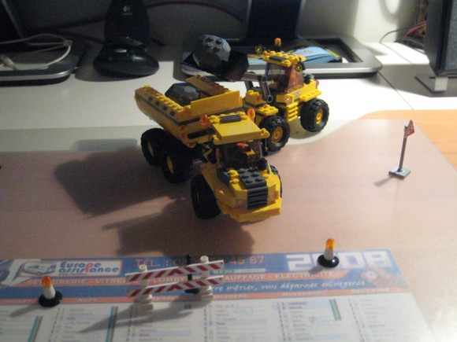
