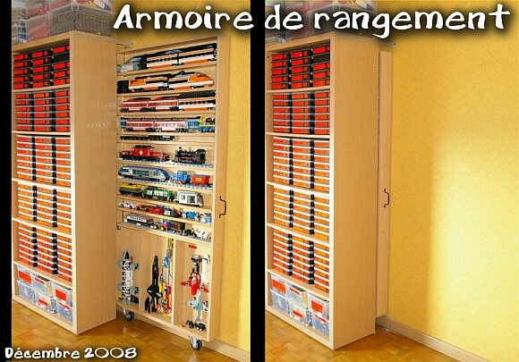
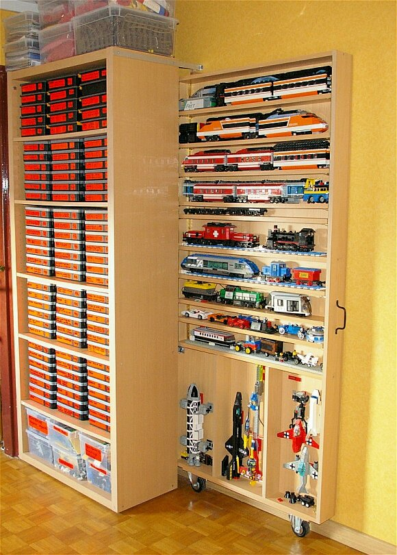
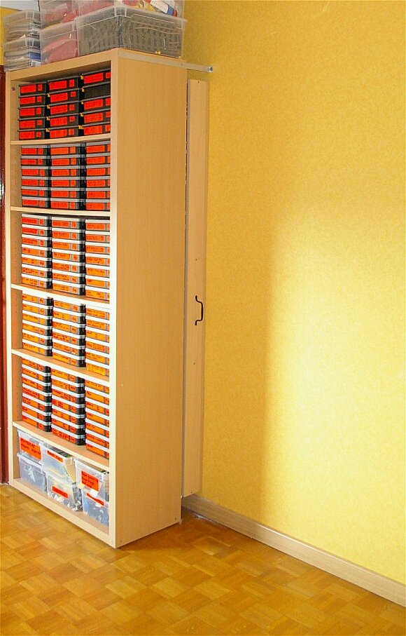
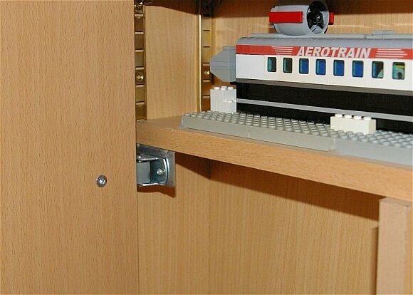
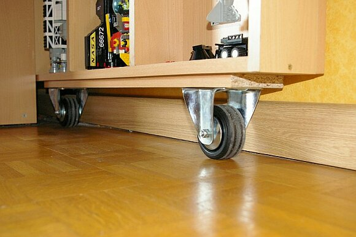
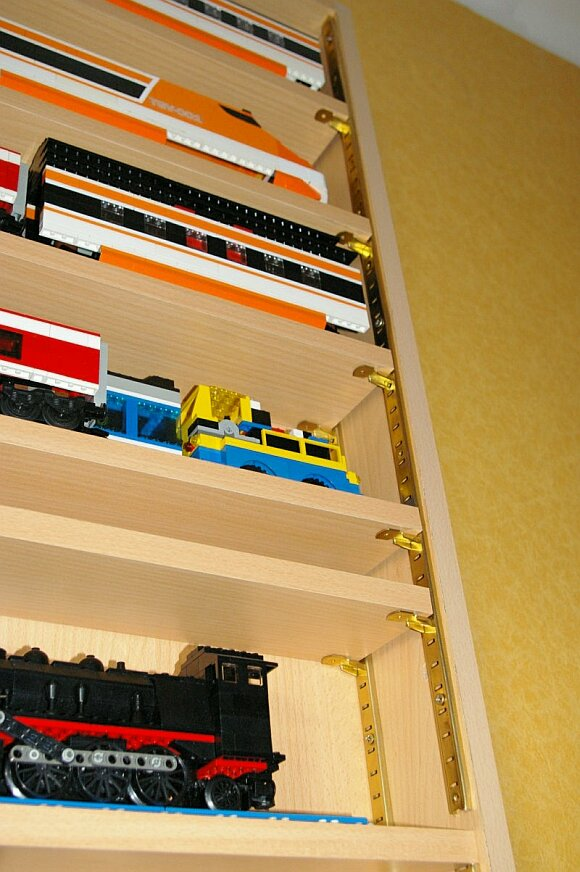
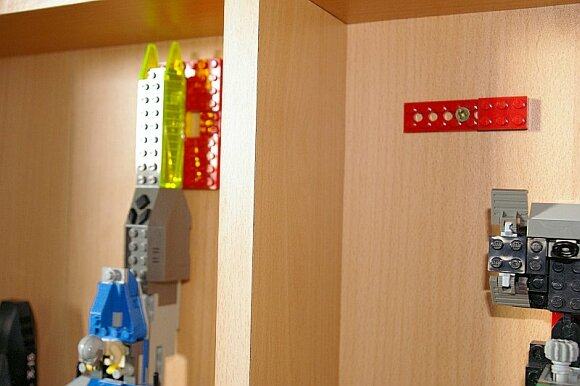

Lorsqu’on vit dans un appartement de dimensions modestes, la question de la place est cruciale, quelle que soit l’activité qu’on pratique, et on n’a pas tous la chance d’avoir une pièce réservée à notre hobby.

Depuis ma sortie du _dark-age_, je m’offre un luxe que je n’avais pas lorsque j’étais enfant, celui de conserver mes MOCS préférés. L’idée de l’étagère ou d’une vitrine apparait donc rapidement comme une nécessité, mais on n’a pas forcément envie de vivre au quotidien au beau milieu d’un "musée du LEGO". Je pense en particulier à nos compagnes qui ont en général une certaine patience mais avec des limites.

[L’étagère à trains dont NICO-57 a parlé dans son article](https://www.freelug.org/spip.php?article671) me plaisait beaucoup mais occupe une place au mur trop importante. Voici donc une variante... qu’on pourrait appeler "présentoir rétractable". Il est vrai que l’espace au mur doit rester dégagé, mais l’aspect "musée permanent" disparait lorsque c’est fermé (l’armoire sera également garnie de portes en façade).

Mon armoire habituelle a été écartée du mur d’une douzaine de centimètres... Mais elle a été fixée au mur pour éviter de basculer accidentellement.

Un rayonnage amovible a été construit sur mesure, en novopan "mélaminé". Ce rayonnage a couté environ une soixantaine d’euros en matériaux achetés en grande surface de bricolage (17 euros pour le bois, 10 euros de frais de découpe, 32 euros de quincaillerie, visserie, roulettes, poignée, chants thermocollants).

Le rail en alu permet d’installer un "arrêt" pour éviter de sortir complètement l’étagère.

Une roulette maintient l’écartement entre l’étagère et l’armoire.

Le dessous est renforcé car l’ensemble pèse tout de même un certain poids. Malgré cela, mon fiston de 7 ans parvient à manipuler cette étagère d’une seule main. Les roues de grand diamètre sur roulements et la poignée aident bien.

L’intérieur est réglable pour gérer au mieux la place disponible.

Certains MOCS nécessitent une fixation.

Voila , je pense que les photos parlent d’elles-mêmes, le but est de présenter l’idée et le principe. Libre à chacun de l’adapter à son besoin et à la configuration de son logement. N’hésitez pas à me contacter ou à laisser des commentaires ci-dessous si vous avez des question.

NICO
