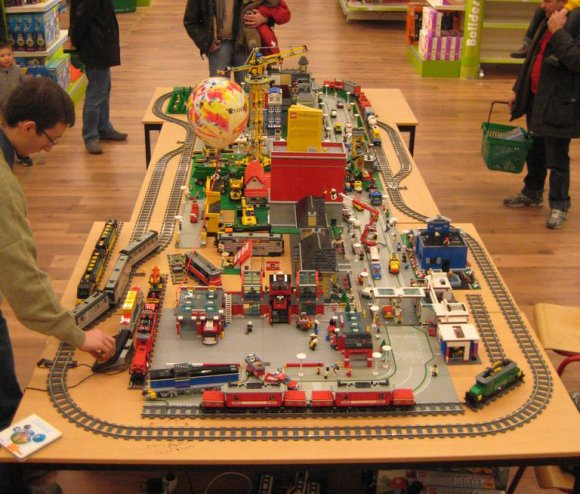
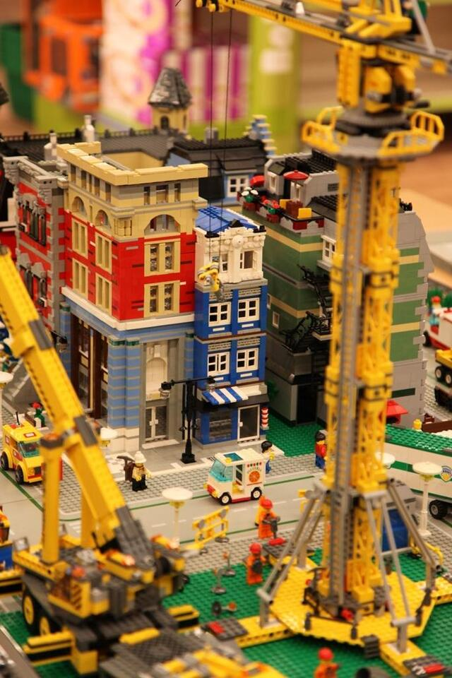

Suite à une visite au magasin Pic-Wic, j’ai proposé au directeur du magasin de faire une exposition en vue du partenariat avec FreeLUG pour l’obtention de 15% de remise.

Une fois l’accord du CA obtenu, je proposais une date au magasin début novembre mais faute de temps et de job, j’ai déplacé la date à mi-janvier 2009.

Comme je ne suis pas très moc, j’ai monté des sets 2007 à 2009 sur le thème du chantier et travaux publics. C’est ma première exposition que je fais et que j’organise, donc pour moi c’était double challenge, voir même une double mission.

Arrivée sur les lieux à 8h45 j’ai attendu 9H que mes camarades arrive pour les accueillir (oui Nicolas c’est bien là). Bon, après la première mission a été de trouver avec le personnel des tables à la bonne hauteur mais surtout identiques (merci au personnel du magasin pour leur aide et qui nous a trouvé des tables identiques). Nous avons du commencer vers 9h30 - 9h45 le montage de l’exposition. Nous avons du finir vers les 11H après que Fabrice aie remonté sa caserne de pompiers pour la énième fois. Ma plus grande appréhension était de gérer le public et tout surveiller. Mais tout s’est bien passé. J’ai adoré de voir le public émerveillé par le train ou par les détails des maisons ou commerces. Il y a eu des moments de foule et des moments calmes ; le plus drôle c’est quand il y a de la casse, le public a peur et part. Maintenant ça me plait de faire des expositions. Il faut que je me prépare mieux et que je bloque des journées pour les dates de mes futurs expositions.

Merci à tous et quand vous voulez pour une autre exposition avec vous. Je vous tiens au courant de la suite.

_Mot de Nicolas_

En conclusion, une journée bien remplie avec beaucoup de monde et un public très enthousiaste, notre réseau n’a pas connu trop de catastrophe, une locomotive a néanmoins chuté de la table à cause d’un chef de triage, mais vite reconstruite.

Encore merci à tout notre public et à très bientôt

[Galerie de Tof](http://photos.freelug.org/main.php/v/Tof92/expo+pic+wic+gennevilliers+le+17+janvier+2009/)
