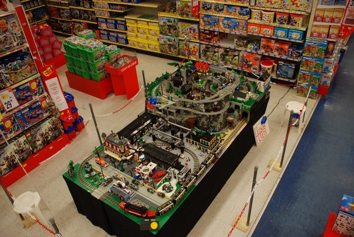
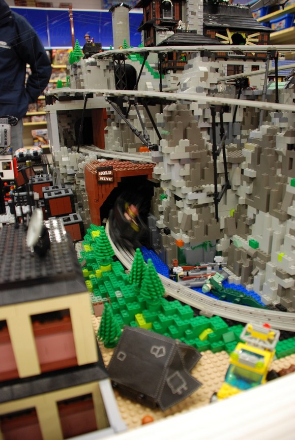
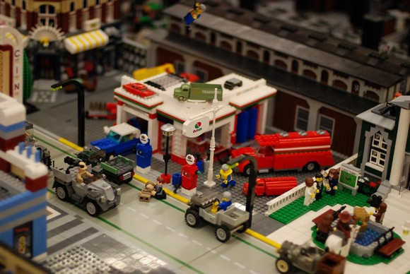
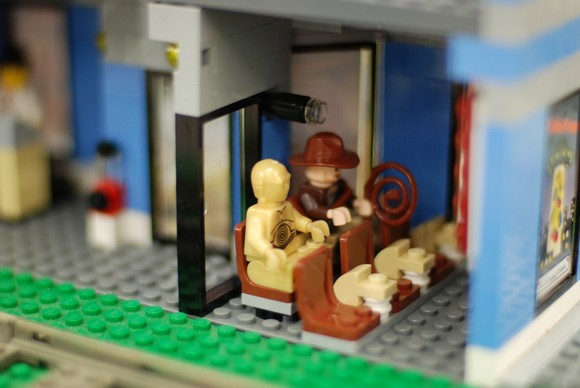
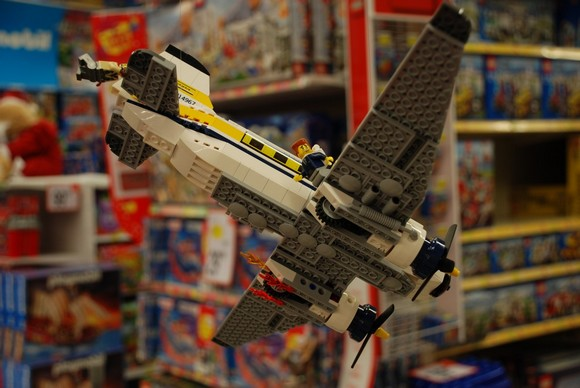
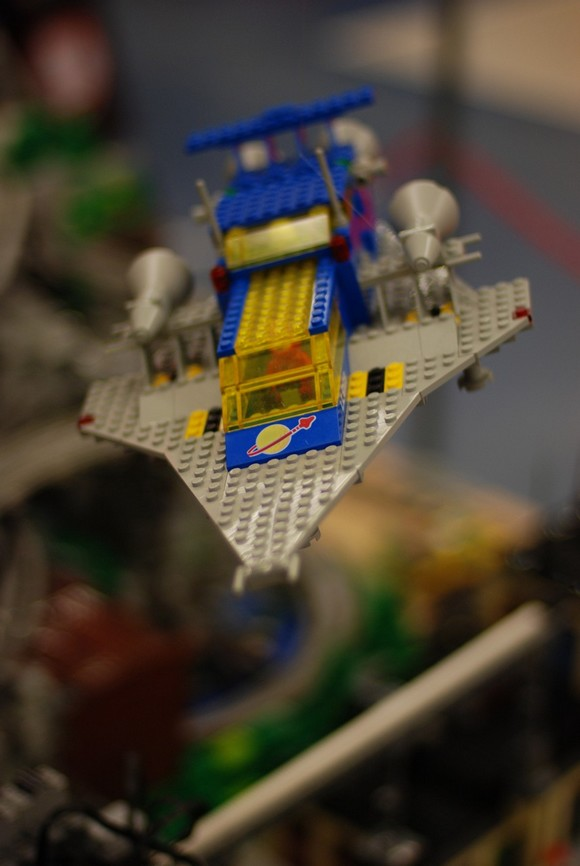
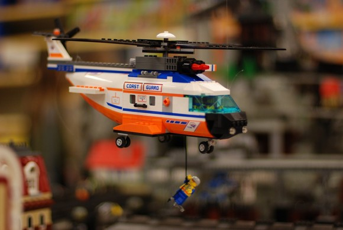

Pour les fêtes de Noël, Daniel, responsable du magasin Toys’r’Us de Montivilliers, près du Havre, nous a demandé si nous pouvions faire une petite exposition de LEGO.

Nous avons donc répondu présents, pour le week-end des 20 et 21 décembre 2008.

Le plaisir d’exposer un réseau de trains LEGO dans le rayon de notre marque préférée...

Daniel nous a fait totalement confiance, en nous demandant cette exposition, car il n’avait jamais vu nos réalisations.

Nous sommes donc arrivés le vendredi soir vers 19H, pour commencer l’implantation de nos tables, et pour déposer le plus gros du matériel. Le magasin fermant ses portes, le rendez-vous était donné au lendemain pour la suite... 6H du mat’...

Petite nuit donc, puis fin du gros-oeuvre. A l’ouverture des portes, un petit imprévu a fait que l’électricité n’était pas là. Rien au bout de la rallonge. Heureusement, il faut toujours prévoir un enrouleur de secours.  
Les premiers clients entrent donc dans le magasin, et comme le rayon LEGO est situé à l’entrée, ils furent surpris, et stoppés net devant l’exposition.

Une vue d’ensemble

Les wagonnets à fond dans les virages relevés.

Celle-ci est composée de quatre modules sur lesquels prennent place une montagne Indiana Jones (les petits wagonnets de la mine ), deux modules pour la zone de hangars de Médérik, avec son pont transbordeur, et deux modules sur lesquels nous avons mis en valeur les boîtes Indiana Jones, et le fameux Town Plan.

En panne ?

C’est quoi le Film ?

Pour un peu plus de relief, trois objets volants identifiés sont suspendus au dessus, l’hélicoptère des gardes-côtes, l’avion d’Indiana Jones qui descend en flammes, et le LL928.

Mayday !!!

C’est un grand pas pour le Minifig...

Un peu à gauche... Un peu à droite...

Pour cette exposition, nous avions besoin de barrières. Vu le prix de celles-ci dans le commerce (environ 30 euros le pied), j’ai réalisé un modèle en tubes PVC, et planche de bois. Ces planches étaient collées au sol par de l’adhésif double face. Retour d’expérience : Il vaut mieux prévoir un lest (bidon d’eau de 5 litres par exemple), car l’adhésif ne tient pas face à un caddie, et ne colle bien qu’une fois.

Beaucoup de monde donc, et plein de contacts. Nous avons joué aux vendeurs-conseil tout le week-end, et orientés les clients dans leurs choix délicats :)

Le soir du dimanche, il faut penser à démonter...  
Mais nous n’avons qu’une heure pour tout ranger, et pour ceux qui me connaissent, c’est mission impossible. J’avais donc prévu le lundi en repos pour ranger tout tranquillement. Dur week-end donc, mais enrichissant de contacts, car le public n’est pas le même que dans une exposition classique où les gens savent un peu ce qu’ils vont voir.

[Les photos](http://www.brickshelf.com/cgi-bin/gallery.cgi?f=357699)
