Parmi les nouveautés 2009, la gamme Ferme fait son apparition dans les LEGO City avec 4 nouvelles boîtes dont un tracteur (ref7634), une moissonneuse-batteuse (ref7636) et la ferme (ref7637) avec une étable, une grange, un sillo à grain, un tracteur et sa remorque et un tracteur tondeuse.

Il y a trente ans que j’attendais cela : une ferme en LEGO. Il y avait bien sûr la ferme DUPLO, les tracteurs et moissonneuse-batteuse Technic, mais rien depuis 1972 avec un premier tracteur avec des roues lisses [TRACTEUR ET BENNE LEGO 378](http://www.peeron.com/inv/sets/378-1?showpic=1111) et 1975 avec [le set 814](http://www.peeron.com/inv/sets/814-2?showpic=3422) et le [set 190](http://www.peeron.com/inv/sets/190-1?showpic=6354)

## La Ferme - set 7637

_Résumé :_  
**–** Nombre de pièces : 609  
**–** Prix : environ 78 €  
**–** Année : 2009  
**–** Gamme : City Ferme

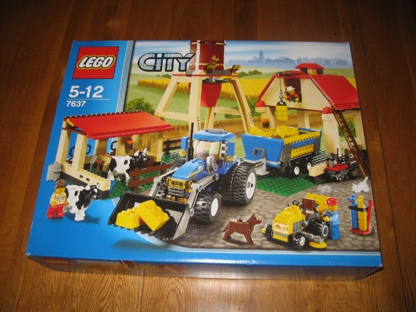

**La boîte**

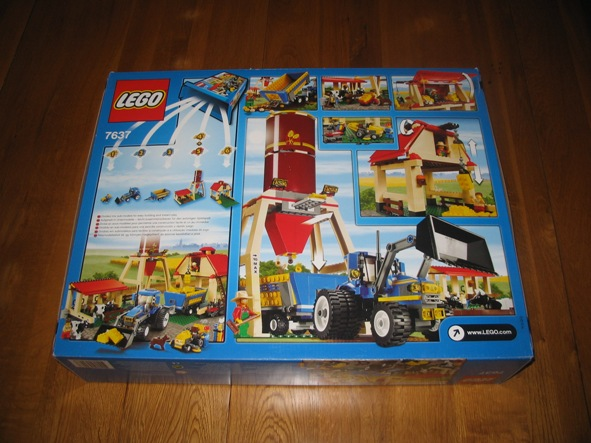

**Le verso de la boîte**

Comme à l’accoutumée, les pièces sont réparties dans 6 sachets numérotés plus un sachet pour les vaches, un pour les plaques et les supports, les piliers du silo et les plaques de base.

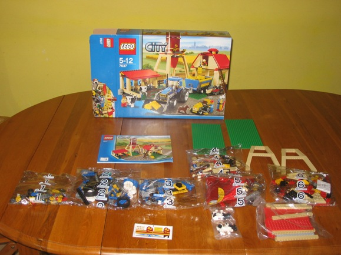

Il y a trois notices de montage :  
**–** le tracteur tondeuse, les vaches et les minifigs ;  
**–** le tracteur et sa remorque ;  
**–** les bâtiments de la ferme.

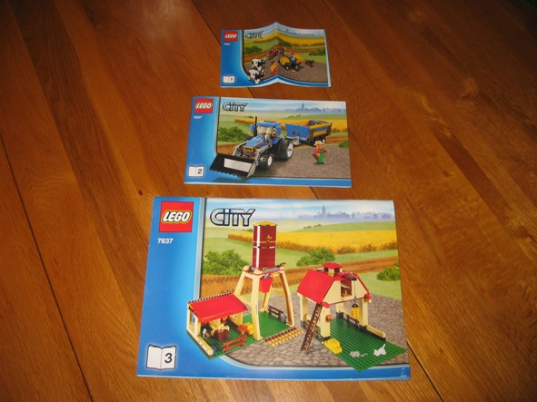

On commence bien évidemment par les minifigs, en même temps que le tracteur tondeuse, les vaches (nouveauté en noir et blanc), le poste à souder et la servante avec ses outils.

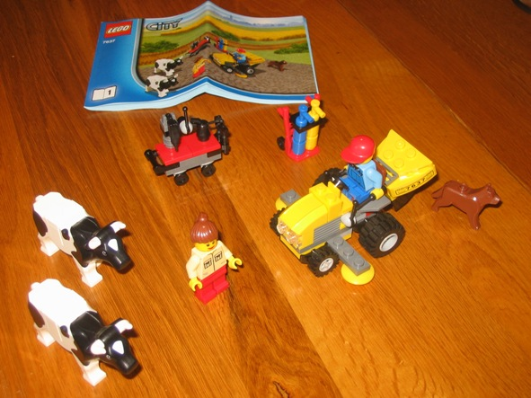

Dans un deuxième temps, on monte le tracteur et sa remorque.

## Le tracteur

Les roues arrières sont nouvelles et ces pare-brises noirs sont une nouveauté 2009 n’apparaissant que dans les chantiers et la ferme.

Le tracteur se fait en deux parties

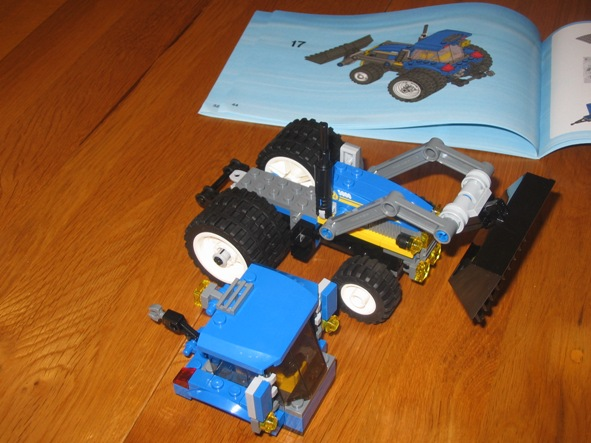

**Le tracteur et sa cabine**

A l’arrière on peut voir la nouvelle pièce pour l’attelage apparue en 2007 et aussi le système d’attelage par trois points, comme sur les vrais tracteurs. Les bras du chargeur frontal sont une nouveauté 2009 apparaissant aussi sur le chargeur de chantier.

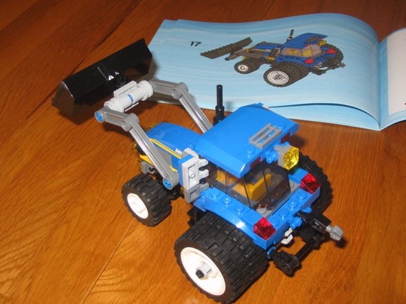

## La remorque

La remorque aussi se fait en deux parties

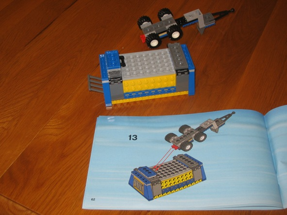

En plus d’être une remorque-benne, les ridelles latérales peuvent s’ouvrir ainsi qu’une trappe à l’arrière pour décharger le grain.

On obtient donc un joli ensemble agricole, dont j’apprécie le design.

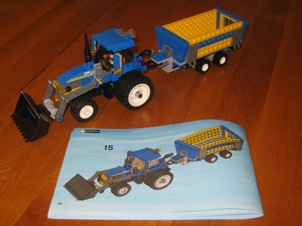

La plus grande notice concerne la construction des bâtiments.

## L’étable

Le toit composé d’une seule plaque est un peu décevant.

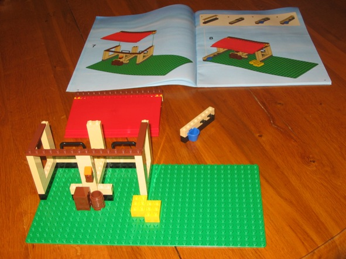

Un professionnel considérera cela plutôt comme des logettes pour vaches.

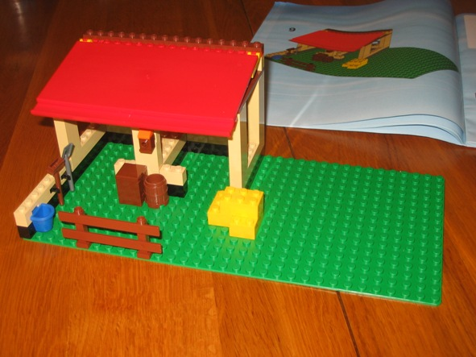

## Le silo à grain

Le sillo est d’abord composé d’un système d’ouverture pour verser dans la remorque. Les deux grandes pièces rouges n’existaient qu’en transparent, de plusieurs teintes, pour faire des pare-brise ou des vitres de bâtiment.

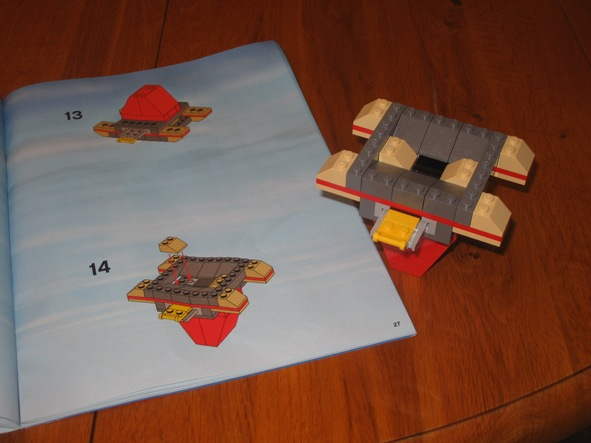

Positionné ensuite sur ses piliers à côté de l’étable, il impressionne par sa hauteur.

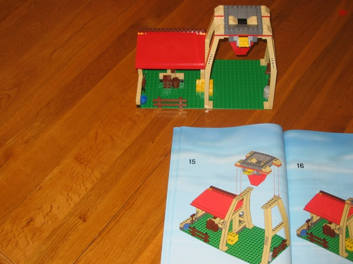

Pour jouer, des plaques rondes 1x1 peuvent s’assimiler à du grain que l’on introduit par le couvercle du silo et verse ensuite par le bas. Les enfants adorent.

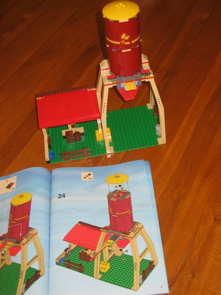

## La grange

Là aussi le jeu est favorisé avec une trappe pour sortir les bottes de fourrage.

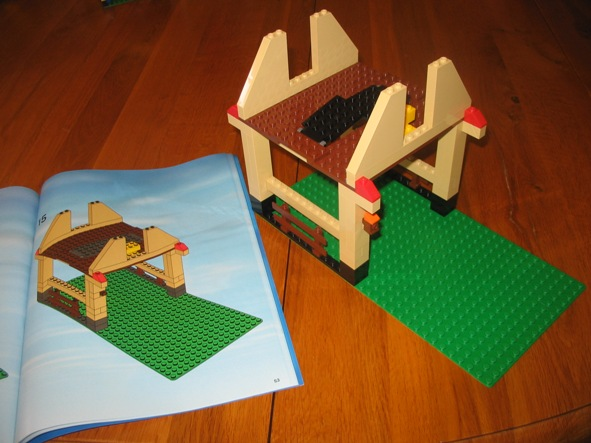

La mono pièce pour constituer un mur incliné est un peu décevante aussi, mais certainement choisie pour son inclinaison.

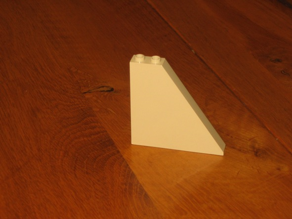

On monte ensuite le treuil pour élever les bottes, placé sur le haut de la grange.

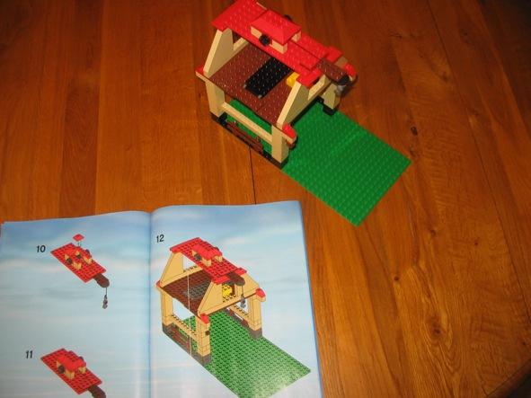

Fermé par les grandes plaques, on obtient un joli bâtiment que l’on peut ouvrir pour jouer.

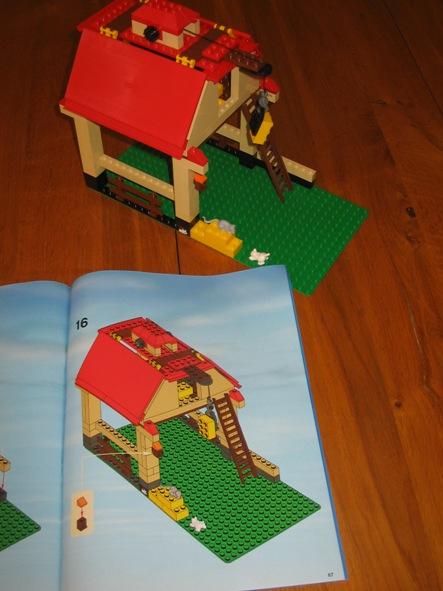

Vous remarquerez la mise en scène du chat qui guette le rat (qui est aussi gros que lui) et un autocollant, simulant une souris sortant de son trou, sur le pilier.

Et voilà une jolie petite ferme qui ne demande qu’à recevoir des améliorations pour être exposée.

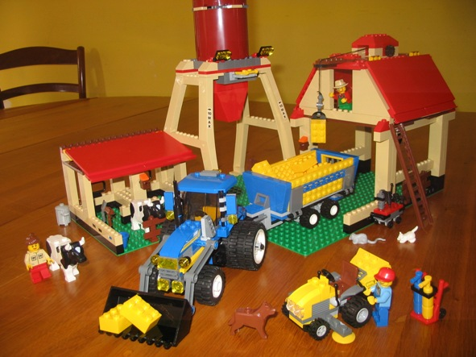

LEGO a certainement pensé à donner suite à cette gamme puisqu’elle est déjà accompagné d’une moissonneuse-batteuse, mais je vous la ferai découvrir dans la suite...

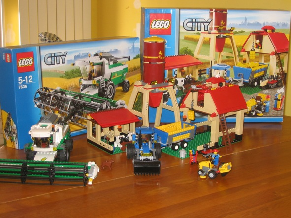

Au vu de la diversité de matériel agricole qui existe, il y a plein de possibilité de machines à atteler au tracteur. Quant aux décors, il faudrait que LEGO mette en vente sur le shop des antennes 1 x 4 jaunes pour faire des champs de blé.

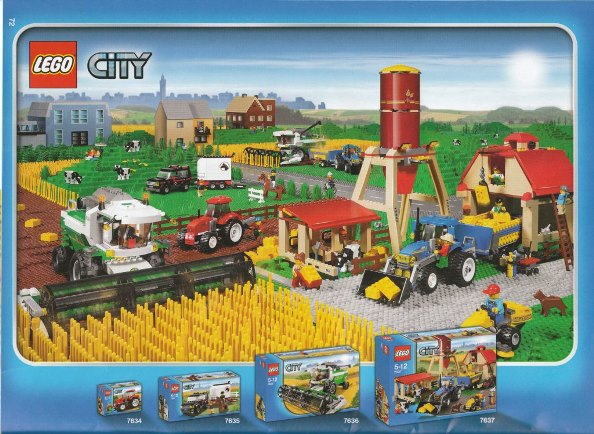

**La ferme LEGO**

Daniel RIGAL
