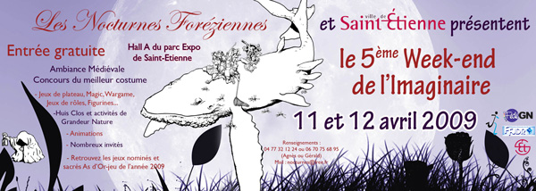

Les Nocturnes Foréziennes organisent le 5ème week-end de l’Imaginaire les 11 et 12 avril 2009 à Saint-Etienne. C’est dans un univers médiéval/fantastique que ce salon a lieu.

Cette manifestation se déroule dans le hall A du Parc des Expositions de Saint-Etienne (42, Loire).

Durant tout ce week-end, il y sera proposé des parties de cartes Magic, Wahrammer, Yu-Gi-Ho, des initiations à ces jeux et à d’autres jeux de rôles, des peintures sur figurines, des jeux de plateaux...

Quelques professionnels proposeront des jeux et des costumes.

L’entrée est libre et gratuite !

L’ouverture au public se fait à partir du samedi 9h, jusqu’au dimanche vers 18h-19h.

A savoir que ce week-end est nocturne, donc durant la nuit du samedi au dimanche, tous ceux qui sont intéressés à passer la nuit à jouer le peuvent !

FreeLUG présentera un diorama Castle et Star Wars.

L’association Festi’Briques animera un espace de jeu de Wahrammer en LEGO et d’autres jeux (échecs, morpions).

Durant la nuit, un Faucon Millenium (set 10179) sera à construire pour le présenter le dimanche.

Donc si vous êtes intéressé par le jeu, venez nous voir !
