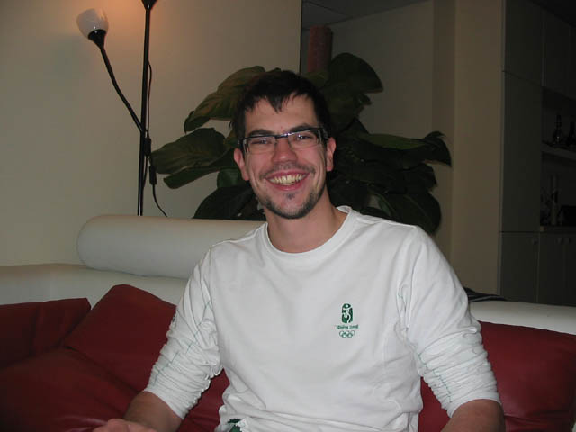
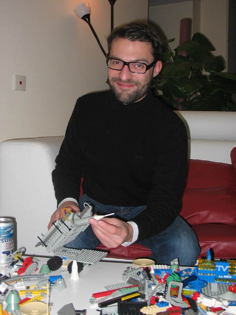
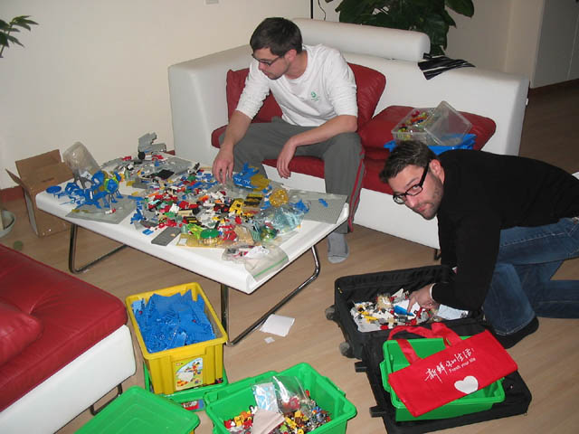
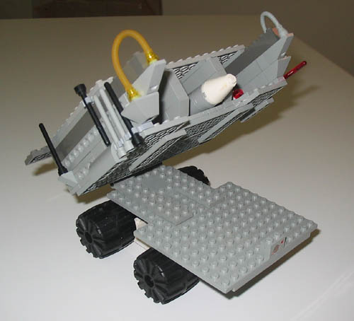
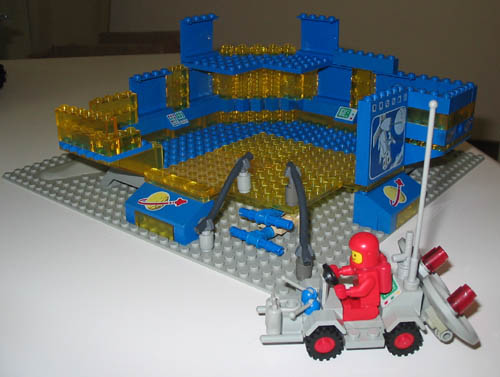
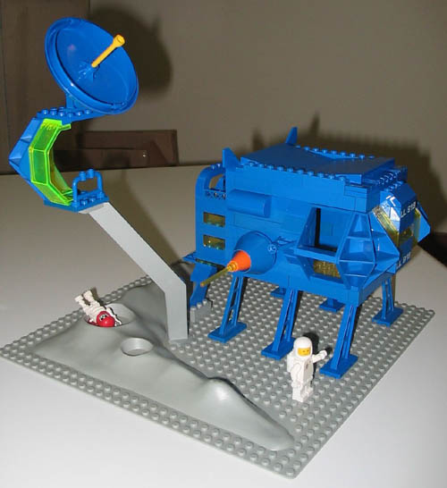

Le problème avec les rencontres d’AFOLs, c’est qu’il faut au moins être deux...

Complètement isolé depuis deux ans dans cette mégapole dont la population représente un tiers de la population française, je désespérais de trouver quelques autres AFOLs dans mon cas. Les briques LEGO ayant été introduites en Chine très tardivement, il n’y a aucun adulte chinois qui ai pu avoir ce jouet étant enfant et donc devenir un AFOLs de nos jours. C’est pour cela que paradoxalement, malgré la population nombreuse, on ne peut trouver des AFOLs que parmi les étrangers.

**Heiko**

En août 2008, Heiko, un AFOL allemand membre de [1000steine](http://www.1000steine.de/), m’a contacté pour m’annoncer sa venue prochaine à Shanghaï. Après une première rencontre pour faire connaissance et le temps qu’il s’installe, ce "setter" invétéré a organisé une "building party" chez lui (le 15 février 2009) ! Bien sûr je ne pouvais manquer une telle occasion (surtout venant d’un setter) !

**Fred**

Il avait aussi invité deux ou trois autres personnes potentiellement intéressées, mais seul Fred, un de ses collègue français, est venu. Fred est encore dans sa période [Dark Age](http://www.brickwiki.org/wiki/Dark_ages) et pour lui, cet après-midi fut un peu étrange car il y avait longtemps qu’il n’avait pas tâté de la brique...

**En pleinne construction**

Sans plus de cérémonie, Heiko vide un premier bac de vrac sur la table du salon. Il distribue aussi une plaque de cratère [classic space](http://www.classic-space.com/) à chacun. Ma foi, je n’ai fait que très peu de MOC space jusqu’ici, c’est donc le moment d’explorer ce nouveau thème pour moi. Fred, un peu intimidé au début, fouille le vrac à la recherche d’une pièce qui pourrait l’inspirer. Il tombe finalement sur des grosses roues qui le décidera à se lancer dans la construction d’un véhicule lance-missile.

Très vite Heiko ramène encore plus de vrac, y compris du vrac qui a voyagé dans une valise et qui apparemment, n’en était pas encore sorti. Mais ne vous inquiétez pas, tout son vrac sera bientôt trié par couleur, car il a demandé à sa femme de ménage de le faire et pour l’instant, elle ne se plaint pas. Il a juste un peu peur de sa réaction quand il lui demandera de trier par type de pièces quand elle aura fini le triage par couleur. :-)

L’après midi passe à une vitesse folle entre la construction et les discussions pour faire connaissance. Fred doit nous quitter en premier, son MOC n’est malheureusement pas terminé. Sans doute aura-t-il l’occasion de le terminer un autre jour ?

**Le MOC de Fred**

Heiko en proie à quelques difficultés pour faire l’escalier d’accès à sa base, décide de se changer les idées en construisant un petit véhicule d’exploration lunaire basé sur les célèbres rovers space classic comme le [886](http://www.peeron.com/inv/sets/886-1). Qu’est-ce que vous voulez, un setter ne se refait pas ! Même si Heiko n’a pas eu le temps de finir sa base, il pense la finir plus-tard.

**Le MOC de Heiko**

En ce qui me concerne, j’ai opté pour une base pas trop grande, histoire d’avoir une chance de la finir, et à vrai dire, à part quelques détails manquants comme certaines vitres que je n’ai pas eu le temps de chercher, je peux dire que ma base est finie.

**Le MOC d’Alban**

Malheureusement, je la trouve un peu trop bleue à mon goût, j’aurais dû ajouter une autre couleur. Mais bon cela fait partie des contraintes d’une "building party", à savoir construire quelque chose à partir du vrac qu’on vous propose et dans un temps imparti.

Cet après-midi fut agréable pour tous, et Fred a redécouvert le plaisir de construire en LEGO. Cette rencontre sera sans doute le point de départ d’un nouveau LUG en devenir, qu’on ne pourrait nommer autrement que SHLUG. :-)
