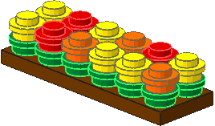
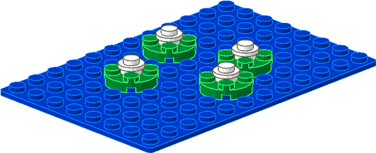
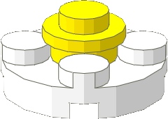
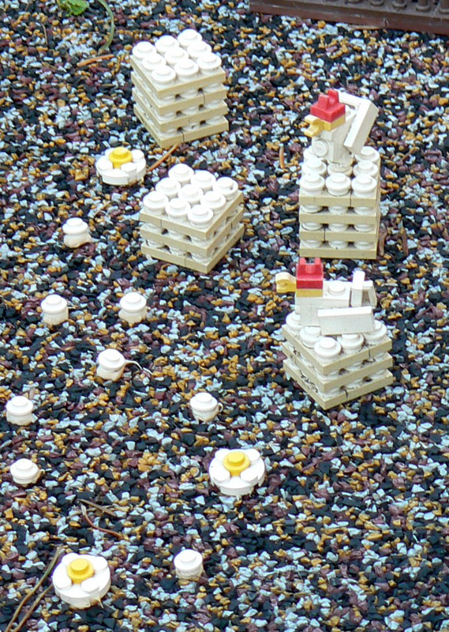
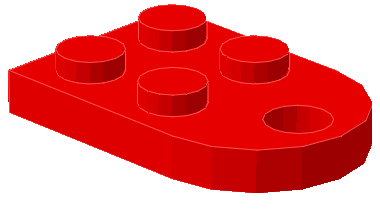
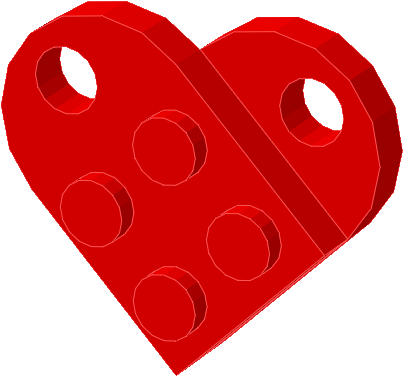

Vous trouverez dans les sets officiels numérotés 4886 "Building Bonanza" et 4996 "Beach House" des fleurs d’un nouveau type : une plaque ronde 1x1 rouge, orange ou jaune simplement placée sur une verte. C’est d’une conception très simple. Qu’est-ce qui fait qu’on la reconnait immédiatement en tant que fleur ?

C’est le contexte, le fait que le même montage est répété et aligné sur une plus grande plaque marron. Nous reconnaissons l’ensemble comme un parterre de fleurs.

Les pièces vertes représentent les tiges et les feuilles. Les pièces supérieures représentent les fleurs diversement colorées. Nous pouvons effectuer des modifications mineures : élargissez les feuilles (d’une plaque ronde 1x1, passez à une 2x2), jouez avec les couleurs, en faisant pâlir les fleurs (de rouge à rose, d’orange à brun, de jaune à blanc) et choisissez un support bleu au lieu d’un sol marron. Vous obtenez des nénuphars sur leur plan d’eau.

Un design unique peut évoquer des objets complètement différents rien qu’en changeant les couleurs ou en modifiant l’échelle de l’environnement. Changez la fleur blanche du nénuphar en jaune et ses fleurs vertes en blanc. Quelle est cette drôle de fleur ?

Ce n’est plus une fleur dans le monde du Miniland, mais un oeuf de poule brisé, comme vous pouvez l’observer sur cette photo prise au LEGOLAND de Billund au Danemark. Cela pourrait aussi fort bien représenter un oeuf sur le plat pour votre dîner.

## _Ce qui est petit est mignon._

Vous avez peut être l’impression de n’avoir jamais assez de pièces, mais je peux vous jurer que vous pouvez faire beaucoup avec seulement deux pièces. Prenez deux plaques rouges 2x3 avec un trou et combinez-les comme illustré ci-dessous.

Vous obtiendrez alors un coeur.

C’est toujours à la fois surprenant et merveilleux de découvrir comment de simples pièces LEGO peuvent être combinées pour évoquer et recréer des formes plus complexes. Le plus surprenant peut être c’est que ce montage est l’objet d’un set officiel : le numéro 1556 "Christmas hearts" de 1986.

Téléchargez la version pdf :

**La version pdf**

Deux Pièces
