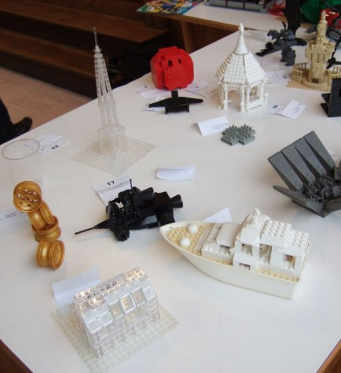
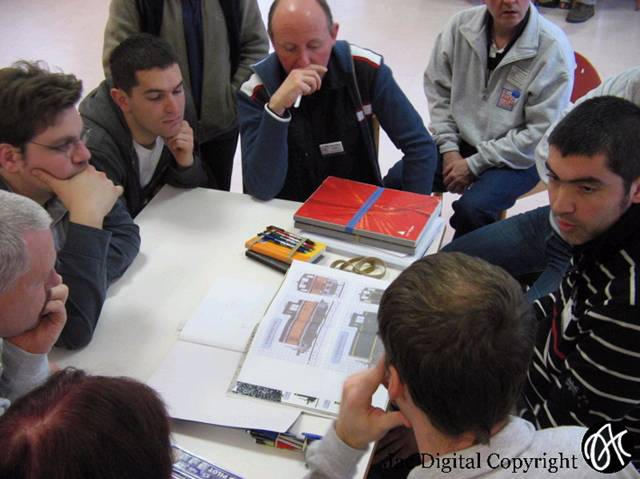
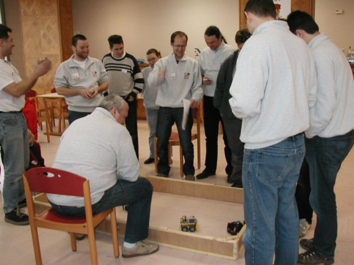
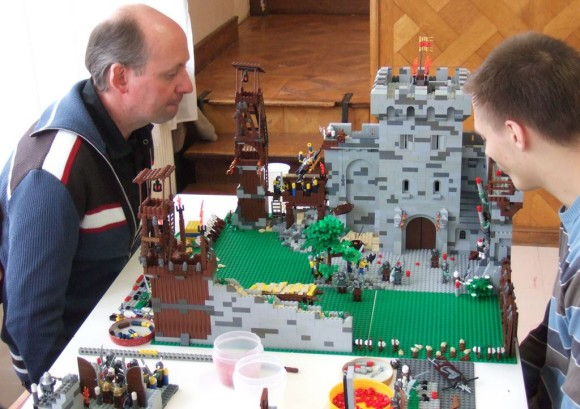
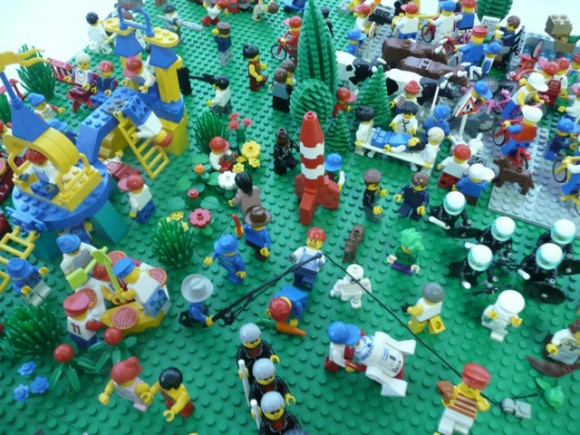
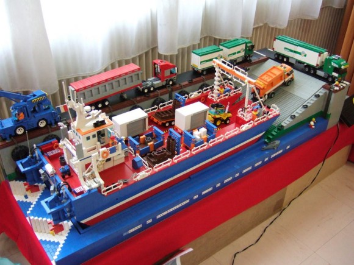
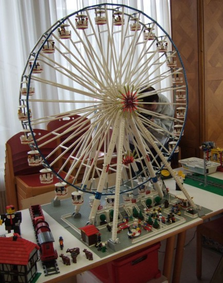
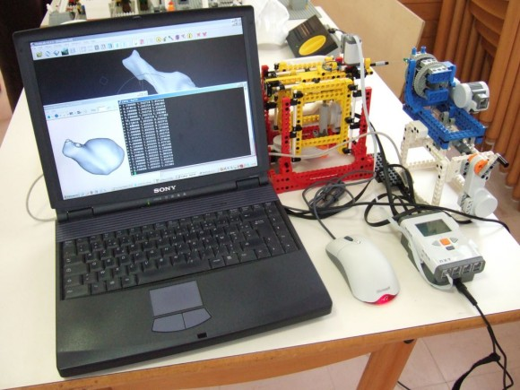
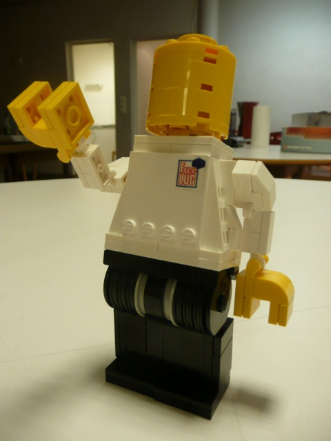

Comme tous les ans en cette période, l’Assemblée Générale FreeLUG est l’occasion pour ses membres de se retrouver le temps d’un week-end.

## Concours de MOC

Le concours de création de cette année imposait deux contraintes :  
**–** un maximum de 100 pièces ;  
**–** une seule couleur de pièces autorisées.

C’est Stéphanie qui remporte le concours dans la catégorie adulte, et son fils Bastien pour la catégorie enfant. Mais que fait le père ? Il parait qu’il s’est rattrapé au tournoi de Techball ;)

## Exposé Pré-concevoir des MOCs par le dessin à la main

Richard a réalisé dimanche matin un petit exposé sur [la conception de MOCs par le dessin, pour faire écho à son article sur ce sujet](/articles/596/).

**Le mot de Richard :**

Merci à ceux venus écouter ce petit exposé, une première pour moi, mais un plaisir de partager quelque chose élaborée et développée sur un coin de table puis dans mes carnets et cahiers à petits carreaux. Ce dimanche matin a permis d’aller plus loin que l’article dans la diffusion de cette pratique.

Après quelques explications sur la technique, la méthodo et les applications possibles, ce qui a été enrichissant pour tous, fut le moment de l’échange, et l’évocation des similitudes ou rapprochements entre la façon d’appréhender la réalisation d’un MOC par "MLcad" ou avec "la gomme et le crayon".

Nous avons également évoqué la question de l’échelle Minifig pour les constructions, vaste sujet, l’occasion d’un autre exposé...

## Tournoi de Tech-Ball

La piste était disponible tout le week-end. Ce qui a permis à beaucoup de personnes de tester leurs modules, de s’entrainer au pilotage et de voir ce que donne le pilotage dans le terrain. A noter que pour beaucoup d’entre nous, c’était la première fois que nous nous retrouvions en situation réelle.

Mais le grand affrontement tant attendu s’est déroulé le dimanche matin et a vu, malgré de nombreuse critiques émanant de personnes jalouses :p, s’affronter 12 équipes de 2 membres (soit 24 participants) même s’il est vrai que certains ont joué contraints et forcés.

Les matchs se sont déroulés en 2 mi-temps de 2 minutes avec changement de camps à chaque fois. Le grand nombre d’équipes nous a obligé à appliquer le principe de l’élimination directe.

Le Podium :  
**–** 1° Bastien et Pierrick.  
**–** 2° Gaël et Manu.  
**–** 3° Erik et Xavier (Équipe présidentielle).

A noter la présence d’un enfant de sept ans sur la plus haute marche du podium.

Les 4 meilleurs joueurs se sont vu remettre un sac de diverses pièces Technic.

[Pour rappel, les règles du Techball](/articles/862/)

A noter les prochain tournoi :  
**–** les 2 et 3 mai lors du WE dans le Gard V3 ;  
**–** les 28 et 29 Juin a Fanabrique ;  
**–** en juillet lors de la REF ;  
**–** les 9 et 10 novembre lors de l’exposition de St Rambert.

**Le mot de NICO :**

Tout d’abord, merci à Pierrick d’avoir eu l’initiative de nous faire découvrir le Techball. Le concept même du Techball n’est pas de lui, certes, mais il a eu la bonne idée de prendre en main l’organisation d’un tournoi, de créer des règles, de construire un terrain. Bravo.

Je n’étais présent que le samedi et n’ai donc pas pris part au tournoi de dimanche, mais les matchs amicaux du samedi soir ont été un bon moment de rigolade. Le principe est excellent et connaitra forcément un certain succès. Les adultes et les enfants font vraiment jeu égal sur le terrain, et tout le monde s’amuse. L’éventail de possibilités tactiques permet aussi à ceux qui veulent développer leur propre "MOC Technic" de se creuser les méninges, tandis que d’autres y voient l’occasion de faire leur premier montage "Technic" grâce à la notice de Philo.  
On imaginerait très bien d’improviser ce genre d’activité, dans un coin d’une exposition, et même d’y faire un peu participer le public. C’est vraiment amusant, pour les pilotes, comme pour les spectateurs.

**Le mot de Richard :**

A noter la défaite la plus rapide dans la jeune histoire du Techball, merci à Jean-Yves, mon co-équipier du jour, pour avoir établi ce record : 0-3 en moins de 2 minutes !!

## Partie de BOW

**Le mot de Jean-Yves :**  
Cette AG fût l’occasion de proposer une partie du "[Brick Only Wargamme](http://bow.lswproject.com/)" créé par Alban Nanty. BOW est un jeu qui allie le plaisir de construire des dioramas avec celui de "jouer avec" un peu comme dans notre enfance.

Médérick, Brice ainsi que Sylvain (le fils de Daniela) se sont pris au jeu, hélas la partie n’a pu être terminée...

Au vu de la concentration des joueurs je pense que je le jeu à atteint son but.

En tout cas merci à tous, cette partie m’a permis de confirmer les facteurs permettant de faire une bonne partie de BOW : un scénario rapide sur une petite surface de jeu (48x48 suffit presque), retour d’expérience que j’espère utiliser lors d’une prochaine rencontre.

## Où est Charlie ?

Comme annoncé, nous avons également tenté de réaliser un espace [Où est Charlie ?](/articles/858/). Peu de modules ont été amenés, c’était la première fois. Il faut voir si le concept va prendre pour de prochaines rencontres.

## Les créations

l’Assemblée Générale, c’est aussi l’occasion de venir présenter ses dernières créations.

Tandis que Jean-Marc donnait le mal de mer à toute l’assemblée avec sa barge montée sur houle bretonne...

... Denis, lui, donnait le tournis avec sa grande roue.

**Le mot de Denis :**Première sortie de la grande roue foraine.

C’était donc çà le "grand" projet (secret) pour lequel j’avais demandé à l’AG 2008 si certains Freelugiens pouvaient m’aider en me prêtant ou vendant des pièces !

Je remercie donc, ici, les généreux prêteurs et/ou donateurs répondant aux noms de Gilles Micheletti , Thierry Meyer, Didier Malon et Enjary,  
Et voici le résultat : 1,20 m de haut, 28 nacelles, comptons 1 heure de montage.

Vous trouverez peut-être une ressemblance avec un ancien modèle réalisé par les Néerlandais, et pour cause. Mon ambition initiale était, bien sûr, de faire plus grand ;-) Mais après de nombreux calculs, je me suis rendu à l’évidence : pour respecter le pas des tenons, une seule solution -> rayon de 68 tenons et corde (base du triangle composé de deux bras successifs) de 16 tenons. Ceci m’a amené au même diamètre que celui de mes prédécesseurs :-(.

L’importante quantité de plates 1x10 nécessaire à la construction des bras, ainsi que bien d’autres pièces comme les demi-cylindres des supports ou les parasols des nacelles, m’a permis de faire mes premiers pas sur Bricklink. Cette roue est décidément très "coopérative".

J’espère que mon modèle plaira au public qui pourra l’observer lors des expositions dans les deux ans à venir.

* * *

Philo n’était pas en reste de son côté, puisqu’à défaut de faire tourner la tête aux participants, il a jeté son dévolu sur une pauvre grenouille, afin de la passer sous toutes ses coutures (ou plutôt moulures) avec son scanner 3D à base de NXT.

Plus humblement, on a pu également admirer les camions PFS de Xavier (et la vidéo qui va bien), différents bâtiments (même celui d’un AFOL encore refoulé) tels qu’une bibliothèque, une bijouterie ou encore un lavoir, mais aussi des wagons et trains et encore bien d’autres choses.

**Le mot de Jean-Marc :**

Bonjour à tous

A l’occasion de l’Assemblée Générale 2009, la FreeLUG PENN AR BED Productions a présenté ses nouveautés 2009, hélas non commercialisables, au public de plus en plus fidèle. Elle a remarqué des réalisations fort intéressantes, noté le Technic ball, le Bow comme supports de jeux pour les salons (Cholet 2009 par exemple).

Elle a voté pour ses membres excusés, rencontré de nouveaux membres, félicité les heureux élus, et ................ l’organisation de l’A.G.

Pour finir, la FPABP vous dit à l’année prochaine si vous voulez bien..

Jean-Marc de Morlaix, membre ACTIF de la FPABP.

**Le mot de Richard :**

Un bon et beau week-end d’AG, et une nuit de gardiennage sur le thème de l’humour cinématographique... Pour ma part, côté MOC, pas de trains cette année... Mais un petit [ATAT](http://photos.freelug.org/main.php/v/Charlie/AG+2009_001/AG_2009-060.jpg.html) et la première sortie de "JOE" cousin d’ALFRED.

**JOE avec son T-Shirt FreeLUG**

En fait c’était une petite famille de JOE, avec quelques briques à l’échelle 3/1, il y avait même un "Maximus Minifigus" squelette d’un maxi-minifig qui a participé au concours de MOCs.

## Galeries photos

**–** [Galerie d’Erik](http://photos.freelug.org/main.php/v/brickerik/expositions/2009/AG2009/)  
**–** [Galerie d’Eric](http://photos.freelug.org/main.php/v/f1tvf/expositions/ag2009/)  
**–** [Galerie de Jean-Marc](http://photos.freelug.org/main.php/v/barr__/expositions/AG2009/)  
**–** [Galerie de Jac](http://photos.freelug.org/main.php/v/JAC/Assemblee+Generale/AG-2009/)  
**–** [Galerie de Jean-Yves](http://photos.freelug.org/main.php/v/JY+BROT/AG2009/)  
**–** [Galerie de Christophe](http://photos.freelug.org/main.php/v/Tof92/AG+2009/)  
**–** [Galerie de Xavier D.](http://photos.freelug.org/main.php/v/XavierD/AG2009/)  
**–** [Galerie de Philo](http://photos.freelug.org/main.php/v/philo/AG2009/)  
**–** [Galerie de Richard](http://photos.freelug.org/main.php/v/Charlie/AG+2009_001)  
**–** [Galerie de DenisL](http://photos.freelug.org/main.php/v/dlaurencon/AG/AG2009/)
