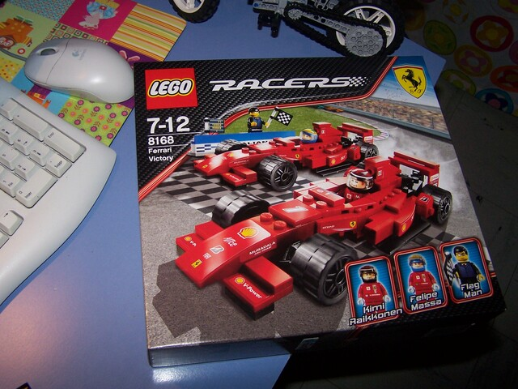
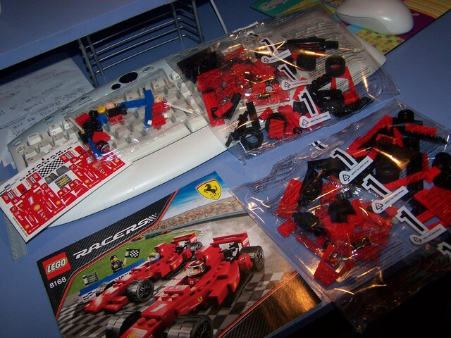
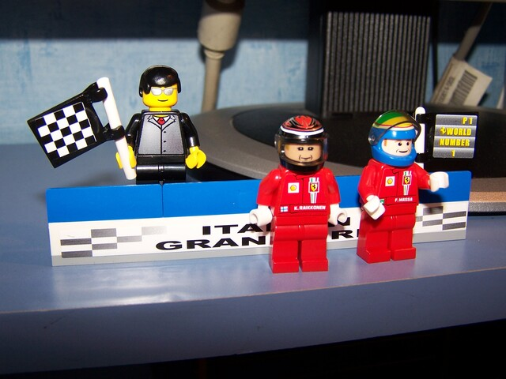
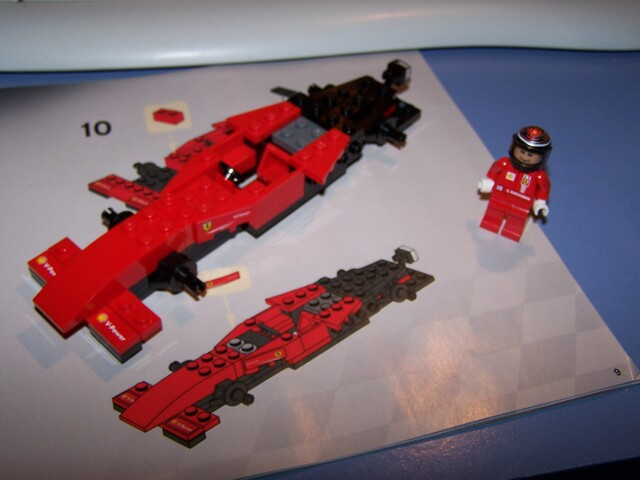
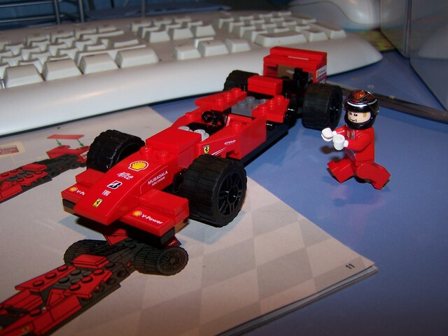
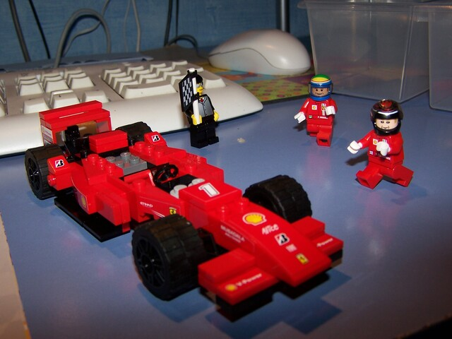
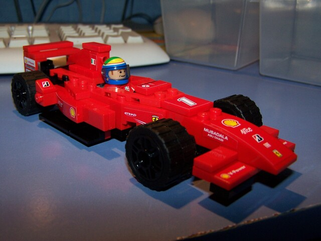
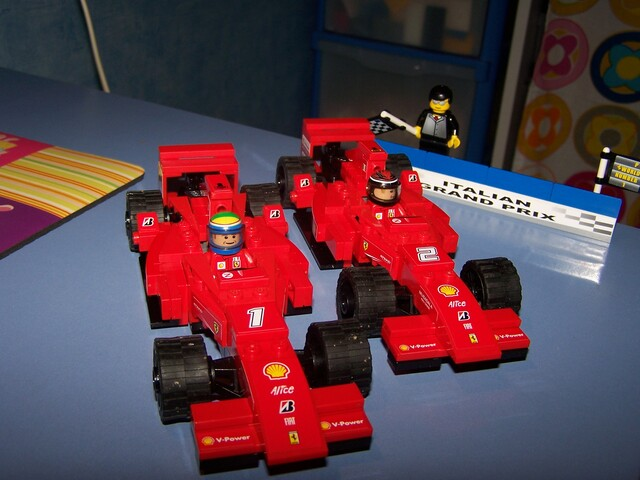

Pour le début de l’année 2009, dans la gamme Racers Ferrari, on trouve un nouveau set, le n°8168 Ferrari Victory, boîte certainement sortie pour fêter les victoires de la Scuderia Ferrari.

Ce set est composé de 202 pièces vendues 22.90euro sur le shop@home

On trouve dans la boîte trois sachets, la notice de montage et une planche d’autocollants. Un des sachets contient les minifigs et le podium, les deux autres contiennent les deux voitures de course.

Je commence le montage des minifigs et du podium, le costume du commissaire de course est un simple autocollant apposé sur le torse de la minifig et non sérigraphie, la tête des deux pilotes n’est pas jaune mais de couleur chair,les deux pilotes sont identifiés par les motifs sur leur casque respectif.

Ensuite on passe au montage de la voiture de course, ce sont les deux mêmes :

L’ensemble est composé d’un grand nombre de pièces plates, on retrouve un grand nombres d’éléments qui composent les précédents modèles de voitures de courses de la gamme Racers Ferrari, montage effectué sous la surveillance de Kimi RAÏKKONEN, impatient,

de monter dans sa Formule 1.

Le montage est facile, sans grande difficulté. Les pilotes sont impatients de faire la course,

Felipé MASSA se lance sur la piste en premier pendant que je fini de construire celle de RAÏKKONEN.

Les deux pilotes sont prêts à partir et attendent le départ de ce Grand Prix d’Italie, pour peut-être de nouvelles victoires.

Un nouveau set apportant une évolution supplémentaire au Formule 1 avec minifig, depuis le lancement de cette gamme Racers Ferrari.
