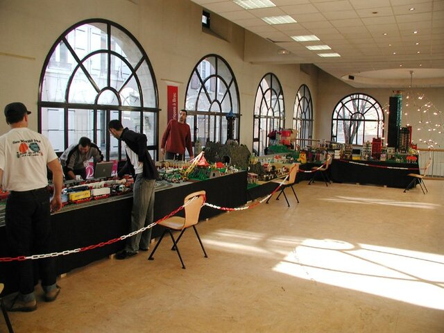
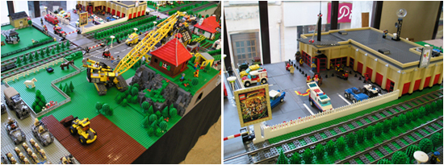

Ce devait être une petite exposition d’une petite journée !!

C’était notre quatrième participation aux expositions organisées par OMNIBUS, le club ferroviaire de Bourgoin-Jallieu. On peut presque dire que FreeLUG et Omnibus sont des "partenaires historiques". Et du coup, les organisateurs comptaient bien sur nous pour leur exposition "les jeux de construction". Nous disposions donc de tout l’étage supérieur de la salle pour nos LEGO.

Nous nous sommes organisés sur plusieurs thèmes, mais pour une journée, franchement nous ne cherchions ni à faire de l’exclusivité, ni à faire du trop grand (ah bon ??? ^^). Il y avait un réseau ville/train qui reprenait une portion de [l’exposition d’Orléans 2008](https://www.freelug.org/spip.php?article820), complété par un module de Pierre Laurenge, et d’un triage. Il y avait aussi une reconstitution d’une bataille terrestre Star Wars présentée par Pierre Charles et Etienne Laurenge.

Pierrick nous a présenté son Taj Mahal et son jardin, et Yannick Vignat se lançait dans sa première exposition avec des Technic... M’est avis qu’on le reverra celui là. Hein Yannick, c’est bien les expositions !!

A noter la présence d’Anio, membre du forum SeTechnic qui a fait sa première exposition avec nous.

Pour ma part, j’ai beaucoup apprécié les amis Afol de la région qui sont venus nous voir.

Au final, nous avons, je pense, passé une excellente journée d’exposition, pas trop surchargée par le monde et le bruit, ce qui nous laissait bien le temps de discuter avec les gens.

Loys

* * *

Ah oui une petite exposition d’une journée mais aussi d’une nuit !!!  
Je m’explique.

Le module ville/train était effectivement celui d’Orléans avec en plus la partie de Pierre et le triage. Comme je me suis occupé du triage j’ai pas eu le temps de revoir ma partie du module.

A l’ouverture des cartons après le retour d’Orléans et le voyage à Bourgoin aie aie aie !! Un tas de briques au fond des cartons !!

Voila pourquoi la nuit a été longue en montage et courte en sommeil. D’ailleurs qui a la photo qui témoigne de mon état de fatigue le dimanche après midi ????

Super week-end bien sûr !!

Xavier

* * *

C’est avec un grand plaisir que j’ai accepté l’invitation de Loys de venir exposer à Bourgoin-Jallieu.

Je me suis donc incrusté dans le module de Loys, Denis, Jac et Xavier, qu’ils avaient présenté à Orléans !

J’ai présenté un centre commercial, une petite zone de travaux et quelques villas...

Cette exposition sur une journée fut intense puisque commencé la veille.

C’est toujours avec un grand plaisir que l’on retrouve ses camarades d’exposition !!

D’ailleurs, c’est quand la prochaine....!! ;-)

Pierre LAURENGE (Pierrolego)

* * *

Et bien, puisque tout a été dit, je vais me charger des remerciements. Et je vais commencer d’abord par l’équipe BAB, qui garde un très bon rapport avec ce club dynamique de Bourgoin Jallieu. Je me souviens que ce fut la première exposition FreeLUG, il y a 4 ans. Tout a été respecté, les constructions, les modules, et les espaces.

Et d’autres part bien sûr, ce fameux club "Omnibus" de Bourgoin, car l’accueil a été aux petits oignons, et c’est le cas de le dire. Pizzas pour tous le monde le samedi soir, alors que nous étions tous plongé dans la construction. Une nuit très courte, mais, ça, c’est parce que nous le voulons bien !! Et puis le dimanche, super petit déjeuner, repas excellent à midi, et soupe à l’oignon, le soir, avant de reprendre la route. Comme je vous dis, nous étions rois, et d’ailleurs, nous avions à notre charge tout l’étage de cette petite salle d’exposition.

Un bon souvenir d’exposition supplémentaire, pour ma part...

Jérôme/JAC

* * *

Une exposition aussi proche de chez moi je ne pouvais pas louper ça.

C’est donc accompagné de mon fils que j’ai fais mes 2h30 de route pour rejoindre les copains et présenter en avant premier le techball au public rhône-alpin qui l’a bien apprécié. Ce fut vraiment un bon week-end et nous avons été très bien accueillis.

Pierrick (qui donne RDV dans 2 ans)

* * *

Encore une magnifique exposition !

Avec Étienne, le frère de Pierrolego, nous avons présenté un grand diorama Star-Wars. J’ai bien aimé travailler avec lui sur cette bataille "Clones VS Droïds" !

A quand la prochaine ?

Pierre - Tribolego

* * *

C’était ma première exposition. Elle était à quelques dizaines de kilomètres de chez moi, donc je ne pouvais pas laisser passer l’occasion. J’exposais des modèles Technic, dont mon excavatrice entièrement filoguidée. Elle a particulièrement plu au public. Pendant toute la journée, les questions ont fusé sur ce modèle !

Prochain challenge : exposer tous les UCS (ou la majeure partie, tout du moins).

Mais 2 problèmes se posent : la place dans la voiture, et surtout, leur fragilité...

Je tiens à remercier Loys et Pierrick, sans qui je n’aurais sans doute pas pu me joindre à l’exposition.

Anio.

* * *

## Galeries de photos

**–** [Photos de Loys](http://www.brickshelf.com/cgi-bin/gallery.cgi?f=372036)  
**–** [Photos de Pierre LAURENGE](http://photos.freelug.org/main.php/v/pierrel/exposition/bj09/)  
**–** [Photos de Jérôme/JAC](http://photos.freelug.org/main.php/v/JAC/Exposition/Expositions2009/BourgoinJ-2009/)  
**–** [Photos de Nicolas](http://photos.freelug.org/main.php/v/nicolas_carel/Bourgoin2009/)  
**–** [Photos de Denis](http://www.brickshelf.com/cgi-bin/gallery.cgi?f=369755)  
**–** [Photos d’Anio](http://www.brickshelf.com/cgi-bin/gallery.cgi?f=365745)  
**–** [Le résumé (avec vidéos) par les membres du forum SeTechnic](http://www.setechnic.com/Forum/topic1422-15.html)
