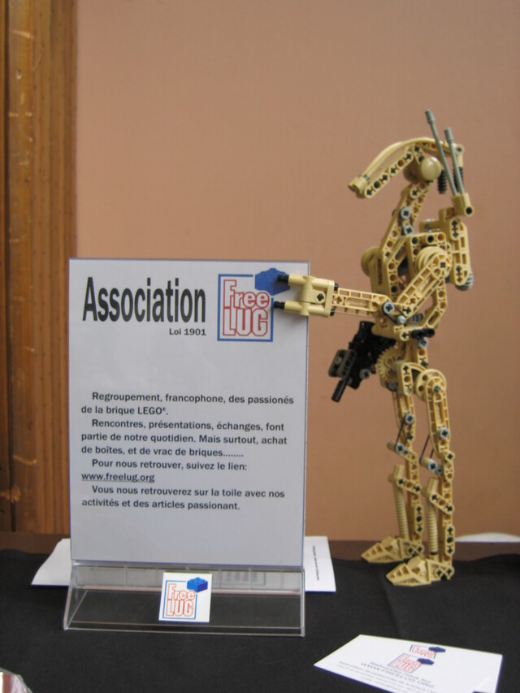
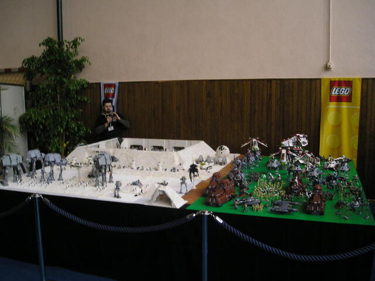
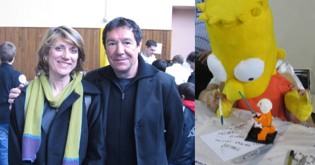
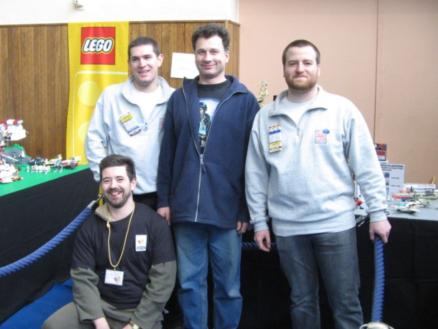

Un grand stand LEGO, et une très belle exposition à Migennes, à côté d’Auxerre, les 28 février et 1er mars 2009.

Nous nous étions entendus depuis longtemps pour nous retrouver chez Fred (Fenix21000), le vendredi soir, avec les deux Pierre, et moi même après quelques 3 heures de route. Mais, malgré la fatigue, et les voitures bien remplies, nous avions gardé une place pour la bonne humeur.

Je ne pourrais pas vous résumer cette soirée, car il y a eu beaucoup de paroles, d’échanges, et nous avons du nous coucher, car une bonne matinée de montage nous attendait le lendemain.

A 7h30, branle bas de combat dans la chaumière. Si si, c’est vrai, grâce à la sonnerie du téléphone de TriboLego ! Migennes est à 10 mn de chez Fred. C’est bien pratique. Fait rare, et qui mérite d’être souligné, à notre emplacement réservé étaient en place les tables nécessaires, exactement comme il faut, et en plus, c’était des tables très stables, très lourdes aussi, mais ajustées au millimètre. De ce fait l’installation a été très aisée. Aucun chevauchement de plaque n’est à signaler. Et l’installation a pu être rondement menée, jusqu’à l’ouverture des portes au public.

Le déroulement du salon a été sensationnel, l’ambiance sympathique. Il y avait beaucoup de personnes déguisées, ce qui permet de prendre en photos d’autres choses que des LEGO et des maquettes ! Je souligne aussi la présence d’acteurs et de doublures, mais, j’ai retenu seulement Colin Cunningham, et les voix françaises des Simpsons, tous très sympathiques...

**Les voix de Marge et Homer**

Le samedi nous avons eu droit à un grand repas, pris en commun dans une salle des fêtes. Ambiance garantie, là aussi, avec en plus les tours de magie de Colin.

Bref, une très belle exposition, clôturée le dimanche soir par le rangement, pfouh, je n’aime pas ça... Heureusement que la bonne humeur était là, et qu’elle nous a suivis jusqu’à chez nous malgré la fatigue.

Vraiment un grand merci pour l’accueil de Fred, mais surtout à Audrey et Maxime pour nous avoir supportés presque trois soirées, et pour être venus nous rendre visite les deux jours.

**Quatre fous de SF et de LEGO !!**

Une très belle alliance aussi entre Festibrique et FreeLUG pour présenter quelque chose de grandiose. Visitez nos galeries :  
**–** [PierreL/PierroLego](http://photos.freelug.org/main.php/v/pierrel/exposition/migennes/)  
**–** [Jérôme/JAC](http://photos.freelug.org/main.php/v/JAC/Exposition/Expositions2009/SW-2009/)  
**–** [Fred/Fenix21000](http://www.brickshelf.com/cgi-bin/gallery.cgi?f=371337)  
**–** [PierreC/Tribolego](http://photos.freelug.org/main.php/v/Pierre_13/Migennes2009/)
