[Dans la première partie](/articles/864/), je vous ai fait découvrir la boîte principale, la ferme (réf. 7637). Dès son lancement, elle est accompagnée par le [transport de chevaux (set 7635), présenté par Erik](/articles/863/), ainsi que la moissonneuse-batteuse (réf. 7636) et un tracteur (réf. 7634).

## La Moissonneuse-batteuse - set 7636

_Résumé :_  
**–** Nombre de pièces : 365  
**–** Prix : environ 41 €  
**–** Année : 2009  
**–** Gamme : City Ferme

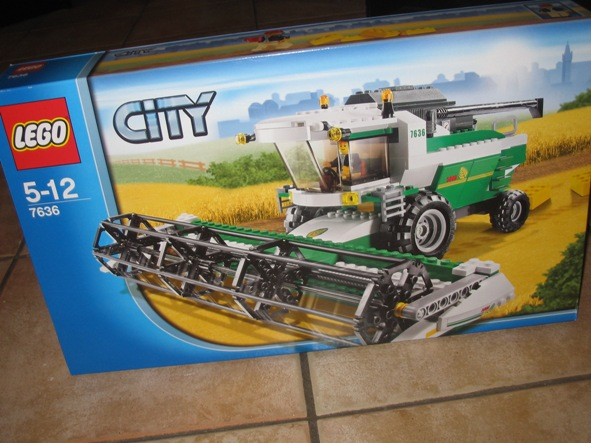

Déjà, sur la photo de la boîte, on s’attend à une jolie construction.

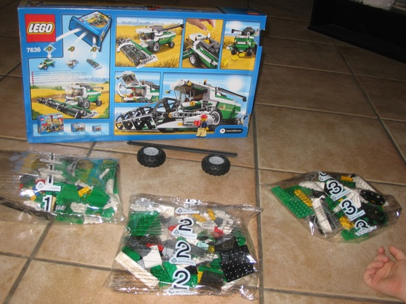

Comme à son habitude, LEGO a prévu 3 sachets :  
**–** le premier pour le véhicule  
**–** le deuxième pour la cabine et le moteur  
**–** le troisième pour la barre de coupe avec les longs tubes rigides à part, de même que les roues.

_A noter que les photos ont été prises par mes deux reporters en herbe qui étaient à la maison avant moi, quand le facteur est passé..._

On peut alors commencer à monter, éléments par éléments, qui viennent s’emboîter les uns sur les autres.

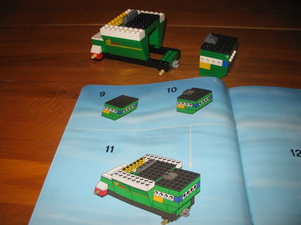

On notera, comme sur le silo de la ferme, l’ex-pare-brise inversé, teinté cette fois-ci en vert.

La carrosserie est comme celle des camions CITY avec des plates pour adoucir les angles. L’attelage est présent et permettra d’atteler des remorques pour porter le grain ou la barre de coupe sur les routes, mais il n’est pas à la même hauteur que sur les tracteurs.

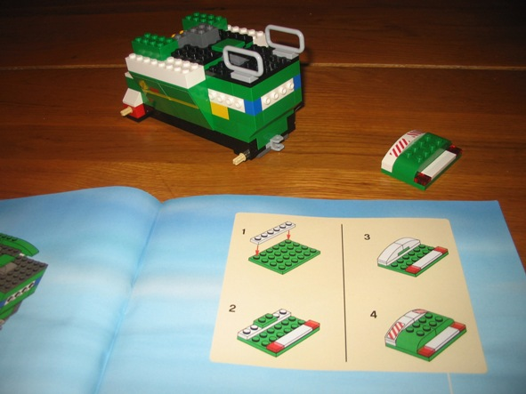

On obtient déjà un beau véhicule, où vient s’ajouter le support de la barre de coupe, non articulé comme sur les vraies, certainement pour la solidité.

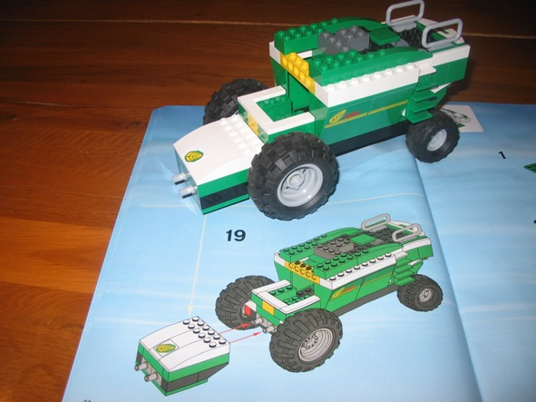

Dessus se rajoute une superbe cabine pour notre conducteur.

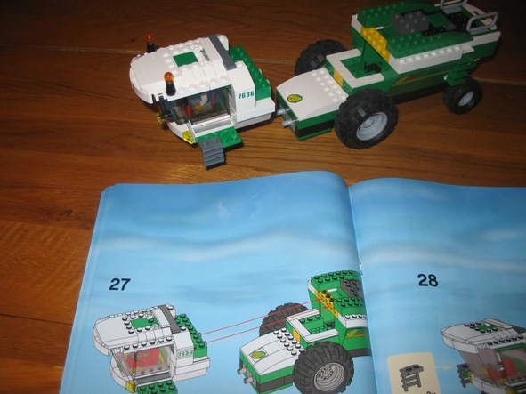

Contrairement aux derniers sets sortis, la cabine s’ouvre sur trois côtés.

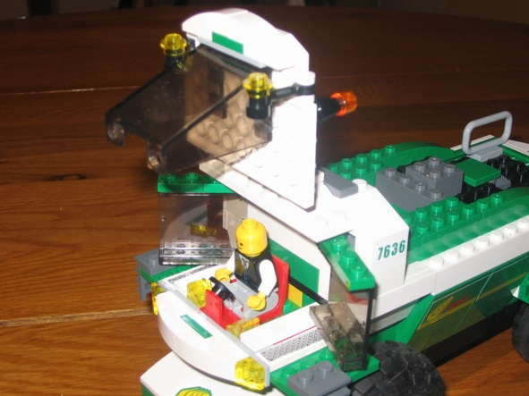

Malgré qu’elle soit destinée à un jeune public, le design du moteur surplombant l’ensemble est soigné.

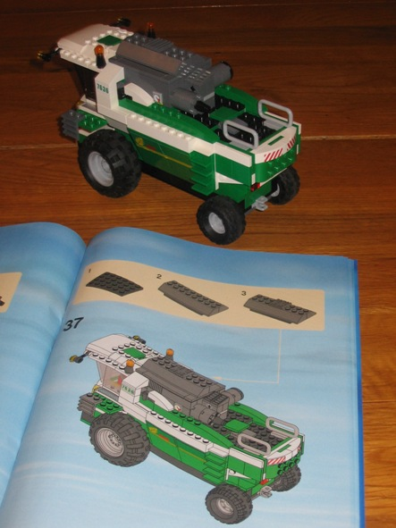

Il ne reste plus que la barre de coupe, le vis à grain et quelques bottes de paille.

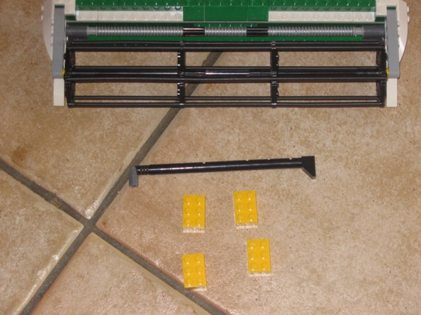

La rotor est un peu trop haut à mon goût en proportion par rapport au reste du véhicule. En comparaison avec la moissonneuse-batteuse Technic, les roues arrières de celle-ci correspondent aux roues avant de la moissonneuse-batteuse City, alors que les rotors sont du même diamètre.  
Les [supports de rotor](http://www.bricklink.com/catalogItemPic.asp?P=64566) sont une nouveauté 2009, apparaissant sur le compacteur de chantier. Par contre il est à même le sol et roule quand on fait avancer l’engin.

Encore une fois les enfants sont ravis, d’autant plus qu’on peut mettre les bottes par le haut et, en avançant, celles-ci sortent vers l’arrière de la machine. Même s’il n’y a plus de lieuse sur les moissonneuses-batteuses de nos jours, cette idée ravit les enfants qui ne pourraient pas faire tomber de la paille coupée derrière la machine.

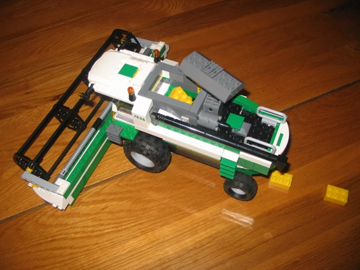

Encore une réussite dans cette nouvelle gamme LEGO, tant au niveau design qu’au niveau jouabilité.

## Le tracteur - set 7634

_Résumé :_  
**–** Nombre de pièces : 78  
**–** Prix : environ 11 €  
**–** Année : 2009  
**–** Gamme : City Ferme

Un AFOL et deux enfants obligent, j’ai dû en commander trois pour ne pas faire de jaloux.

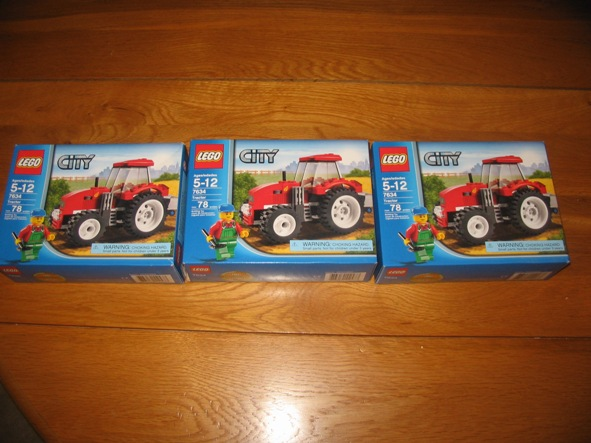

A l’intérieur, une notice, deux sachets, dont un pour les petites pièces, et les autocollants.

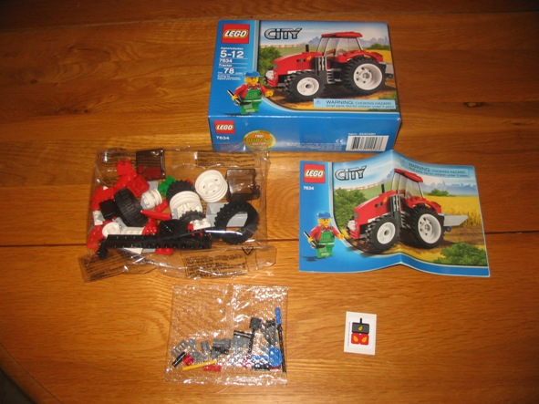

Comme il est dit sur le shop : "L’ensemble a été conçu pour être construit facilement et pour pouvoir s’amuser instantanément ! "

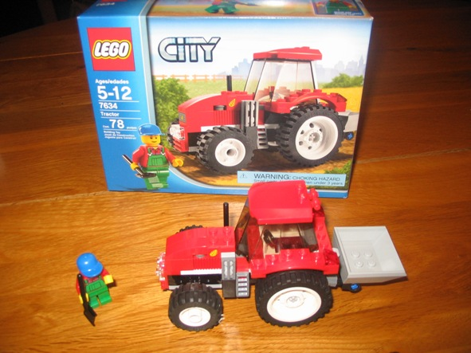

Moins élaboré que le tracteur bleu de la ferme, sans troisième point, sans chargeur frontal, sans rétroviseurs et avec un pot d’échappement plus simple, c’est une bonne idée de cadeau à petit coût à faire aux enfants, sans attendre de grandes occasions, et qui touche un plus large public.

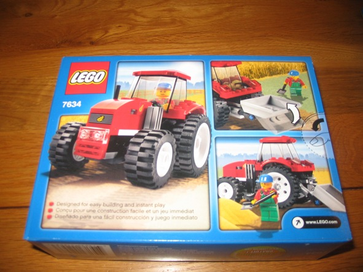

Le godet arrière pour effectuer de multiples tâches à la ferme permet de jouer instantanément sans posséder d’autre set et plaît énormément aux plus petits.

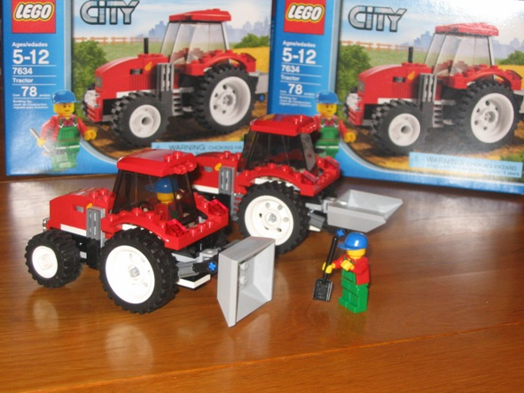

En conclusion, je ne peux que réitérer mes félicitations à LEGO pour cette nouvelle gamme, que j’attendais personnellement avec impatience, pour moderniser mes constructions d’enfant. Il ne me reste plus qu’à adapter des outils agricoles dessus et faire des MOC de machines avant que LEGO ne sorte d’autres sets que j’espère nombreux.

Mais avant tout, je vais jouer avec les enfants...

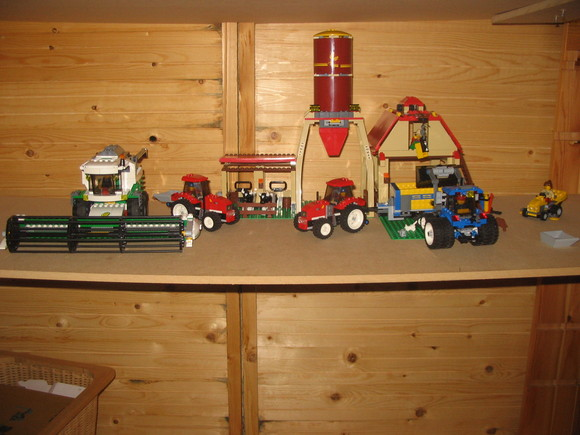

Daniel RIGAL
