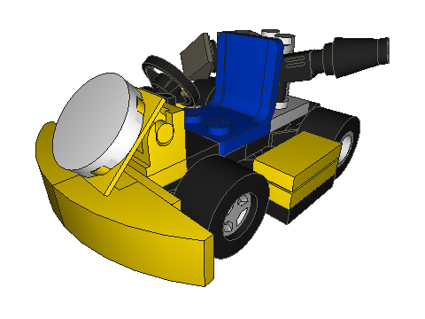
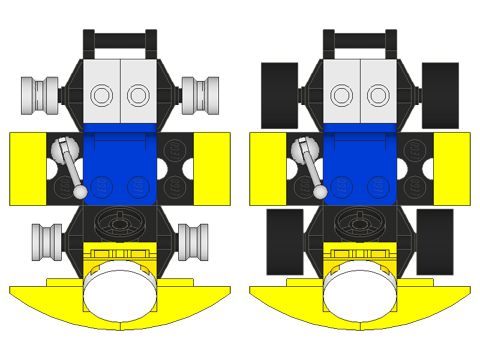
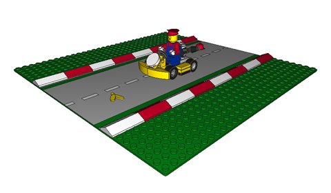

Qui suis-je ? J’ai vu le jour durant la Seconde Guerre Mondiale, des mains de mécaniciens de la Royal Air Force en mal de passe-temps. Bricolé à partir de roues d’avions et de moteurs de débroussailleuses, je pétarade sec. C’est à mon volant que la plupart des grands champions du sport automobile firent leurs gammes. Je suis ? Je suis ?... Le kart ! Bonne réponse !

## Construction

La principale difficulté rencontrée lors de la conception de ce [MOC](/articles/128/) de kart fut la reproduction des voies asymétriques des trains avant et arrière.

Plusieurs types de châssis se succédèrent sous mes doigts, souvent à base de tarabiscotages hautement concentrés.

Un compromis satisfaisant se dégagea avec l’emploi d’une architecture conventionnelle et de jantes de largeurs différentes, tout en conservant un jeu de pneus unique pour les quatre roues.

Les briques composant la carrosserie existent dans la plupart des couleurs fondamentales. Chacun pourra ainsi construire le modèle de ses rêves, voire un plateau de compétition complet. Sans oublier la possibilité d’ajouter des numéros de course :-D

## Notice

Bonne construction avè Mariooo :-)

**Notice du kart**
