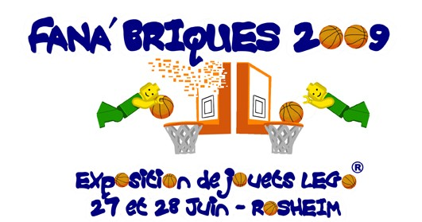

C’est parti pour une 4ème édition les 27 et 28 juin !

**–** **Lieu :** Salle des fêtes - 10 , Rue de l’Eglise - 67560 ROSHEIM  
**–** **Horaires :**

-   Samedi 27 Juin : 13 à 18 heures
-   Dimanche 28 Juin : 9 à 17 heures

**–** **Tarifs :** 1 euro pour les enfants de moins de 16 ans - 2 euros au delà.

Tous les renseignements : [http://fanabriques.freelug.org/](http://fanabriques.freelug.org/)

Partageons notre passion !
