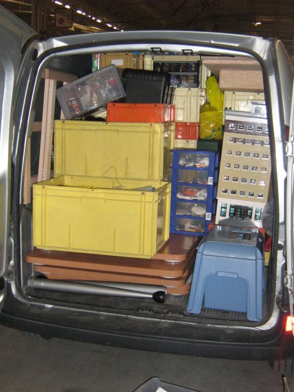
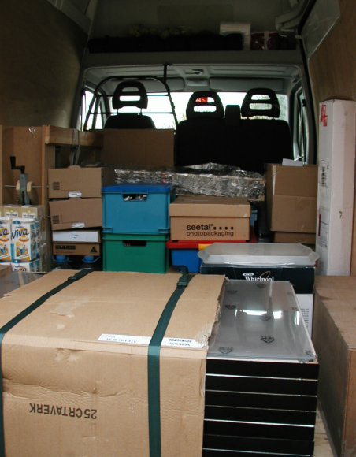
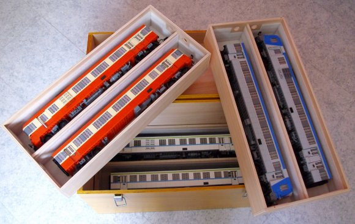
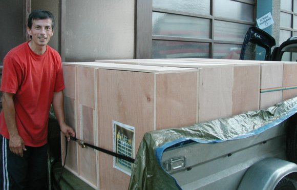
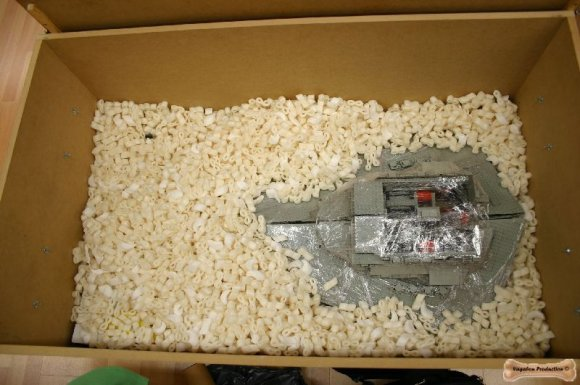
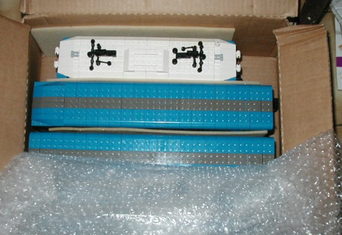
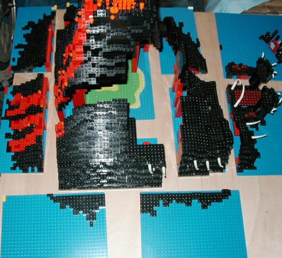
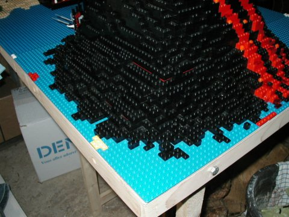
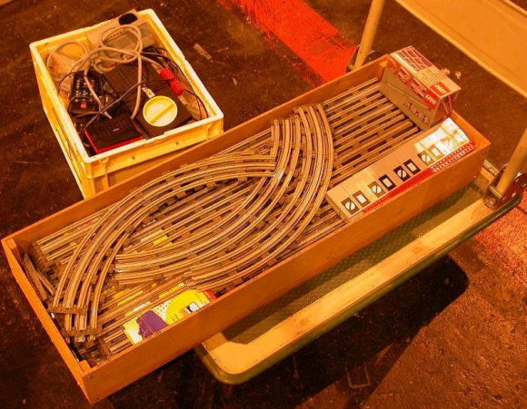
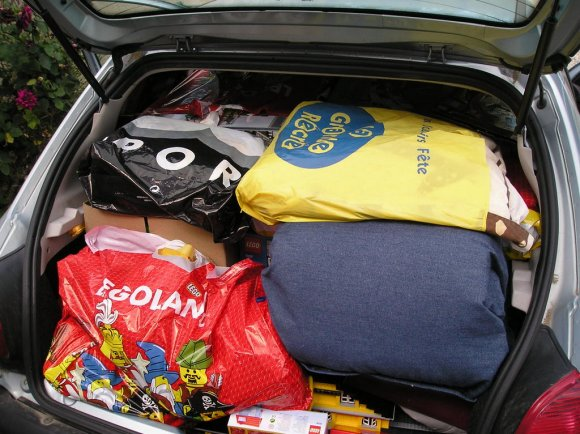

Une des premières questions qui se pose lorsqu’on souhaite participer à une exposition est bien celle du transport : comment déplacer cette création grande et fragile, que ce soit à quelques kilomètres de chez soi ou à l’autre bout du pays ?

Il y a deux approches complémentaires pour répondre à cette question : le _contenant_ (ce dans quoi on va transporter le modèle) et le _contenu_ (comment concevoir le modèle pour être transportable).

## Dans quoi transporter ses modèles

**Sans contenant tu ne transporteras pas tes LEGO**

Il ne viendrait aujourd’hui à l’esprit de personne de transporter un modèle hors d’une boîte, carton ou même bac. Ce serait sinon le meilleur moyen de perdre quelques pièces au fond du coffre ou sous un siège de la voiture.

**La solution simple : les bacs**

Si le volume de LEGO à transporter est faible, le meilleur moyen est le bac.

Il en existe de toute taille et en différents matériaux : carton, plastique, bois. On évitera les bacs avec des ouvertures sur leur fond qui pourraient laisser échapper des briques (cagettes, etc.).

L’avantage du bac est d’offrir un accès facile aux créations ce qui peut s’avérer très pratique pour de grands, lourds ou fragiles modèles.

Toutefois, dès que le volume à transporter devient trop important, on peut rarement empiler les bacs car les constructions en dépassent. On préfèrera donc d’autres solutions.

**La solution économique : les cartons**

Souvent issus de récupération, les cartons restent le moyen de transport le plus utilisé. Il est assez facile d’en trouver à la taille souhaitée, ou sinon on peut aisément les découper pour les adapter.

On notera quand même deux inconvénients.

Si ces cartons servent aussi de stockage, il faudra éviter les endroits humides, le carton pouvant s’abîmer voir dégager une odeur qui pourrait imprégner nos briques.

Si les modèles à transporter sont lourds, le carton peut ne pas être assez solide. Surtout, on pourra difficilement les empiler sans risquer que celui du dessous ne finisse par s’écraser.

**La solution modulaire : les boîtes en plastique**

Dès qu’il faut empiler des caisses, les boîtes en plastique semblent être la meilleure solution.

Structure rigide, on favorisera les caisses répondant aux critères suivants :  
**–** système emboîtable, pour permettre de les superposer sans que ça bouge ;  
**–** système encastrable, pour réduire le volume occupé lorsque les caisses sont vides ;  
**–** fond de caisse plat ;  
**–** fond de caisse adaptée à la taille des plaques LEGO ;  
**–** hauteur suffisante pour une majorité de constructions.

Autant dire qu’un système répondant à ces critères est quasi-introuvable, surtout à bon prix.

Et bien sûr, il ne reste valable que si toutes les caisses sont compatibles. Les achats successifs au cours des années résultent hélas très souvent en des modèles hétérogènes.

Cela peut être une vraie problématique lorsque le transport est réalisé de façon groupé. La diversité des caisses mélangées à des cartons de taille variable peut poser des problèmes importants d’agencement dans une camionnette.

**Exemple typique de l’hétérogénité**

LEGOWORLD 2005 : des caisses et des cartons variés, un instrument de torture pour les ponts, un pont sous cellophane, des vitrines pour minifigs, les victuailles pour une semaine... Diversité des emballages, quand tu nous tiens...

**La solution personnalisée : les caisses en bois**

Même si les cartons ou les boîtes en plastique répondent à la majorité des besoins, dans certains cas très particuliers, une caisse réalisée sur mesure sera la seule solution.

**Malle de transport**

Malle avec poignées, couvercle, et 4 "tiroirs" escamotables tapissés de mousse, pour 4 caravelles voyageuses.

On favorisera un bois léger, n’oublions pas que ces caisses seront portées ou du moins soulevées pour être mises dans le coffre du véhicule.

**Caisses et remorque**

Caisses en bois sur mesure, avec la photo du contenu. Et remorque pour transporter le tout sur des centaines de kilomètres. Allez, encore un peu de courage Jean-Claude :)

**Les petites astuces**

_Les protections_

Si la caisse est trop grande pour le modèle et qu’il risque de bouger, on peut la remplir en utilisant des chips ou des sachets d’air.

Les grandes structures fragiles peuvent être emballées dans du cellophane pour éviter de trop bouger durant le transport.

**Transport de l’ISD UCS**

Une caisse sur mesure, l’ISD emballé dans du cellophane, et de la chips pour caler le tout.

Lorsqu’on transporte plusieurs petits modèles dans une même caisse, une bonne idée est de les ranger individuellement dans un sachet avec fermeture. En cas de casse durant le transport, les pièces restent groupées. Vous ne vous retrouverez pas ainsi avec un tas de pièces en vrac au fond d’une caisse.

Les plus soigneux emballeront leurs modèles dans des bulles ou les sépareront avec des bandes de mousse. On trouve de telles bandes dans les cagettes de raisins par exemple.

_L’identification_

Petit détail mais bien utile, pensez à marquer vos caisses pour les identifier. Lorsque plusieurs personnes exposent dans un espace étriqué, il est bien plus facile de s’y retrouver si les caisses sont marquées. Une bonne idée est aussi de préciser le nom du club. Comme ceci, si une caisse est oubliée, les organisateurs pourront rapidement identifier son appartenance.

_La taille_

Autre détail qui a son importance. Prendre des cartons ou boîtes qui passent par la porte ou qui rentre dans le véhicule. Certains se sont déjà retrouvés à vider la caisse délicatement remplie car elle ne pouvait pas passer par la porte de la pièce ou de la maison !

_Autres astuces_

Pour les modèles difficiles à placer ou extraire d’une caisse, on étudiera la possibilité de mettre l’ouverture sur le côte. Il suffira alors de glisser la construction.

Enfin, prévoir un charriot à roulettes pour éviter les aller-retours entre le stand et le véhicule. Et puis pourquoi se fatiguer à porter ? :) Evitez quand même de faire rouler le chariot sur des surfaces avec aspérités, les créations n’aiment généralement pas les vibrations soutenues.

## Comment construire pour faire transportable

**La modularité avant tout**

Plus vos éléments à transporter seront petits, plus ce sera aisé de trouver une caisse à leur taille et donc facile à déplacer.

Pour ceux qui voient grand, la méthode la plus courante à appliquer est la construction modulaire. Le modèle doit pouvoir se scinder facilement en éléments de taille plus petite.

Pour un bâtiment ou des décors, on favorise donc la découpe selon les plaques de base. N’oubliez pas que plus une plaque est grande, plus elle est souple. On prendra donc un soin particulier à solidifier les plaques 48x48, autrement il y a de fortes chances qu’elle se plie au moment du soulèvement, pouvant entraîner la chute d’éléments du décors.

**Modularité des constructions**

Prévoir la découpe des grands ensembles dès la construction pour n’avoir que des petits morceaux à ranger.

Pour des bâtiments à la géométrie simple, on peut également envisager une construction par parois démontables ou pliables, pour transporter la construction à plat.

Pour des grands vaisseaux ou bâteaux, il faut également prévoir des tronçons démontables. En plus, cela peut offrir une modularité permettant de faire facilement des évolutions au modèle.

Enfin, dès que vous commencez à scinder un modèle en plus petites unités, pensez systématiquement à placer des repères pour l’assemblage. Des petites plates de couleurs et formes différentes font très bien l’affaire. Pensez aussi à les remettre au moment du démontage à la fin de l’exposition ;)

**Repères de montage**

A chaque plaque, ses repères de montage appairés pour faciliter l’assemblage.

**Les prises pour attrape**

Si votre modèle dispose de prises solides (poignées, encoches...), il en sera plus facile pour le porter. La phase la plus critique est lors de l’extraction de la construction de la caisse ; avoir de bonnes prises évite les accidents.

**Retirer les éléments de décors**

Tous les petits éléments de décors (drapeaux, antennes, arbres, etc) peuvent être retirés. Ce sont des éléments sur lesquels on peut s’accrocher facilement lors d’une manipulation. Cela permet par exemple d’éviter qu’une antenne saute à quelques mètres pour se glisser dans une rigole inaccessible à des gros doigts... On rangera tout cela dans des petits sachets à fermeture (la fermeture pour éviter que le contenu ne puisse s’échapper...).

**Autres astuces**

Pour gagner de la place, vous serez parfois tenté d’empiler plusieurs choses dans la même boîte. Vous pouvez ajouter des structures temporaires de soutien pour le transport. Cela évitera aux modèles du dessous d’être écrasés.

Technique couramment utilisée en modélisme, vous pouvez vous essayer à faire des plaques réversiblement superposables. Cela peut représenter dans certains cas un gain en volume non négligeable !

Si vous avez des câbles électriques qui parcours votre création, prévoyez un fil par module plutôt qu’un fil unique qui parcourt l’ensemble et qu’il faudra refaire passer à chaque remontage.

**Boîte pour rails**

Les rails arrivent déjà assemblés pour gagner du temps au montage. Surtout que le 12V, c’est pénible et fragile :)

Evitez également les assemblages ou les fonctionnements qui nécessitent une précision ou des efforts trop élevés. Un assemblage sur une surface moins plane que celle d’origine peut devenir un véritable cauchemar. De façon plus générale, si vous connaissez par avance la taille des tables (dans le cas où ce ne sont pas des tables modulaires), pensez à agencer vos dioramas de sorte qu’un grand bâtiment ou un ensemble indissociable ne soit pas à cheval sur deux tables, les différences de niveau pouvant poser des soucis de stabilité ou de raccordement.

Plus étonnant encore, la position de travail peut influencer sur la facilité d’assemblage. Si vous avez l’habitude de construire assis, attention, en exposition vous serez très probablement debout au moment de l’installation. Il m’a fallu plusieurs expériences pour comprendre pourquoi, lors de l’assemblage des modules de la fusée de Tintin, tout se passait bien chez moi alors qu’en exposition, c’était systématiquement la catastrophe. Chez moi, en étant assis, les forces appliquées sont plutôt latérales. En exposition, debout, les forces appliquées sont verticales (de haut en bas), et systématiquement, la fusée s’écrasait ; la seule solution : l’assembler assis à chaque fois.

## Des constructions-rangement

Certains vont encore plus loin en concevant des modèles qui permettent d’en ranger d’autres ! Un immeuble contenant des rails pour ranger un train, des toits de bâtiments escamotables pour les remplir de petites choses... optimisez l’espace disponible !

## Le démontage

Nous avons pour le moment principalement parlé de la phase de transport précédent l’exposition. Mais il y a aussi le retour.

Dans une grande majorité, le soin apporté à l’emballage à la fin d’une exposition est bien souvent inférieur à celui précédant l’exposition.

La fatigue, bien sûr, est le premier facteur d’une attention réduite. Il y a également une certaine hâte à remballer, la route attendant généralement de nombreux participants.

Tout cela fait que les modèles sont souvent rangés en vrac, les caisses manipulées avec moins d’attention. Si le modèle était destiné exclusivement à cette exposition vous pourrez même prendre un malin plaisir à le détruire sur place devant les yeux ébahis des derniers visiteurs ou exposants des autres stands.

Par contre, si le modèle doit être conservé, il faudra faire preuve de la même attention qu’à l’emballage initial. Sinon, vous êtes bon pour reconstruire chez vous, ou pire, si le modèle reste dans sa boîte, lors de la prochaine exposition en catimini alors que vous avez plein d’autres choses à installer !

## Conclusion

Il faut se faire à l’idée que le transport de créations LEGO dans de bonnes conditions représente finalement un investissement, et intéressera plutôt les exposants réguliers. L’exposant occasionnel saura se contenter du système débrouille.

Pour les créations, pensez dès le début de la construction à la façon dont vous les transporterez. Cela vous poussera également à construire plus solide.

Et pourtant, malgré toutes les précautions que vous pourrez prendre, il y aura toujours un peu de casse durant le transport. Un dos d’âne un peu trop méchant ou une marche malheureuse les bras chargés peuvent avoir raison de vos créations. Mais rappelez-vous qu’à la différence des modélistes, un modèle LEGO se reconstruit toujours, les briques elles-mêmes cassant quasiment jamais. Pensez donc à prendre un peu de marge sur le temps d’installation prévu au cas où il y aurait quelques réparations à faire. Et puis, on ne sait jamais, prenez aussi quelques pièces supplémentaires, il y aura peut-être des consolidations supplémentaires à faire sur place.

De plus, pour ceux qui exposeraient loin de chez eux, vous aurez également à transporter des affaires personnelles, qui sont rarement placées dans une belle caisse. Pensez-y afin de ne pas vous retrouver embêté au moment de mettre le sac de sport dans le coffre de la voiture.

**Un coffre bien chargé**

Fanabriques + virée au LEGOLand, ça ne pardonne pas. Saurez-vous retrouver une gare jaune ?

Enfin, même si vous ne participez pas à des expositions, ces conseils vous seront très probablement utiles si vous êtes amené à déplacer vos créations ne serait-ce que chez vous.

## A lire également

Autres articles sur le sujet des expositions :  
**–** [Quelques réflexions sur les expositions](/articles/195/)  
**–** [Quel plaisir y a-t-il à participer à une exposition ?](/articles/414/)

Et bien sûr notre [galerie photos](http://photos.freelug.org/) dans laquelle vous trouverez plein de photos des phases montage/démontage des expositions :)
