La minifig, qui a fêté il y a peu son trentième anniversaire, fut continuellement équipée d’accessoires variés. Clef à molette, sulfateuse 9 mm et j’en passe. Attardons-nous sur l’un des plus réussis. Il est rikiki, joliment sculpté et dispose d’un potentiel d’évolution insoupçonné : l’appareil photo.

## Une pièce spécifique très aboutie

L’appareil photo minifig est apparu pour la première fois en 1997. C’est une pièce d’une finesse exceptionnelle, riche de détails. C’est tout à la fois un [boîtier photo de type reflex](http://fr.wikipedia.org/wiki/Appareil_photographique_reflex_mono-objectif) et un [appareil compact](http://fr.wikipedia.org/wiki/Compact_\(appareil_photo\)).

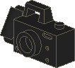

Généralement noir, il est aussi décliné en d’autres coloris. La version jaune, à connotation sous-marine, est la plus fréquente.

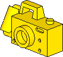

_Les puristes pointeront la relative disproportion de l’engin, qui est aussi large qu’un torse de minifig..._

On peut considérer que la pièce se suffit à elle-même, le tenon creux de sa face restituant une optique crédible. Néanmoins, il est d’usage de la combiner à la pastille 1 x 1 transparente afin de renforcer son identité.

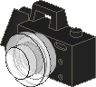

## Aller plus loin...

Pfff, ce n’est pas avec un modeste 50 mm / f 5,6 que le génie créatif de nos minifigs préférées s’exprimera pleinement ! Il leur manque pour cela quelques accessoires, que nous allons [MOC](/articles/128/)er de ce pas.

Nous verrons également que la pièce spécifique n’est pas une fin en soi. Et dans la continuité de [l’article de Didier, « Deux pièces »](/articles/876/), qu’il est possible de créer du matériel photographique réaliste à l’aide de peu.

## Un complément de vitamines

A peine deux ou trois petites briques suffisent à concevoir les optiques les plus performantes. Réjouissez-vous minifigs ! A vous téléobjectifs ultra lumineux et autres cailloux hors de prix :-)

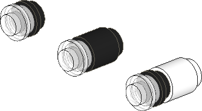

Les conditions d’éclairage n’étant pas toujours favorables, l’appoint d’un flash externe pourra être déterminant à l’occasion.

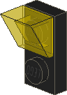

Ou encore :

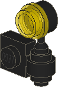

Les combinaisons deviennent alors innombrables.

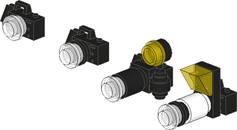

## Et si on reprenait tout depuis le début ?

**Le jumper, pièce à tout faire**

Il est possible de reproduire un appareil photo à l’aide d’autres briques que celle spécifique. Par exemple, en employant un [simple « jumper »](/articles/278/), ce judicieux croisement de tuile lisse et de plaque à tenons protubérants.

Ses dimensions (1 x 2 tenons pour 1/3 d’épaisseur) sont très voisines du boîtier original. Et son tenon creux central lui confère naturellement l’allure d’un appareil photo.

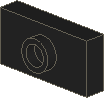

L’ajout de la pastille 1 x1 transparente ne fait que renforcer cette impression.

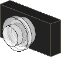

Cette pièce, injectée en beaucoup de coloris exotiques, rend les petits compacts flashy qui pullulent ses dernières années tout aussi accessibles.

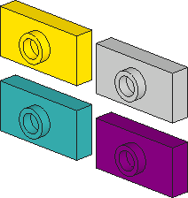

Avec les accessoires développés pour l’appareil initial, on parvient même à lui conférer un aspect de reflex assez convaincant.

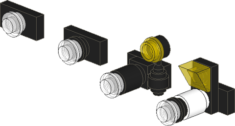

**La brique Technic n’est pas en reste**

Une autre brique pourrait elle aussi faire l’affaire, bien que nettement disproportionnée et plutôt destinée à des [sets maxifigs](http://www.bricklink.com/browseList.asp?itemType=S&catString=85) : la brique Technic 1 x 2.

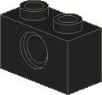

Nue, elle ressemble peu à un appareil photo, mais la traditionnelle pastille 1 x 1 transparente, et même noire, suffit à la métamorphoser.

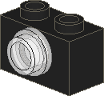

Et :

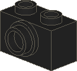

L’absence de tenon facial impose alors de repenser ou de recréer les accessoires.

Les optiques devront être assemblées à l’envers.

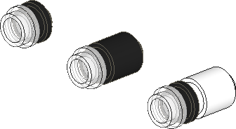

L’architecture des flashs revue.

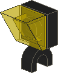

Ou encore :

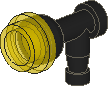

Les tenons supérieurs permettent l’utilisation d’autres types de flash, pourquoi pas avec la plaque 1 x 1 ou la brique biseautée 1 x 1 x 2/3, toutes deux en jaune translucide.

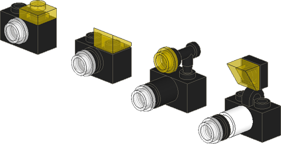

## Le moyen format

Le [moyen format](http://fr.wikipedia.org/wiki/Moyen_format) est l’appareil photo des pros et des artistes. Grâce à sa grande surface d’exposition, il permet les tirages les plus fins, les plus pointus. Un engin aux lignes préhistoriques qui immortalisa à coup sûr les grandes étapes de votre odyssée scolaire. Arf ! Quelle trombine sur cette photo de classe ;-)

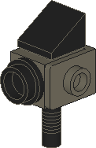

Ou pourquoi pas avec une optique renforcée :

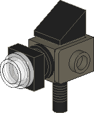

Afin d’éviter tout flou de bougé, un trépied s’avère indispensable. Sa création s’annonce sans difficulté particulière.

Prenons un volant.

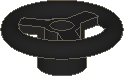

Ajoutons lui trois pieds, composés de quelques briques.

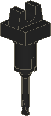

Et le tour est joué !

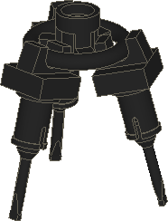

La variation de l’écartement des pieds ou de la hauteur des tournevis offre même des plages de réglages, à l’image d’un vrai :-) On peut enfin y fixer notre beau joujou moyen format.

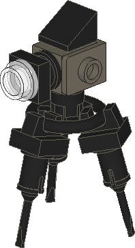

## Aller encore plus loin !

Pour conclure cette incursion dans la photographie en briques LEGO, un fichier au format PDF reprend sobrement la plupart des idées esquissées ou développées au gré de cet article. Mon souhait est qu’il puisse alimenter vos propres recherches.

Un exemple de pistes parmi d’autres : avec de légères modifications - que je laisse volontairement à votre imagination ;-) - il est tout à fait possible de réemployer le trépied avec la pièce spécifique. Ou l’un de ses pieds seulement en guise de mono pod. Pour cela, cogitez donc autour de cette brique :

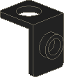

Bonne construction. Et dites bien « Cheese » ;-)

**Appareils photos & accessoires**
