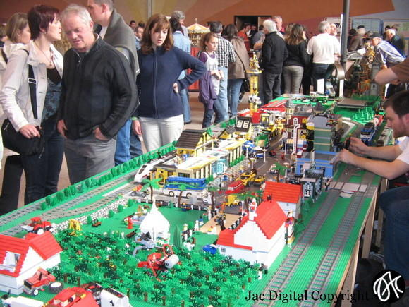
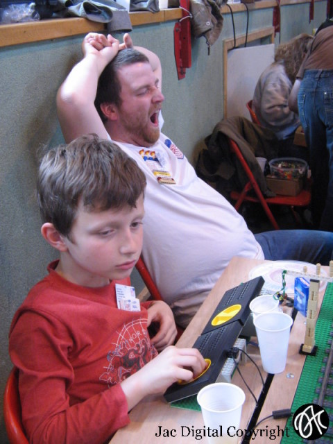
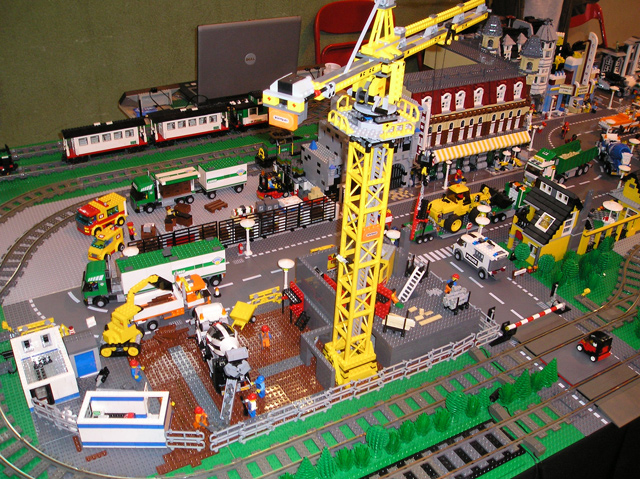
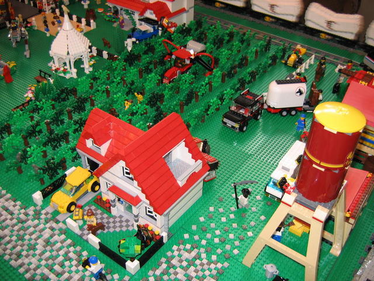
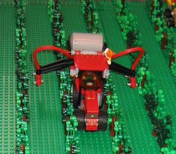
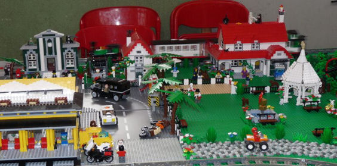

Saint-Chély d’Apcher est une petite ville de Lozère, nichée au coeur du Gevaudan. L’association FreeLUG y était invité pour le Salon Européen du modélisme qui s’est déroulé les 4 et 5 avril 2009.

Chaque année, le club "Gévaudan Modelisme" organise une exposition dédiée à ce loisir qui nous occupe tant. Des clubs et des associations étaient invités de tout coin de France et même d’Europe, d’où le nom donné à cette nouvelle édition.

De plus, cette année, les organisateurs tenaient à la présence d’un réseau en LEGO dans l’exposition, et c’est donc pour cela que l’association FreeLUG a été contacté, par mon intermédiaire. C’est le président du club Auguste Fontugne en personne qui a pris cela en charge, et je me suis placé tout naturellement en coordinateur pour prévoir le nombre de personnes présentes et notre emplacement nécessaire.

Quatre passionnés de la brique ont répondu à mon appel : Pierre Charles, Pierre Laurenge, Pierrick, et Stéphanie. Je me suis senti bien seul, au milieu de toutes ces pierres, mais en bon prince sympathique, j’ai laissé rouler !!!

Le layout a été établi et chacun a construit les décors.

L’arrivée sur place s’est fait sans soucis majeurs, la salle a été très simple à trouver, et tout de suite nous avons pu nous installer. L’emplacement vide à pu être rempli, d’abord par les cartons, puis par la menuiserie, et enfin, par les briques.

Pierre Charles et Pierrick nous avaient concocté une surprise. En effet, nous n’avons pas vu de Taj Mahal, mais une belle petite ville, et une ferme très bien reproduite. Tout ce qui a fait que notre petit réseau était magnifique, et que durant ce week-end si court, je n’ai cessé de le répéter, tout en me disant que ça ne suffisait pas. mais je vous laisse en juger par les photos que nous avons pu prendre, chacun, avec nos appareils respectifs.

Sur tout le salon, régnait une ambiance sympathique, propre aux jeux, et à l’échange. Nous avons tous passé, enfin, j’espère un week-end agréable, marqué par de très bons repas, offerts par le "Gévaudan Modélisme". Le samedi soir, pas de loup au menu mais une délicieuse tartiflette avec de la saucisse cuite au feu de bois, miam !!!

Je laisse un peu de choses à dire à vous aussi, amis présent lors de ce salon, mais je voudrais quand même rajouter que tout cela n’aurait pu être, sans la présence des tables BAB, et l’aide de Xavier, notre vice prez, qui a énormément aidé au montage. Il a pris beaucoup de son temps libre pour être bricoleur ;-), et reporter.

Je souligne aussi la présence de Justin, qui a pu prendre les commandes un moment, pour remplacer une équipe de conduite bien fatiguée !!!

[Vidéo](http://photos.freelug.org/main.php/v/rigal_daniel/st_chely/MVI_3574.AVI.html)

* * *

**La partie de Pierre/Pierrolego**

**partie Pierrolego**

De retour dans une exposition de LEGO CITY, j’ai ramené ma gare présentée la première fois à St Rambert en 2007, avec mes trois Corner Cafe, le Green Grocer, le cinéma et un bâtiment perso... J’ai fait un chantier de construction, avec une grue et ma toupie qui tourne ! (tirée du modèle officiel et inspirée du modèle de Pierre Normandin).  
Puis pour finir, j’ai mis en place une petite zone de stockage de marchandise avec les camions officiels LEGO et [les palettes de Grrr 31](https://www.freelug.org/spip.php?article878).

C’est toujours un plaisir de retrouver la bande de copains lors de ces expositions... On a encore bien rigolé, discuté, philosophé... Les modifications du layout ont été nombreux le long du week-end...(n’est ce pas Pierrick ?)

Merci aux organisateurs de nous avoir si bien accueillis.

Un grand MERCI à Jac, pour ce week-end (et puis à ses parents pour la nuit de vendredi soir ;-) )

Pierre L. / Pierrolego

* * *

**La partie de Daniel**

De passage dans la Lozère le dimanche après-midi, nous avons fait un crochet par St Chély d’Apcher, un peu court mais réussi de par l’accueil des exposants et de par la qualité du salon (ex : [porte-avion FOCH](http://photos.freelug.org/main.php/v/rigal_daniel/st_chely/IMG_3582.JPG.html))

Justin et Antoine ont abusé d’un énorme terrain de jeu mis à leur disposition encore une fois magnifique.

Félicitations aux exposants (ma seule participation ayant été la moissonneuse-batteuse dont la fonction première a été détournée...) qui peuvent être fiers d’exposer dans un salon de cette ampleur.

Daniel

* * *

**La partie de Pierre/Tribolego**

Je me suis demandé longtemps ce que je pouvais faire pour cette exposition. Et puis une idée m’est venue. J’ai profité de la nouvelle gamme City-Ferme, pour mettre en oeuvre une petite idée qui trottait dans ma tête depuis un moment : faire un vignoble en LEGO !

Je suis assez content de mon résultat :

Le tracteur va certainement faire l’objet d’un article détaillé, pour les intéressés.

Ce fut en tout cas une super exposition qui nous a à nouveau permis de passer un bon moment entre Afols du grand Sud-Est ainsi que de rencontrer des modélistes pleins d’astuces et d’entrain pour faire vivre leurs décors !

Pierre C. / Tribolego

* * *

_La partie de Pierrick et Stéphanie_

Une exposition si proche de la maison, à peine 3h de route, ça ne pouvait se louper.

C’est donc de très bonne heure et bonne humeur que nous nous somme levés pour affronter les virages et le brouillard lozérien et arriver pas trop tard à Saint-Chely.

Pour ce week-end exposition, je me suis forcé, et aidé de ma chère compagne, j’ai fait du city (j’en ai encore honte). Nous avons donc présenter un module avec 2 maisons, une mairie et un joli parc accompagné d’un extrêmement beau kiosque. Le week-end a été ponctué de quelques mises en scène de minifigs (affaire à suivre...) et de rencontre avec d’autres exposants super sympas.

Comme souvent l’accueil a été génial et je tiens à remercier les organisateurs (seul bémol, penser à mettre des gros tapis de mousse en bas des escaliers !!).

Pierrick et Stéphanie.

* * *

**–** [Galerie de Jérôme/JAC](http://photos.freelug.org/main.php/v/JAC/Exposition/Expositions2009/St-Chely-2009/)  
**–** [Galerie de Xavier/BrikoLego](http://photos.freelug.org/main.php/v/vroum/Expositions/StChely/)  
**–** [Galerie de PierreL/Pierrolego](http://photos.freelug.org/main.php/v/pierrel/exposition/stchely/)  
**–** [Galerie de PierreC/Tribolego](http://photos.freelug.org/main.php/v/Pierre_13/Saint-Chelly-2009/)  
**–** [Galerie de Daniel&Justin](http://photos.freelug.org/main.php/v/rigal_daniel/st_chely/)  
**–** [Galerie de Pierrick et Stephanie](http://photos.freelug.org/main.php/v/-PZ/Exposition/St+chely/)
