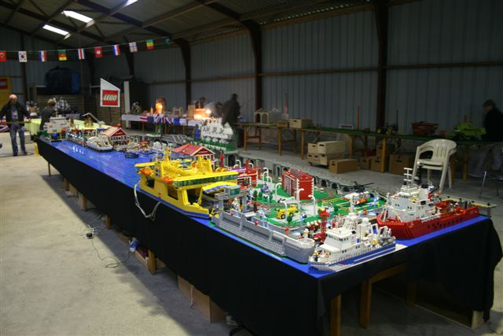
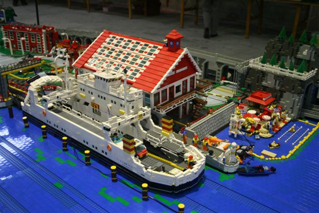
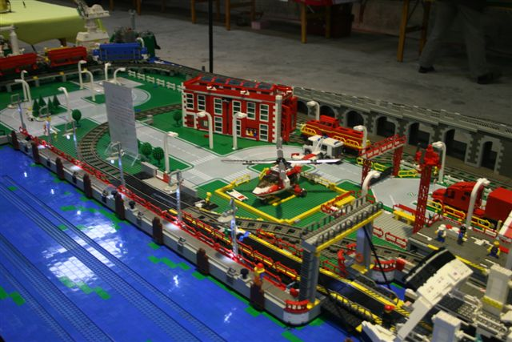
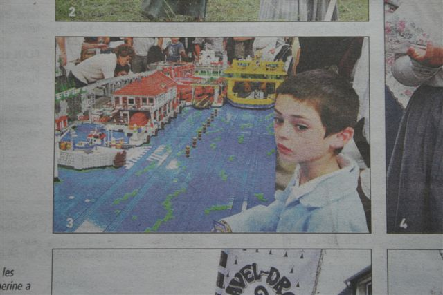
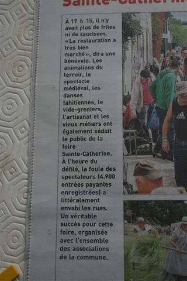
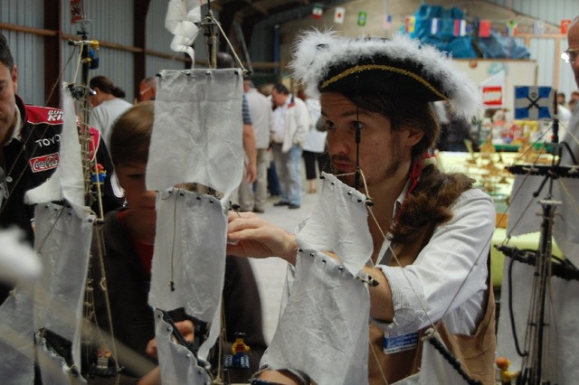
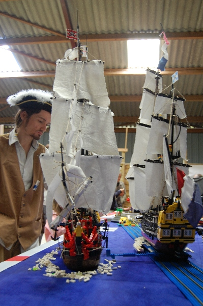
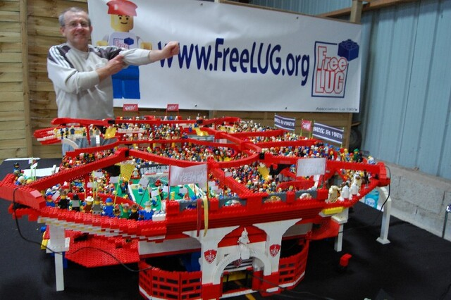
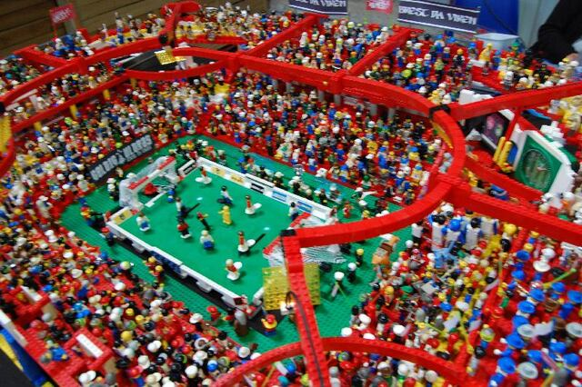
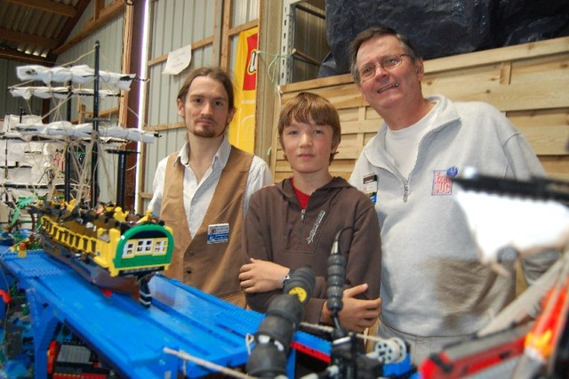

Après plusieurs échanges avec le président de la foire, il a été convenu que le stand FreeLUG (32m2 ) serait éclaté pour répartir les centres d’intérêt à l’intérieur de la "salle des merveilles".

Effectivement, ce fut un grand et franc succès. Le public a pu voir sans difficulté nos créations.

Pour un jour, j’ai amené à la demande express de la foire, mon grand diorama trains et ferries complet (tout rentre dans ma Kangoo), Laurent et Bruno ont exposé, pour leur part, pour la première fois, leurs bateaux, stade, et kraken.

Plus de 6000 visiteurs sont venus nous voir, des bulletins FreeLUG ont été distribués, nous avons répondu aux nombreuses questions du public.

Coté matériel, rien à signaler, le matériel est toujours aussi performant, c’était une répétition avant les fêtes de la mer à Roscoff prévues 4 jours plus tard.

Idem pour Laurent et Bruno pour peaufiner leurs derniers réglages.

Merci à la famille Eymann d’être venue nous voir.

Prochaine manifestation : fêtes de la mer à Roscoff et Morlaix.

Presse :

_Jean-Marc_

* * *

Bonjour les Freelugiens !

En plein coeur d’une période riche en créations et en démonstrations, la 8° foire-expo de Saint-Catherine, bien qu’elle n’ait lieu que sur un seul jour, était inévitablement le temps fort de l’été legotique en Finistère.

Malgré le temps un peu maussade mais tellement breton, le public s’est montré fidèle à sa traditionnelle affluence avec 6000 entrées, et cette journée a été une grande réussite pour Jean-Marc et moi-même.

Les organisateurs avaient en effet décidé au dernier moment de nous séparer dans la salle, afin de ne pas attirer trop de spectateurs en même temps et de créer des bouchons dans le hangar où nous exposions au milieu de tous les autres maquettistes, et ce ne fut pas une mesure superflue.

Jean-Marc a une nouvelle fois ébloui son public en faisant défiler sans discontinuer les enfants aux manettes de ses trains électriques, tandis que mes innovations ont suscité de nombreuses réactions chez les visiteurs qui ont été très nombreux à s’arrêter pour discuter avec nous, ou simplement admirer en prenant des photos.

De mon côté, je présentais une version améliorée de ma bataille navale. Le treuil a en effet été revu pour une version gagnante ; l’Archiviste se déplace désormais à une vitesse suffisante pour ne pas ennuyer le public, et ça, c’est une victoire.

Le démâtage du Delinka a parfois posé problème, mais c’était toujours vite réparé. Cependant, le bruit ambiant de la salle a empêché d’entendre le son des canons et la musique des combats. Et puis, j’étais un peu déçu par le diorama de l’attaque du kraken, qui n’a pas rencontré beaucoup de succès, ce n’est pas encore assez spectaculaire, et surtout pas aussi interactif que les trains de Jean-Marc.

Je présentais également un train un peu particulier puisqu’il s’agissait d’un bateau pirate dont la coque intègre un moteur 9v pour rails électriques ; l’astuce a fasciné petits et grands, même sur un circuit réduit qui faisait le tour d’un moulin motorisé et d’un fort de commerce.

Mais le clou de mon stand, c’était l’inauguration de mon nouveau stade. Énorme carton ! Une véritable foule s’est amassée devant l’enceinte remplie de pas moins de 1300 minifigs, projecteurs allumés et travaux de finitions encore en cours. D’ailleurs, mon prototype de monorail périphérique a été mis en marche l’après-midi, rendant l’ensemble encore plus attractif. De ce côté-là, c’est mon papa qui se chargeait d’assurer la promotion !

Premiers arrivés derniers partis, le rangement a pris deux petites heures.

Merci beaucoup à Jean-Marc pour m’avoir accompagné sur cette première grosse exposition pour moi, à Mickbatto pour nous avoir rendu visite, mais surtout au jeune et prometteur Titouan, que j’ai rencontré ce jour-là, et qui m’a grandement aidé à garder et à animer le stand !

Jean-Marc et moi nous sommes à nouveau la semaine prochaine pour les festivités de la mer, à Roscoff.

A bientôt tout le monde, pour de nouvelles aventures, puisque ma présence à la foire-expo de Sainte-Catherine 2012 a d’ores et déjà été validée !

_LaurentB & Bruno_

[Galerie photos](http://photos.freelug.org/main.php/v/barr__/expositions/2011/catherine/)
