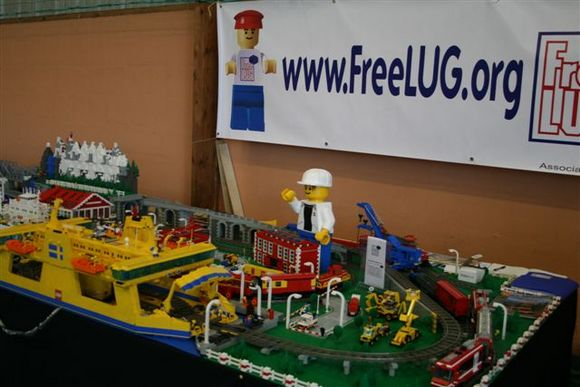
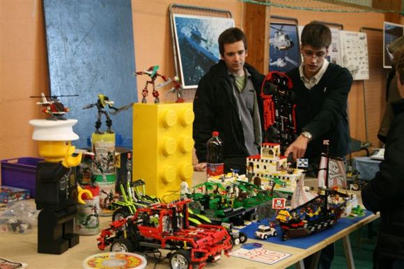

Contacté en mars 2008 à Bourgbarré (35), puis en septembre 2008 à Dinan (22), je suis donc venu à Pont-Péan les 28 et 29 mars 2009 près de Rennes, accompagné de François-Xavier et Marc, deux futurs adhérents de la Roche-sur-Yon. C’était une grande première pour eux !!!

A part mon réseau que vous connaissez bien, mes deux amis ont présenté une palette de leurs créations : pirates, voitures Technic. Leur magasin de jouets a même, pour l’occasion, prêté une grande minifig (policier).

Le public, loin de la cohue (270 visiteurs seulement contre 150 il y a 2 ans) a beaucoup apprécié notre stand.  
Samedi, vers 17h30, une panne générale a arrêté mes démonstrations fort prisées, et tout le monde a eu peur pour le lendemain. Le courant est revenu vers 10h du matin.

Durant le salon, j’ai remarqué une maquette d’un bateau de l’IFREMER fort intéressante. Techniquement et légotiquement parlant, c’est faisable.

Outre les deux amis, j’ai noté la présence de Christophe de Rennes qui a exposé quelques-uns de ses modèles et surtout de Boris et son fils d’Allaire prés de Redon venus officialiser leurs présence pour Cholet.

Pour terminer mon article, je remercie très chaleureusement Marc et Francois-Xavier pour leur présence tout au long du week-end. Bon courage et bon vent !

Jean-Marc

[Galerie de photos](http://photos.freelug.org/main.php/v/barr__/expositions/2009/PontPean2009/)

* * *

Pour un premier salon, le stress était au rendez-vous : est-ce que mon diorama "Pirates" va plaire ? j’aurais peut-être pu faire un peu plus ?

Malheureusement, ma collection ne me le permettait pas... Je ferais mieux la prochaine fois.

A retenir de ces deux jours : l’ambiance amicale entre les exposants, l’attention du public pour les petits détails (le père Noël et Charlie s’étaient glissés sur mon diorama), l’hésitation du jeune public pour l’essai d’un prototype de tech-ball...

Merci à Jean Marc pour ses conseils. Merci à Marc pour ses idées et quelques briques. Merci à Christophe pour la visite éclair de Rennes, samedi soir.

Vivement Cholet !

Merci pour tout et à bientôt.

François-Xavier
