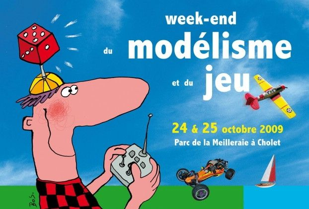

_L’univers du jeu et du réduit_ invite FreeLUG a participer à la deuxième édition du Week-end du Modélisme et du Jeu à Cholet, les 24 et 25 octobre 2009.

Plusieurs membres de FreeLUG ainsi que du forum Legopirate présenteront leurs créations ou leur collections.

_Heures d’ouverture :_  
**–** Samedi 24 : de 14h00 à 23h00 ;  
**–** Dimanche 25 : de 10h00 à 18h00.

_Tarif :_  
**–** 3€ à partir de 14 ans

L’exposition se déroule au Parc de la Meilleraie, à Cholet (49).

Retrouvez plus d’informations sur le site de l’évènement : [http://www.modelisme-jeu-cholet.com/](http://www.modelisme-jeu-cholet.com/)
