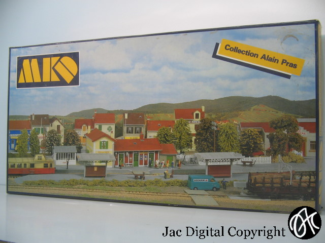
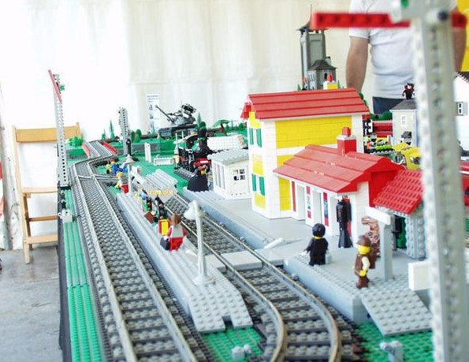
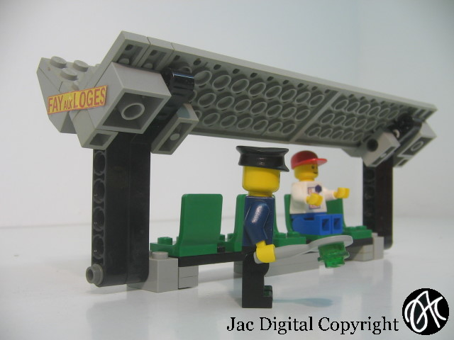
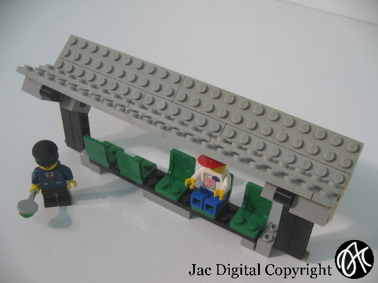
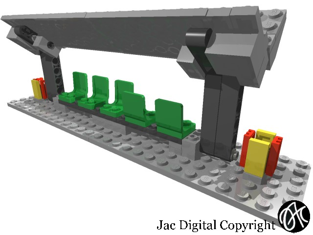

La gare de Fay-aux-Loges fait partie du réseau "PO" (Paris-Orléans). Elle est située sur une petite ligne qui reliait Orléans à Pithiviers.

La gare en elle même est constituée d’éléments courant sur les réseaux SNCF. C’est à dire, un bâtiment d’habitation, un bâtiment voyageur, et un hangar à marchandises. Son petit charme régional a inspiré un modéliste connu : Alain Pras, qui l’a reproduite à l’échelle Ho. Je possède cette maquette, et ne l’ai jamais montée. Cette gare me plais beaucoup, c’est pour cela que j’ai pris plaisir à la reproduire en briques LEGO.

**La maquette, toujours dans sa boîte**

L’ensemble est conforme à la réalité, avec son hangar à marchandise attenant, son bâtiment d’habitation typique et le poste d’aiguillage déplacé. Le quai et son abris sont inspirés des plans contenue dans la boîte. Par contre, j’ai laissé libre cours à mon imagination pour l’implantation des voies. C’est simplifié pour une meilleure jouabilité, et pour placer au mieux les signaux mécaniques fonctionnels. Et puis, c’est un bâtiment SNCF dont l’architecture sert à plusieurs gares de même importance.

Je me suis servi de cette gare de Fay-aux-Loges sur plusieurs réseaux en exposition, dont celui d’[Orléans en 2004](http://www.brickshelf.com/cgi-bin/gallery.cgi?f=104768). Et c’est normal, puisque c’est dans la région... Par contre, je n’avais pas de photos valables à vous montrer. Il a fallu attendre [Miramas](http://photos.freelug.org/main.php/v/JAC/Exposition/Miramas-2009/), et l’appareil photo de David pour vous présenter la gare dans son ensemble.

**Merci Guss, pour cette photo.**

Pour ce premier article, je vais vous décrire l’abri de quai.

Ce petit bâtiment est d’une simplicité exemplaire. Mais, il a fallu prendre tout de même quelques contraintes pour pouvoir le placer sur le quai. En effet, les voies s’écartent de 8 tenons, lorsqu’on les déporte avec des aiguillages. Du coup, l’abri de quai devait tenir dans ce gabarit. De plus, il fallait pouvoir laisser passer nos locomotives en 8 tenons de large...

Heureusement, _En briques LEGO, Tout Est Possible_. Et j’ai pu le construire grâce à l’utilisation de pièces Technic. Mais, je n’ai pu reproduire fidèlement le modèle de la maquette. Aucune importance, puisque le résultat me plait.

**Une vue de devant**

**Et une de dessus, en attendant le train !**

Ci-dessous, une vue virtuelle de cette partie du quai. En situation, je place des poubelles toutes simples, à chaque extrémité. Je les ai modélisées dans cette vue. En fin d’article, le fichier MLCad, pour reproduire ce petit abri.

**Le quai, après modélisation virtuelle**

La suite au prochain numéro, en espérant que vous n’êtes pas trop pressé...

**Abri de quai.**
