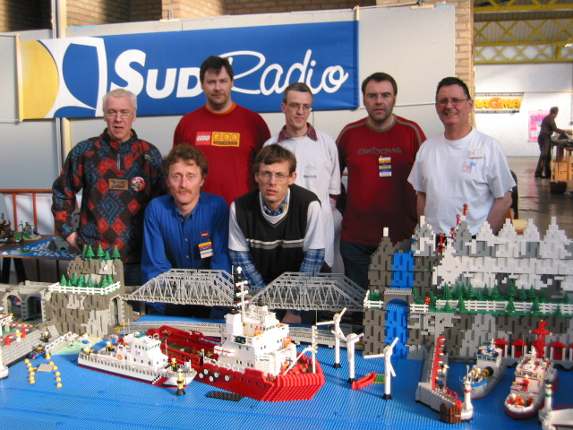

Etant membre de BeLUG (club belge des passionnés de LEGO) depuis le 1er janvier 2009, et n’ayant pas pu venir en novembre dernier pour cause d’embrayage cassé, j’ai répondu à l’invitation de Vincent et ses amis pour exposer à Mouscron les 11, 12 et 13 avril.

C’est au volant d’une Polo d’occasion que j’ai emmené mon grand réseau, plus les nouveautés finistériennes 2009. A ce sujet, je suis étonné par la capacité d’embarquement de la Polo, j’en connais qui vont hurler !!!

Après 9h de route en pilotage automatique, je suis arrivé à Mouscron près de la frontière franco-belge et j’ai été accueilli par Vincent et son papa.

Le lendemain matin, nous sommes allés repérer les lieux et avons remplacé les tables du Salon par celles de BeLUG (équivalents de BaB).

Convoyées par Eric de Bachère de Gand à Mouscron, les [fameuses tables](http://www.brickshelf.com/cgi-bin/gallery.cgi?f=226622) seront montées en 2h45 pour quelques 35m2.  
L’installation des dioramas pouvait commencer.

Au final, 2 dioramas différents sont proposés au public : trains et ferries d’un coté et de l’autre ville + gbb.

Sur mon stand, ma grande minifig portait les drapeaux de courtoisie français et belge plus un drapeau breton plus loin...

Durant les trois jours, le public est venu nombreux, comme d’habitude, j’ai invité plein de personnes à jouer avec moi, même les exposants ferroviaires et journalistes de R.C marine !!!

J’ai même "guéri" des adolescents très timides, certains sont revenus plusieurs fois dans la même journée. Avec LEGO,le complexe n’existe plus !!!

Le Stand franco-belge fut très apprécié, notons au passage, les personnages et grenouille de Charlie, les maisons bretonnes de Vincent, l’église norvégienne de GOLE par Ludo, les différents immeubles, arbres, trains, gbb de Jean-Marc Nimal, trains, wagons, gare et ....................................... la dernière locomotive de LEGO.

Je l’ai vu en action mais je trouve qu’elle dandine trop, un réglage de bielles sera nécessaire, les avis sont très partagés, c’est un beau modèle certes, mais pas pour moi.  
Mes trains ont circulé sur leur réseau, surtout ma locomotive autrichienne.

En conclusion, merci à Vincent, Ludo, Peter, Jean-Marc, Patrick, Serge, Eric de m’avoir reçu chez eux, je reviendrai dans le cadre d’un week-end club BeLUG.

Puis vient le retour avec un crochet par Saint-Lô où j’ai revu la famille EURY pour déposer les pièces de FreeLUG et notices.

Le grand week-end pascal chez les Belges est terminé. [Vive Plonéour-Lanvern prés de Quimper fin mai](/articles/874/) avec la participation EXCEPTIONNELLE de Vincent de BeLUG.

JEAN-MARC

* * *

_Mot de Richard "Charlie"_

Pour ma part, sachant que ce week-end Pascal se résumerait à un mot : "révisions" pour un concours, j’avais préparé en amont cette exposition avec Vincent de BeLUG.

Quelques jours plus tôt, je lui avais confié quelques MOCs pour le week-end (quelques "JOE", "Maximus Minifigus", une grenouille géante, et une petite scénette de "Vaporiste").

Dans la famille, un AFOL pouvant en cacher un autre, c’est mon père qui s’est rendu à l’exposition. Il avait déjà apprécié ces grands dioramas en LEGO : [Mondial](/articles/593/), [KidExpo](/articles/816/). Et cette fois, Jean-Marc étant très partageur, il n’a pu résister et a pris en main les commandes de ses bateaux. Et ce sont ces photos qui sont à présent sur ma Galerie.

**–** [Galerie de Jean-Marc](http://photos.freelug.org/main.php/v/barr__/expositions/2009/mouscron_2009/)  
**–** [Galerie BeLUG sur Brickshelf](http://www.brickshelf.com/cgi-bin/gallery.cgi?f=378027)  
**–** [Galerie de Richard "Charlie"](http://photos.freelug.org/main.php/v/Charlie/Mouscron/)
