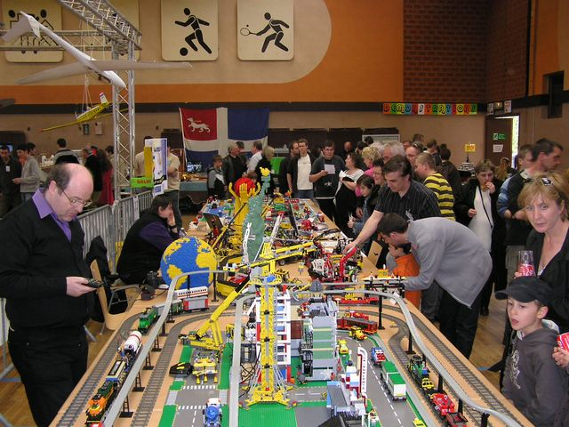
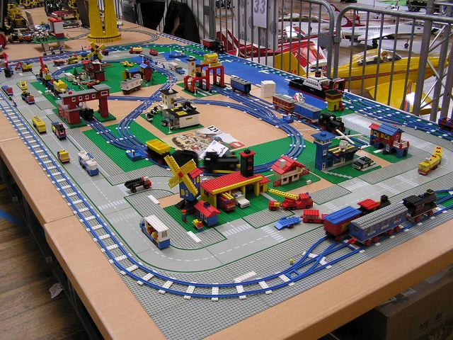
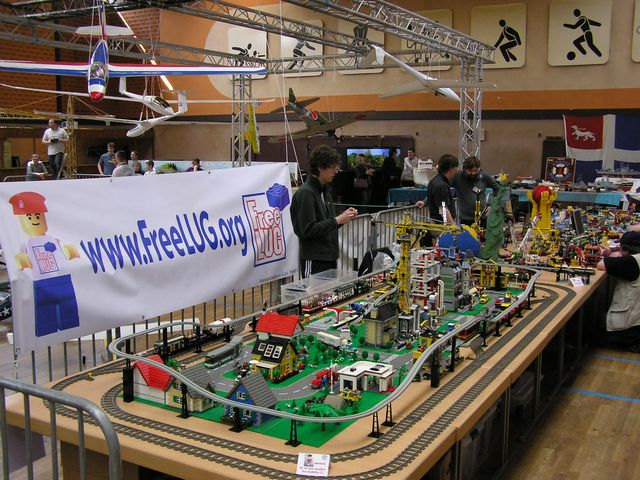
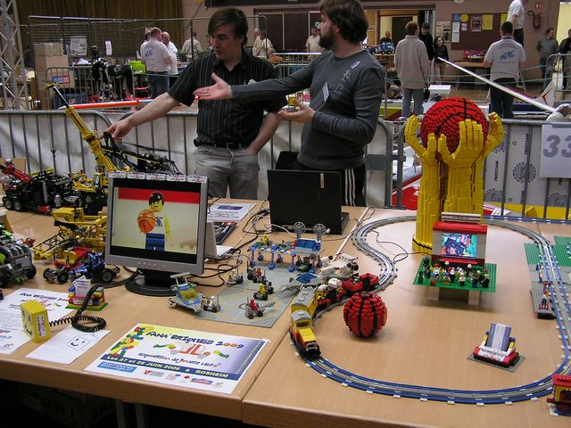
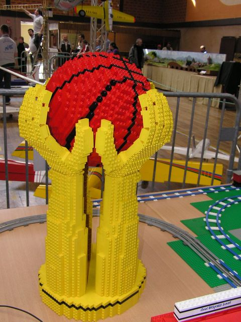
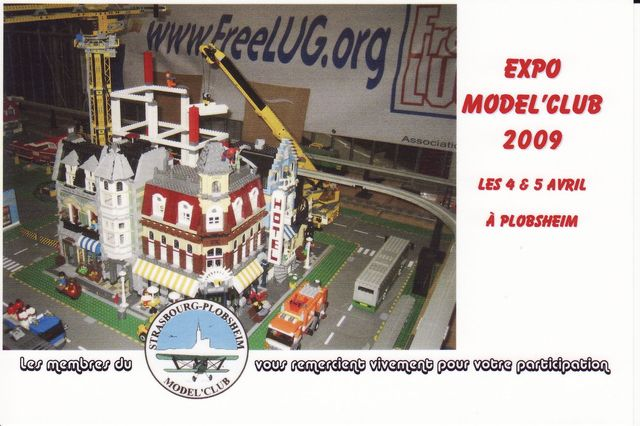

Malgré le sommet de l’OTAN, avec ces barrages, ces déviations, l’exposition de Plobsheim, contrairement au centre-ville de Strasbourg, n’est pas resté inerte. Le public était fidèle au rendez-vous ce week-end du 4 et 5 avril 2009.

Associé pour la première fois avec Fana’briques (association locale) nous avons pris d’assaut les 12 mètres de longueur ! Un bien bel espace qui fut rapidement occupé par nos briques.

La partie années 70, toujours aussi appréciée.

Daniel s’est frayé un passage aérien en installant dans la ville un monorail.

Grâce à Benoit, les visiteurs de l’exposition de Plobsheim savent que [Fana’briques](http://fanabriques.freelug.org/) aura lieu le 27 et 28 juin ! Vidéo, photos, affiches, cartes de visite, tout y était !

Superbe sculpture réalisée par Daniel. Alors ! C’est pour quand le basketteur ?

[Les photos de Marc K.](http://photos.freelug.org/main.php/v/marckl/plobsheim2009)

Le [petit film de Daniel du layout de Plobsheim](http://www.brickshelf.com/cgi-bin/gallery.cgi?f=377220) est visible sur brickshelf.

A bientôt.

