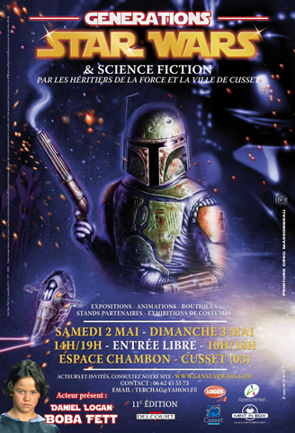
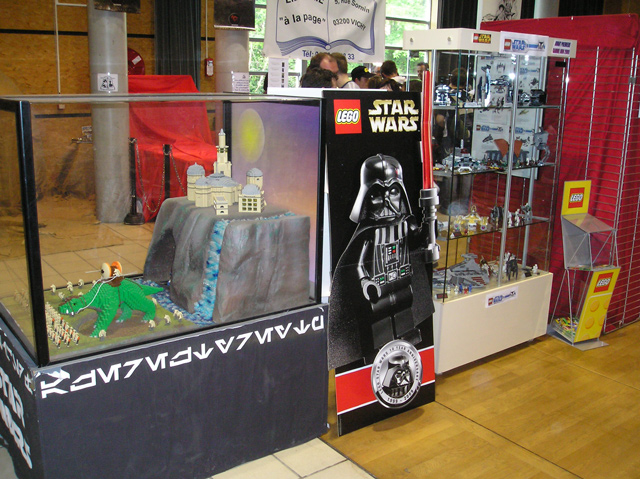
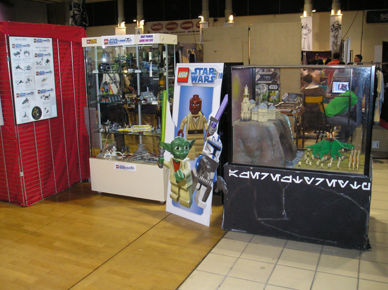
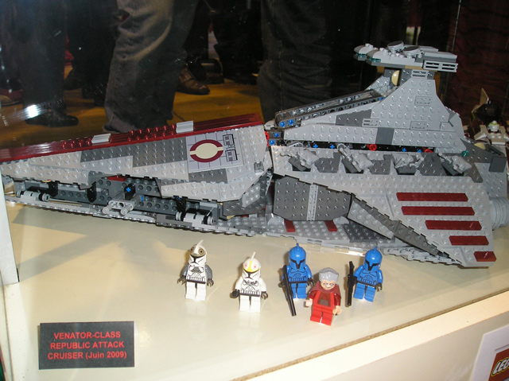
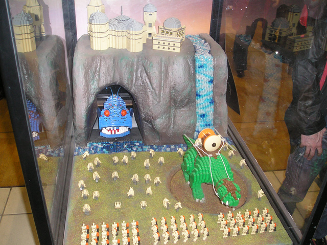
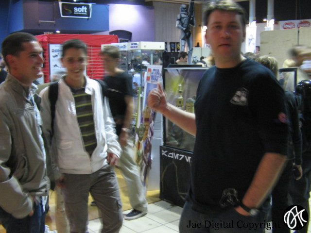
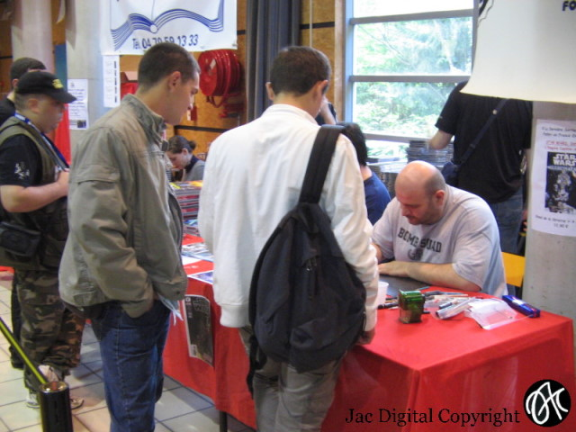
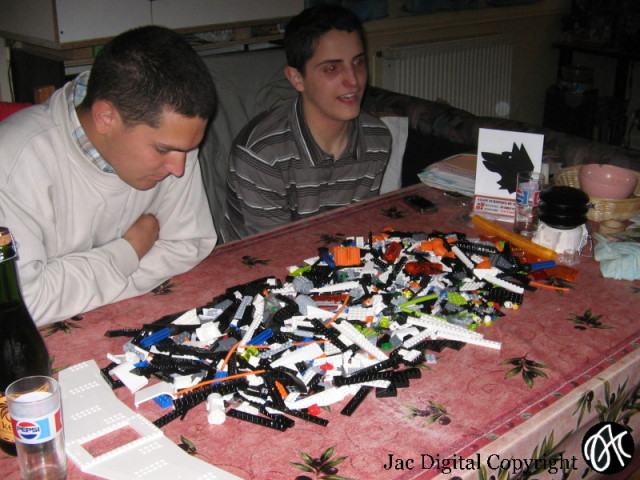

Nous étions quelques FreeLUGiens à se retrouver à Cusset (03) pour cette nouvelle édition de "Générations Star Wars".

**Affiche de cette 11e édition**

Cette année encore, ce salon a fait le bonheur de milliers de fans... 4700 visiteurs le long du week end, un record !

Heureux de rentrer dans une salle remplie de Star Wars... aux murs, sur les stands, les costumes, les discussions...  
Enfin du Star Wars de partout !!  
Et puis aussi un peu de Stargate, Harry Potter, des Pirates...

Comme à l’accoutumée, il y a essentiellement des stands marchands qui proposent des figurines, livres et autres goodies dans l’univers Star Wars et Fantastic.

Pour cette année, il y a eu encore des stars présentes :  
Davide Fabbri, dessinateur de bande dessinée, Cédric Delsaux, photographe professionnel et Daniel Logan, acteur du jeune Boba Fett.

Bien que nous ne soyons pas présents cette année avec nos LEGO, et bien c’est LEGO eux-même qui présentait en avant première les nouveautés Star Wars 2009 (1er et 2e semestre).

C’est grâce à des efforts, maintenant depuis quelques années, que les Héritiers de la Force, association organisatrice de ce salon, ont pu obtenir de la part de LEGO ces vitrines exclusives Star Wars.

On s’est donc régalé devant la vitrine en cherchant un moyen de repartir avec ces nouveautés, mais c’était peine perdue !

On a quand même ramené quelques photos...

**vue générale 1**

**vue générale 2**

Les nouveautés du second semestre :

**Venator-class republic attack cruiser**

Il y avait en plus des nouveautés, une magnifique vitrine représentant une bataille de Gungans contre des Droides...

**vitrine de la bataille Gungans**

Le rendez-vous est donc déjà pris pour l’année prochaine, le samedi 1er et dimanche 2 mai, toujours à Cusset !

Venez nombreux !!

PieroLego/ Pierre L

* * *

Cette année, je n’avais rien prévu à cette exposition car j’aime bien y exposer tous les deux ans pour avoir le temps de préparer de nouvelles choses. Et après [la prestation de l’année dernière](/articles/749/), il fallait bien ça pour se retourner. Par contre, je m’y rends en visiteur et j’ai invité les personnes voulant y venir, de loin ou même de très loin.

Seuls les frères Laurenge (tiens, ça fait bizarre de dire ça) ont pu se libérer ce week-end là, et ont donc répondu présents à mon invitation.

Ils sont arrivés le samedi en fin de matinée, pour l’apéro, certes !! Et nous sommes allés à Cusset, l’après midi. Là, nous avons retrouvés Franck et Cheub/Jérôme. Malgré le monde, déjà très présent en début d’après midi, nous avons réussis à nous retrouver. Faut dire que l’on savait où trouver les afols, à côté de la superbe vitrine LEGO. Autant vous dire que nous avons énormément discuter, autour de cette fameuse vitrine. Entre nous, mais aussi avec des membres très actifs des héritiers de la Force.

**Point rencontre d’afols**

Certains ont aussi beaucoup patienté pour un dessin sur une BD... Plus de deux heures, il me semble, dingue !

**Mais qu’est-ce qu’il dessine ???**

De mon côté, j’ai pu prendre de très bons contacts pour notre emplacement de l’année prochaine. En fait, nous sommes attendus maintenant chaque année, que ce soit petit ou grandiose.

Enfin, un excellent moment, de rencontre, et de partage, dans une très bonne ambiamce. Pour la soirée, nous avons choisi trois boîtes importantes dans mon stock pour se rappeler l’année dernière. D’abord ouvrir les boîtes, puis ouvrir tous les sachets, mélanger les pièces, et enfin construire. Dur quand même, à trouver les pièces...

**Tirage au sort des notices....**

Voilà, comme le dit Pierre, à l’année prochaine, pour une nouvelle rencontre SW en Auvergne.

JAC/Jérôme T

* * *

**–** [Galerie de JAC](http://photos.freelug.org/main.php/v/JAC/Exposition/Expositions2009/SW-Cusset-2009/)  
**–** [Galerie de Pierrolego](http://photos.freelug.org/main.php/v/pierrel/divers/cusset09/)  
**–** [Notre participation en 2008](/articles/749/)
