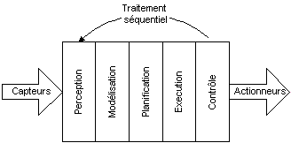
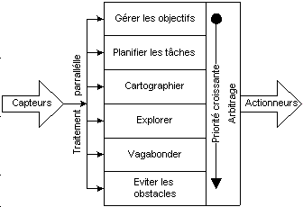
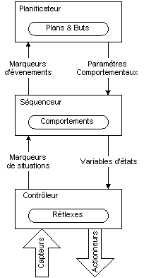
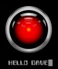

Un robot autonome a besoin d’un "cerveau", d’autant plus s’il est mobile. Savoir avancer, reculer, tourner, saisir, ne sert pas à grand chose, sans un système capable de coordonner ces mouvements vers un but, plus ou moins précis (de l’exploration de l’environnement à la recherche de victimes enfouis sous des décombres par exemple). Dans une première partie, nous nous focaliserons sur les concepts apparus les premiers dans l’élaboration des "cerveaux" des robots. Nous irons flâner ensuite dans une seconde partie vers les beams (logique floue à transistors, sans calculs), la logique floue et les "multi-agents". Dans une troisième partie, nous explorerons les voies qui mènent au robot capable d’apprentissage, aux réseaux de neurones "singeant" le fonctionnement du cerveau humain.

## Première Partie : l’âge classique de la robotique

L’histoire de la robotique "classique" fait état de trois axes de réflexions successifs :  
**–** la vieille école : Détecter-Planifier-Agir ou "**SPA**" (Sense-Plan-Act) ;  
**–** l’école "Brooks" :Tâches concurrentes ou "**Subsumption**" ;  
**–** l’école "Moderne" : L’Architecture en trois couches ou "**TLA**" (Three-Layer Architecture), elle est aussi appelée Hybride.

Parallèlement, se sont développées des technologies alternatives parmi lesquelles les Multi-Agents (la technique de pointe, objet actuel de nombreuses recherches...) et les Beams.

## Sense-Plan-Act

SPA consiste en trois étapes linéaires, répétées indéfiniment :  
**–** détection de l’environnement ;  
**–** planification de l’action à entreprendre grâce à la construction d’un modèle du monde par fusion des données capteurs, en prenant en compte toutes les tâches à accomplir à court, moyen ou long terme ;  
**–** réalisation du plan par l’action sur les commandes.

Toutes les tâches sont connues à chaque niveau, et affectent le résultat à chaque itération.

Les avantages : facilité de compréhension du mode de fonctionnement (qui fait quoi).

Les inconvénients : d’une conception monolithique, SPA est lent. A chaque itération, il faut faire la fusion capteur, la représentation du monde, et planifier toutes les tâches. Cette lenteur intrinsèque implique que la planification ne peut se faire aussi vite que le monde change autour du robot ! Il en résulte un comportement incertain et imprévisible...

-   incertitude : nous continuons la prise des mesures parce que notre mesure originale est imprécise et nous devons continuellement la corriger.
-   imprévisibilité : en raison des insuffisances dans le modèle dues à la résistance non modélisée de l’air, du vent, d’autres facteurs...

## Subsumption

Introduit par Brooks (86) dans une série d’articles, elle consiste en un ensemble de comportements hiérarchisés, du plus simple au plus complexe, avec des interfaces simples. Les couches de comportements peuvent se supplanter les unes les autres. Chaque couche à un programme de contrôle travaillant à la vitesse des changements de l’environnement. Chaque couche peut alors construire une modélisation spécifique du monde, par fusion des données capteurs pertinents.

|  |  |
| --- | --- |
|  **A.I Memo 864, Brooks 86** A Robust Layered Control System |  **A.I Memo 899, Brooks 86** Achieving A.I through building robots |

Chaque couche de comportements à une fonction définie. Les couches basses (de plus haute priorité), sont plus réactives (évitement d’obstacles, recherche de balises...). Les couches hautes sont plus réflexives (modélisation, localisation, planification). Chaque couche peut influer sur les entrées et les sorties des autres couches.

Les avantages : de conception modulaire, une couche peut être construite et testée après l’autre, pour progressivement construire un système complexe. Supporte une architecture massivement parallèle de façon intuitive (une couche, un module), ce qui évite un contrôle centralisé, gourmand en ressources. Conduit à des comportements émergents, "des comportements complexes (et utiles) peuvent être simplement le reflet d’un environnement complexe". L’intelligence du système réside entièrement dans le planificateur.

Les inconvénients : la répétitivité du comportement général du robot n’est pas bonne.

## Three-Layer Architecture

En réponse aux deux architectures proposées ci-dessus, et au vue de leurs limitations respectives, des chercheurs ont imaginé une nouvelle architecture sur les bases suivantes :  
**–** des modèles de traitements différents sont nécessaires pour réagir à des évènements sur des échelles de temps différentes ;  
**–** des interfaces asynchrones sont nécessaires entre les différentes couches ;  
**–** pas de régression infinie de couches ;  
**–** pas d’influences sur les entrées/sorties des autres couches.

**TLA as Subsumption evolution, Brooks 91**

New Approaches to Robotics

Les architectures purement délibératives sont lentes ; les commandes de type boucle ouverte ne peuvent réagir à la dynamique environnementale. Les architectures purement réactives sont rapides et répondent à la dynamique environnementale, mais il est dur de leur faire exécuter des tâches complexes. l’architecture hybride permet que des modules réactifs et délibératifs coopèrent.

L’architecture TLA consiste en trois couches (on s’en serait douté ;-).

**–** **Le contrôleur (La couche réactive)**

-   sans états internes, états externes basés sur les mesures des capteurs ;
-   actions temps réel ;
-   système linéaire et continu.

Le contrôleur récupère les données brutes issues des capteurs, actionne les commandes, et traite de manière continue les états et le temps. Il filtre les données brutes, détermine la/les "situation(s)" actuelle(s) et envoie les données traitées à la couche "subsumption".  
Il applique les données brutes directement aux boucles de contrôle, cherche à maintenir les variables d’états autour de valeurs prédéfinies par le séquenceur, tente de limiter l’apparition de comportements erratiques en "lissant" les commandes.

**–** **Le séquenceur (la couche de Subsumption !)**

-   états internes (non linéaires et discontinus), mémoire du passé ;
-   actions à court terme ;
-   procède les comportements primaires.

Le séquenceur configure les valeurs prédéfinies des variables d’états, réagit aux situations détectées, traite de manière continue le temps et de manière discrète les états internes. Enfin, il envoie les variables d’état interne au planificateur.

Les comportements concurrents sont hiérarchisés de façon prédéfinie, ainsi le planificateur décide des comportements actifs et des états internes pertinents. Il entretient des "tables d’éventualité", qui servent à définir les évènements (par analyse des états internes des comportements) et à activer une éventuelle action immédiate

**–** **Le planificateur (la couche délibérative, ou symbolique)**

-   représentations & structures de données complexes ;
-   travaille principalement à partir d’évènements ;
-   tâches gourmandes en ressources (recherche, vision...) ;
-   tâches futures & buts de la mission.

Le planificateur configure le contrôleur, répond aux évènements, traite de manière discrète le temps et les états internes, définie et configure les comportements spécifiques actifs du séquenceur, définie la "table d’éventualité" active, et répond aux évènements.  
Il répond aux éventuels buts assignés par l’utilisateur (possibilité d’en changer en cours de mission). De plus, il maintient et utilise des représentations complexes de l’environnement (planification de la trajectoire d’un point à l’autre, mise à jour du plan en réponse à chaque évènement.

**TLA implementation, Erann Gat 94**

Integrating Planning  
and Reacting in a Heterogeneous Asynchronous Architecture

## Conclusion

Voici qui clôt le petit tour d’horizon de l’histoire "classique" des concepts de réalisation des cerveaux de nos robots, reste encore d’autres aspects à aborder, parmi lesquels logique floue, neurones artificiels et sociétés de robots ne sont pas de la science fiction, mais bien des concepts opérationnels, qui guident l’élaboration des robots toujours plus complexes qui nous entourent...

**hal**

2001 odyssée de l’espace, l’archétype même de l’intelligence artificielle, et des fantasme que l’I.A véhicule.

N’hésitez à faire part ici de vos réalisations, à partager vos bouts de code ou vos interrogations, c’est le but de cet article, faire naitre des robots plus intelligents !
