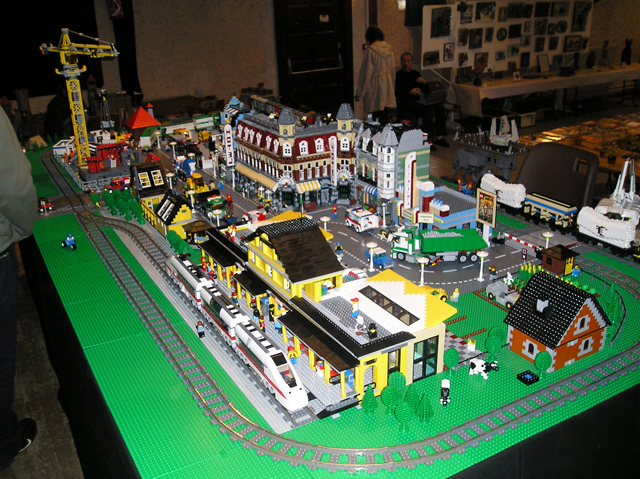
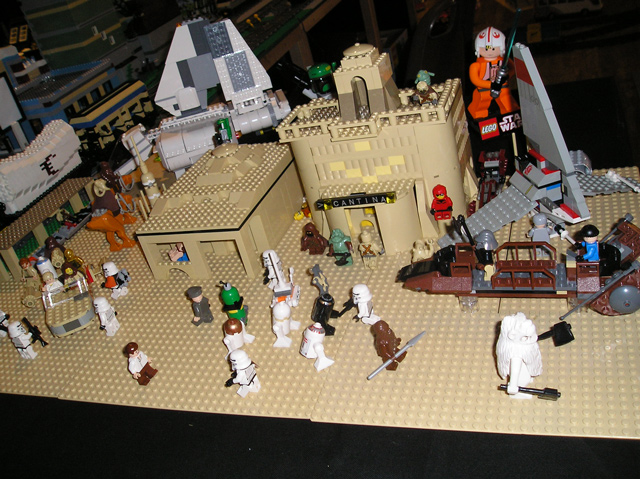
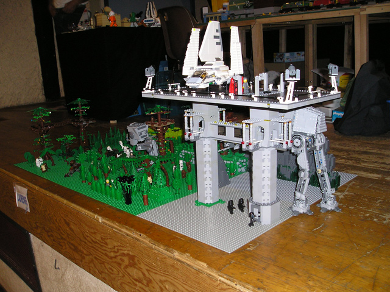
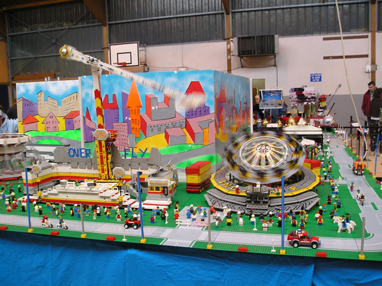

Contacté un mois environ avant l’exposition et en plus pas loin de la maison... j’ai naturellement répondu présent avec mon frère et nos LEGO !!

Les 18 et 19 avril 2009 s’est déroulé le quatrième salon de la maquette et du modélisme à Monistrol sur Loire dans la Haute Loire.

Ce salon, organisé par Monistrol Animation et réparti sur quatre sites, présentait plusieurs réseaux de trains, des maquettes, des avions, des bateaux... enfin que de belles choses à voir !

Aprés le week end à [Saint Chély d’Apcher](/articles/896/) et à [Saint Etienne](/articles/903/), j’enchaine donc une nouvelle exposition.

Pour plus de facilité, je représente ce que j’avais fait à Saint Chély d’Apcher, c’est à dire un chantier, mes Corner Cafe, un cinéma et une zone de fret... J’amène en plus ma gare, présentée pour la première fois à [Saint Rambert d’Albon en 2007](/articles/683/) et ce sera la dernière... et oui, je l’ai détruite le dimanche lors du démontage, volontairement... faut bien se renouveler un peu !

**du CITY**

Mon frère a présenté ce qu’il avait fait à Saint Etienne, Endor et Tatooine.

**Tatooine**

Avec une amélioration pour Endor. La plate forme d’atterrissage de la navette impériale, avec son AT-AT.

**Endor**

Après en avoir parlé lors du week-end à Saint-Etienne entre Afols, il s’est lancé dans la construction dès le lundi soir, et c’était prêt pour Monistrol !

A noter que nos voisins d’exposition présentaient des... PLAYMOBIL... Et oui, des LEGO et des PLAYMOBIL côte à côte lors de ce week-end !

Dans une autre salle, on pouvait voir encore des LEGO. C’étaient des manèges tout en LEGO, réalisés par Adrien (si mes souvenirs sont bons).

**Des manéges..!**

Ses manèges sont fonctionnels comme dans la réalité. C’est à dire que les manèges sont sur leur remorque respective, sont installés puis se mettent en marche. Ca tourne dans tous les sens !

On a donc passé un excellent week-end, pas loin de la maison de plus est. J’ai revu le long de ces deux jours pas mal de têtes que j’avais croisées lors d’autres expositions, et ils se souviennent de nos LEGO !

Encore un grand merci à Xavier et BaB pour leurs tables.

Merci aux organisateurs, aussi bien pour la place que pour les repas, tout compris !

Pierre et Etienne LAURENGE

_Pierrolego et Kit Fisto_

* * *

[Galerie photos de Pierre](http://photos.freelug.org/main.php/v/pierrel/exposition/monistrol/)
