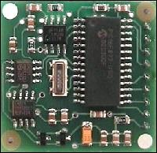
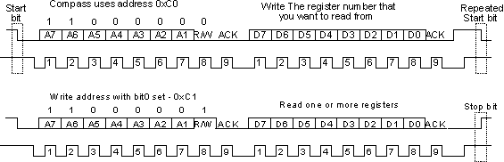
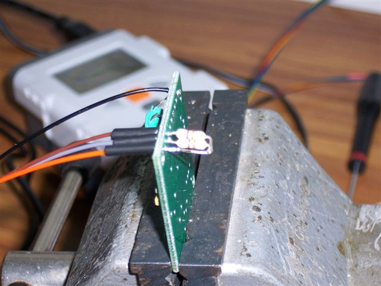
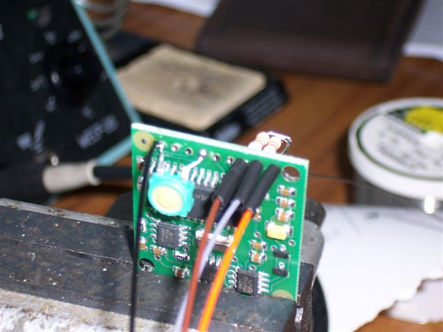

Cette boussole a été spécialement développée pour les besoins d’aide à la navigation des robots, le but étant de renvoyer un nombre unique représentant l’angle du robot par rapport au Nord Magnétique.

But : se bricoler un capteur de type boussole pour le NXT, à partir d’un module "tout en un", facilement disponible dans le commerce.

## Introduction

**Module CMPS03**

Pour renvoyer l’azimut, ce module CMPS03 utilise le capteur de champ magnétique KMZ51 de Phillips, qui est suffisamment sensible pour détecter le champ magnétique terrestre. Deux capteurs, disposés orthogonalement, sont utilisés pour retrouver la composante horizontale du champ magnétique terrestre.

La consommation nominale du module est 15mA. Il y a deux manières de récupérer l’angle du module avec le nord magnétique, par interface I2C et par un signal PWM.

**Doc CMPS03**

toute la doc du capteur en 1 pdf

**Avertissement :** Enfant, ne faites pas cette manipulation. Demandez à un adulte de vous aider. A tous, les auteurs ne sauraient être tenus responsables de blessure éventuelle et/ou de dommage provoqué par de mauvais branchements électriques.

## Connexion via I2C

Le protocole de communication I2C implémenté dans le CMPS03 est le même que celui utilisé pour accéder à la très populaire EEPROM 24C04.

**Chronogramme I2C**

Premièrement, envoyer un bit de start, ensuite l’adresse du module(0xC0 par défaut) avec le bit de lecture/écriture au niveau bas, puis le numéro du registre que l’on veut lire.

**Attention**

Deuxièmement, répéter le bit de start, ensuite l’adresse du module avec le bit de lecture/écriture au niveau haut (0xC1 par défaut).  
**Attention, la documentation est fausse, il n’y a pas besoin de cette étape, j’ai passé une soirée complète à chercher, avant de remettre en cause la documentation, et de supprimer ce bout de code...**

Enfin il ne vous reste plus qu’à lire 1 ou 2 octets représentant les valeurs des registres (8 ou 16 bits) à l’instant de la demande. Les registres de 16 bits sont lus octet de poids fort en premier.

| Registre | Fonction |
| --- | --- |
| 0 | Numéro de version logicielle |
| 1 | Direction du nord magnétique codée sur 1 octet, Lecture \[0..255\] pour un tour complet (0-360°) |
| 2,3 | Direction du nord magnétique codée sur 16 bits, Lecture\[0..3599\] pour un tour complet (0-359.9°) |
| 15 | Calibration, Écriture de l’octet "255" pour initier la procédure de calibration. |

Le module CMPS03 est conçu sans résistances de tirage pré-cablées, afin de permettre une meilleure gestion du bus au niveau du maître I2C. Le bus I2C nécessite des résistances de tirage sur les deux lignes, une seule fois pour tout le bus. Les valeurs de résistance recommandées par Devantech sont 10K pour 100KHz, 1,8K jusqu’à 400Khz, et 1,2K (ou même 1K) jusqu’à 1,3 Mhz. Au delà de 160Khz, ils préconisent d’ajouter un délai de 50µs de chaque coté de l’écriture de l’adresse du registre, par précaution.  
J’ai câblé des résistances de tirage de 82K, comme préconisé par LEGO.

**Résistances de tirage I2C**

## Calibration

Avant de calibrer le module, repérez les points cardinaux précisément. Rappelez vous que ce sont les pôles magnétiques, pas géographiques. Trouvez une boussole à aiguille, et vérifiez. Posez le module CMPS03 à l’horizontal, composants au dessus. Dégagez l’espace autour du module de tous éléments magnétiques, électriques ou ferreux, et pensez à enlever votre montre.  
Il y a deux méthodes, l’une logicielle, l’autre mécanique.

Par bouton poussoir (le truc vert sur le module) :  
\-\* mettre le module à plat, pointez le nord, appuyer ;  
\-\* recommencer pour l’est, le sud et l’ouest.

Par I2C (non implémenté dans mon code) :  
\-\* mettre le module à plat, pointez le nord, écrire 255 (0xff) dans le registre 15 ;  
\-\* recommencer pour l’est, le sud et l’ouest.

Vous pouvez câbler une LED entre la patte 5 et le 5V (avec résistance de limitation de courant de 390ohm), comme indicateur de calibration. En effet, cette patte passe à l’état bas pendant la calibration, et haut le reste du temps (non testé).

**Réalisation cablage bus I2C et poussoir de calibration**

## Code

Un PC avec [Brixcc](http://bricxcc.sourceforge.net/), [NBC/NXC](http://bricxcc.sourceforge.net/nbc/), et un NXT avec le « [enhanced firmware by John Hansen](http://bricxcc.sourceforge.net/lms_arm_jch.zip) »

//Code pour la connexion via I2C d'une boussole Devantech CMPS03 //Aucune espèce de garantie ou de copyright sur le code, faites //en ce que vous voulez. #include "NXCDefs.h" //Vous pouvez plugger la boussole sur l'un des 4 ports, en le //déclarant dans votre code (variable port\_CMPS). //Recupération du registre 1, donnant l'azimut sur 8 bits (0-255), précision de 1,4°. byte Get\_azimut1(byte port\_CMPS) { byte i2c\_readazimut1\[\]={0xC0, 0x01}; // @I2C 0xC0, registre 0x01 byte i2c\_data\[\]; // buffer byte result; // resultat byte bytes\_ready; // nb bytes reçus //Initialisation de connexion I2C avec la boussole Devantech CMPS03 SetSensorLowspeed(port\_CMPS); // données brutes, raz du capteur //Ecriture à @I2C 0xC0, registre 0x01, attente de 1 byte do {result = LowspeedStatus(port\_CMPS, bytes\_ready);} while (result > 0); LowspeedWrite(port\_CMPS, 1, i2c\_readazimut1); //Lecture du registre, et reception dans le buffer do {result = LowspeedStatus(port\_CMPS, bytes\_ready);} while (result > 0); LowspeedRead(port\_CMPS, bytes\_ready, i2c\_data); return i2c\_data\[0\]; } //recupération des registres 2&3, donnant l'azimut(\*10) sur 16 bits (0-3599), précision de 0,1°. int Get\_azimut2(byte port\_CMPS) { byte i2c\_readazimut2\[\]={0xC0, 0x02}; // @I2C 0xC0, registre 0x02 byte i2c\_data\[\]; // buffer byte result; // resultat byte bytes\_ready; // nb bytes reçus //Initialisation de connexion I2C avec la boussole Devantech CMPS03 SetSensorLowspeed(port\_CMPS); // données brutes, raz du capteur //Ecriture à @I2C 0xC0, registre 0x02, attente de 2 bytes do {result = LowspeedStatus(port\_CMPS, bytes\_ready);} while (result > 0); LowspeedWrite(port\_CMPS, 2, i2c\_readazimut2); //Lecture du registre, et reception dans le buffer do {result = LowspeedStatus(port\_CMPS, bytes\_ready);} while (result > 0); result = LowspeedRead(port\_CMPS, 2, i2c\_data); if (result == 0) {return ((i2c\_data\[0\]\*255 + i2c\_data\[1\])/10);} } task main() { int i; while(1) { NumOut(2, LCD\_LINE2, Get\_azimut1(IN\_1)); NumOut(0, LCD\_LINE3, Get\_azimut2(IN\_1)); Wait(200); } }

## Tests grandeur nature

Pensez à éloigner la boussole au maximum de vos moteurs, 20 cm minimum. En deçà, la boussole se transforme en un grand détecteur de fonctionnement des moteurs.  
Dans le cas où les mesures seraient trop perturbées par les moteurs, et que vous ne puissiez pas éloigner plus la boussole, pensez à effectuer vos mesures à l’arrêt !

La précision de la mesure est de l’ordre de 2/3° en mode précis, et de 3/5° en mode rapide, ce qui est déjà pas si mal, et permet bien des "rattrapages".
