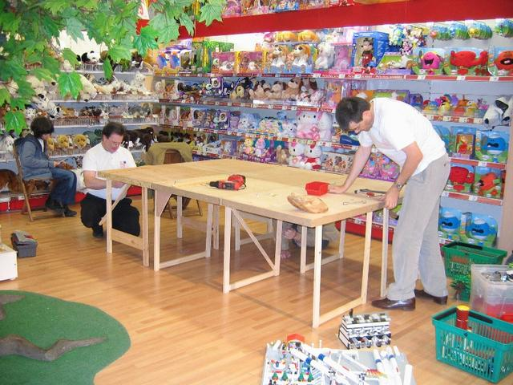
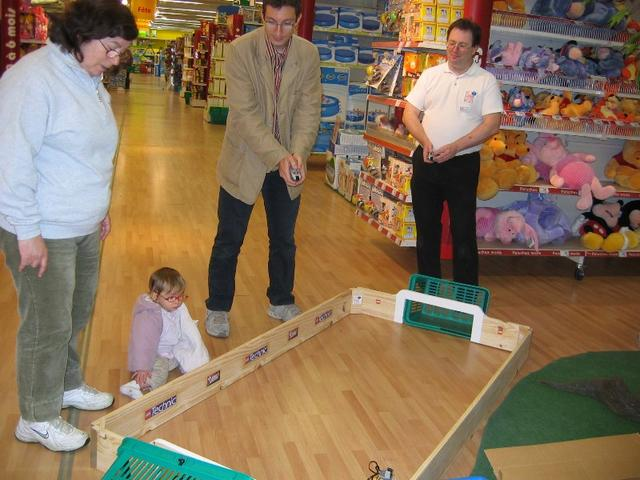
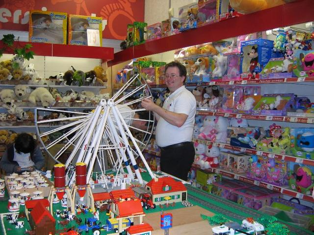
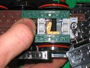
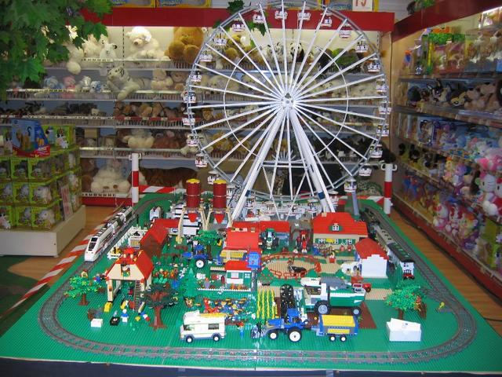
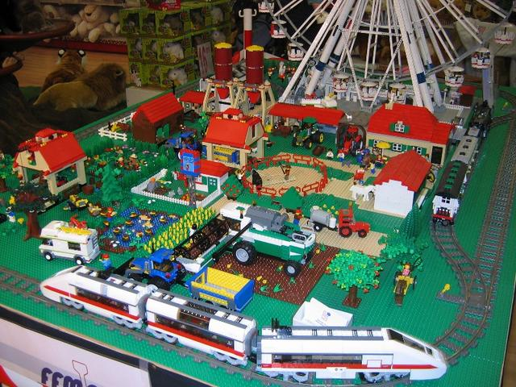
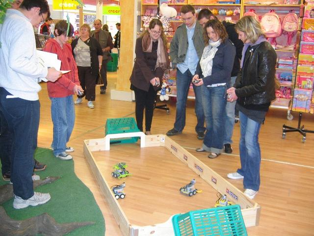

Toujours le même objectif dans le cadre de ces animations : présenter aux visiteurs du magasin à la fois ce qu’ils peuvent trouver dans les boîtes actuellement en rayon du magasin et quelques exemples de nos réalisations.

Nous nous sommes donc retrouvés Daniela, la famille Huyard, Denis et moi-même, de bonne heure le samedi matin afin d’installer notre petite animation.

Rapidement les tables...

...et le terrain de Techball ont été mis en place.

Il a évidemment fallu ensuite attendre le montage de la grande roue de Denis pour que notre show commence à tourner.

Nous avons également profité de ce petit diorama pour essayer le nouveau train "Emerald Night" en motorisation PFS, en limitant toutefois ses évolutions dans l’attente du chargeur d’accu.

Cet essai nous a confronté à un petit défaut de conception/réalisation qui occasionnait un blocage des engrenages.

Un démontage et une remise en place "propre" ont permis de résoudre le problème et "l’Emerald Night" a ensuite pu assurer son service parfaitement.

Du coté de la ferme, nous avons pu mettre en évidence toutes les dernières nouveautés.

Nous avons même pu présenter une exclusivité, qui n’est pour l’instant disponible que dans un seul magasin Parisien, le nouveau camping car, dont le design nous faisait penser à quelques réalisations d’un designer Québécois bien connu chez FreeLUG.

Côté Techball, le "public", surpris, ne s’est pas fait prié pour prendre les commandes des robots de Gilles, Didier et Daniela. Petits et grands ont tenté de conduire la balle indisciplinée vers les cages, mais, il faut bien l’avouer, les difficultés ont été grandes et le découragement quelquefois précoce. Une amélioration d’ergonomie de pilotage sera peut-être à étudier pour l’accessibilité aux joueurs novices.

**Le mot de Daniela :**  
Pour moi, ce week-end était surtout le début d’une saison d’expositions et de rencontres. J’avais hâte de retrouver le public et les amis dans une nouvelle aventure.

Il est vrai que je me suis bien amusée durant ce week-end et j’ai bien aimé animer le terrain de Techball. Les gens se sont laisser prendre au jeu et il n’était pas rare de voir des familles entières autour du terrain. A ma grande surprise les filles et les mamans, au début plutôt hésitantes, ont bien apprécié de se mesurer aux garçons et aux papas pendant ces matchs.

En conclusion, je pense, qu’il faudra un terrain de Techball pour toutes nos expositions ;-)

**Le mot de Gilles :**

N’ayant pu me libérer le samedi, ce n’est que le dimanche que j’ai rejoint tous le monde.  
C’est beau quand tout est monté ;-) et surtout moins fatiguant.

Pour cette exposition, n’étant pas très riche en ferme, j’ai juste participé en réalisant 4 robots pour le techball. Ayant testé tous seul mes robots (et pas très longtemps), c’est sur place que je me suis rendu compte que l’entrainement directe des roues n’était pas forcement le meilleur choix, la vitesse que cela donne aux robots les rendait difficilement manoeuvrables, mais efficace pour marquer des buts avec la méthode de la toupie (rotation sur place rapide) en espérant que la balle aille dans le bon but ;-)

Encore un bon dimanche de passé.

**–** [La galerie de Daniela :](http://photos.freelug.org/main.php/v/Daniela+et+Sylv1/Expositions/2009-mai+PIC+WIC/)  
**–** [La galerie de Gilles (contient juste des photos des 4 techball) :](http://photos.freelug.org/main.php/v/gmifr/Expositions/PICWIC-200905/)

Un bien bon week-end où nous avons pu commencer à parler de l’organisation de notre rencontre lors du futur Salon des Passionnés de La Ville Du Bois (91) mi-novembre 2009.
