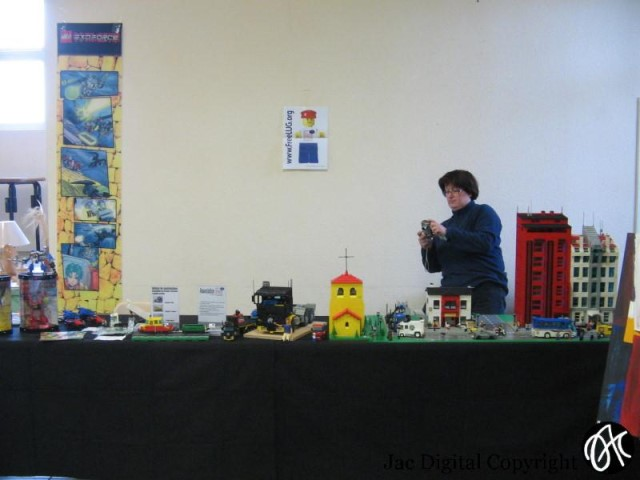

Pour une fois, ce n’est pas coutume, je suis invité à participer à une fête de village, celle de la St-Georges à Palladuc dans les Bois Noirs du Haut Forez, au Nord du parc du Livradois Forez dans le Puy de Dôme. Les briques LEGO ont encore voyagé...

Levé un peu tôt en ce dimanche matin, je ne fus pas ébloui par le soleil. En effet, ce dernier ayant décidé d’être absent toute la journée, et de remplacer ses rayons par des sceaux d’eau, c’est sous la pluie que j’arrive dans le petit village...

J’avais prévu de présenter des camions, une partie de ma collection qui commence à dater, et une rue de ville un peu animée. Sur place, j’étais en train de préparer les tables, aidé des organisateurs, et de quelques artisans déjà présents, et j’ai eu le plaisir de voir arriver la famille Goberville. Du coup, j’ai été bien aidé pour le déballage et le montage.

**Vue complète du petit stand...**

La journée se passa sans gros problème et le stand en a ébahi plus d’un, autant petit que grand. Nous avons passé une agréable journée malgré la pluie incessante. Un excellent repas nous attendait pour le midi, servi sur place, au chaud, dans une petite ambiance sympathique.

Pas beaucoup de photos pour cette petite exposition, mais le temps ne s’y prêtait guerre. Je n’ai pas beaucoup de chance lors des expositions artisanales, [comme celle de Busséol](/articles/772/). Et pourtant, je suis persuadé que nos constructions en briques y ont une place. Alors, ce sera pour une prochaine...

Dans la galerie, une vue des superbes tableaux réalisés par... bin, euh, je ne sais plus. Mais, c’était vraiment très beau !

Jac/Jérôme

* * *

[Galerie photos](http://photos.freelug.org/main.php/v/JAC/Exposition/Palladuc-2009/)
