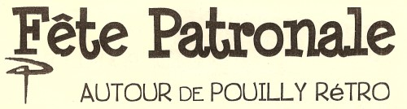
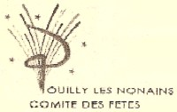
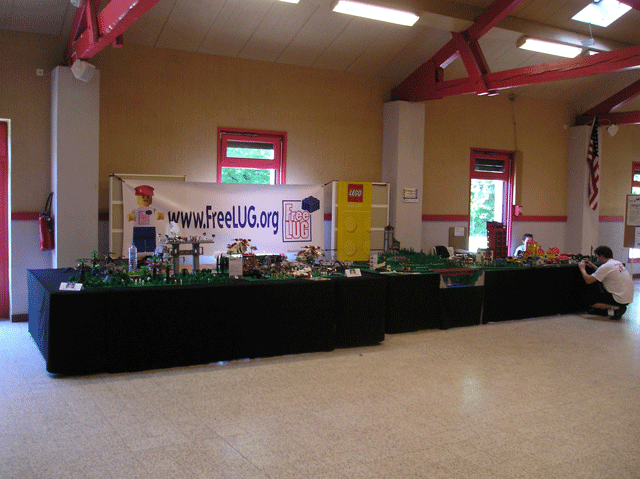
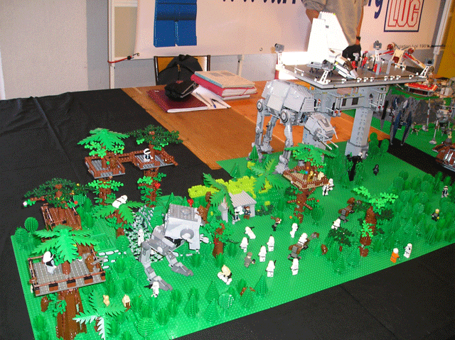
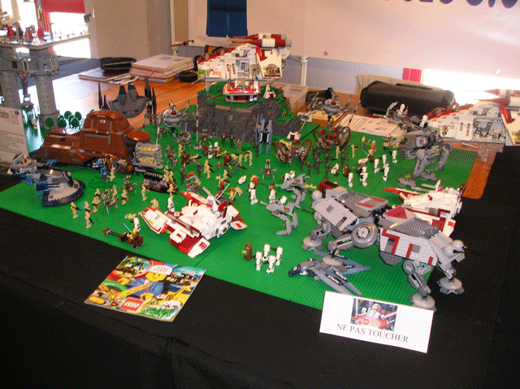
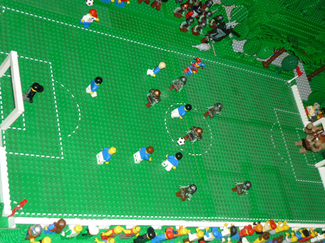
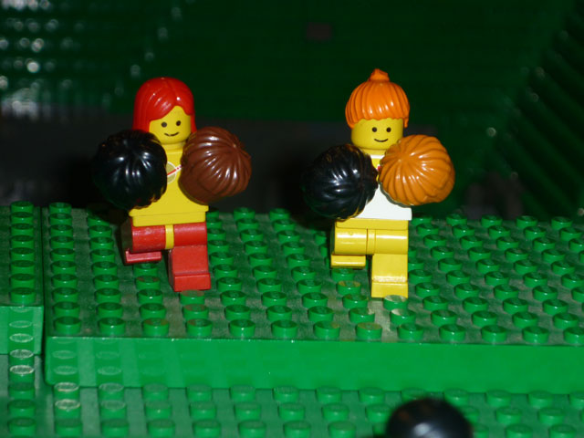

J’ai été invité à Pouilly-les-Nonains pour la première fois l’année de création de FreeLUG, il y a 6 ans... C’était en mai 2003.

J’avais présenté mes courses de camions sous un petit chapiteau, dans une des rues du village. Depuis, régulièrement, lors de nos autres présentations, je croise le couple Dunez, membre actif du service des fêtes de Pouilly-les-Nonains. Ce que l’on fait leur plait beaucoup, et du coup, nous avons été invité une deuxième fois. Mais là, avec beaucoup plus de place, une bonne partie de la salle des fêtes que pour nous, et beaucoup de FreeLUGiens attendus. Malheureusement, les aléas de la vie ont fait que seuls les frères Laurenge ont pu répondre à l’appel. Ce qui n’a pas empêché les BàB d’être une nouvelle fois présents grâce au prêt des tables que nous avons assemblées dès notre arrivée, tôt le matin. En effet, il fallait qu’un maximum de choses soient installées pour 10h00, alors, ce fût une journée qui a commencée très tôt, vers 5h30 !

Mais, il n’y eut aucune déception, durant ce fabuleux week-end dans le Roannais. L’accueil a été, comme promis par les organisateurs, impeccable. Nous avons été "aux petits oignons". Une fois le stand installé, c’est à dire le dimanche vers 16h - non, je rigole - vers 12h le samedi, tout était vraiment en place, nous avons été nourris, logés, et même blanchis !

Un très bon repas familial nous attendait le samedi midi. Le samedi soir, nous avons été invité à la fête du village, avec repas géant, 280 personnes, et puis, danse auvergnate et country nous ont bien remué... Nous avons pu enfin nous reposer vraiment correctement chez l’habitant. C’était d’ailleurs très agréable, et calme. Et donc nous avons rejoint frais et dispo notre stand le dimanche matin, pour prendre le petit déjeuner, avec des croissants. Nous avons encore pu prendre un excellent repas le dimanche, dans une très bonne ambiance.

Vous avez peut être l’impression que nous avons fait que manger, mais, c’est que par là, je veux vraiment remercier l’organisation qui nous a très bien accueillis. Une pensée aussi pour "monsieur micro", Gilles je crois, qui a présenté plusieurs fois notre stand pendant ces deux jours. Même s’il n’y avait pas Spok(!!), c’était très sympathique.

Le plus dur, comme toute exposition, étant le dimanche soir quand il faut tout ranger, et tout recaser dans la voiture. Mais, c’est vite oublié, en rapport aux 2 jours d’amusements intensifs...

**Un très grand merci à Monsieur et Madame Dunez**, qui se sont énormément donnés sur ces deux jours.

**Un très grand merci aussi à toute l’équipe du commité des fêtes de Pouilly-les-Nonains**. Je connais moins mais ils se reconnaitront, et comme ça, j’oublie personne.

**Un grand merci aussi à BaB**, pour le prêt intégral des tables, montées de main de maître sans l’aide d’un membre constructeur pour nous aider...

Jérôme/JAC

* * *

**vue générale**

Pour cette nouvelle exposition, moi et mon frère avons, encore une fois, présenté des dioramas Star Wars.  
La scène de l’épisode 6 sur la planète d’Endor, et la bataille des clones contre les droides.

**Endor**

Un peu plus grand que lors de l’exposition à Monistrol, nous nous sommes encore bien amusés à mettre en scène les Ewoks. Aussi bien les Ewoks que les Stormtroopers en ont eu plein les fesses !!

**bataille clones/droides**

Un classique maintenant, cette bataille plait toujours autant auprès du public qui recherche à chaque fois divers personnages de la saga au milieu du champs de bataille.

Bien que l’on présente maintenant régulièrement ces scènes de Star Wars, elles sont toujours uniques, soit par les quelques scènes cocasses, ou encore par de nouvelles techniques de combats. Les nouveautés du commerce font aussi leur apparition sur les tables au fur et à mesure de leur sortie, ce qui complète les scènes.

A côté de nous, il y avait Jac avec sa partie City. Nous l’avons aidé à rendre plus vivant sa ville et à la faire évoluer tout au long du week-end.

Il y eut même un match de foot, l’équipe de France contre des Trolls.

Le France a facilement dominé les Trolls grâce à leurs magnifiques pom-pom-girls !!

Nous avons encore passé un excellent week-end. Magnifiquement reçus, nous avons eu droit au logement, aux repas ainsi qu’au feu d’artifices !!

Merci aux organisateurs, et encore un grand merci à Jac pour passer ces week-end en sa compagnie ! ;-)

Etienne et Pierre LAURENGE

Kit Fisto et Pierrolego

* * *

**–** [Galerie JAC](http://photos.freelug.org/main.php/v/JAC/Exposition/Expositions2009/Pouilly-2009/)  
**–** [Galerie Pierrolego](http://photos.freelug.org/main.php/v/pierrel/exposition/pouilly/)  
**–** [Galerie Kit Fisto](http://photos.freelug.org/main.php/v/Kit+Fisto/Expo/Pouilly2009/)
