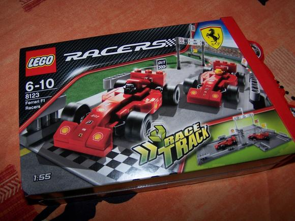
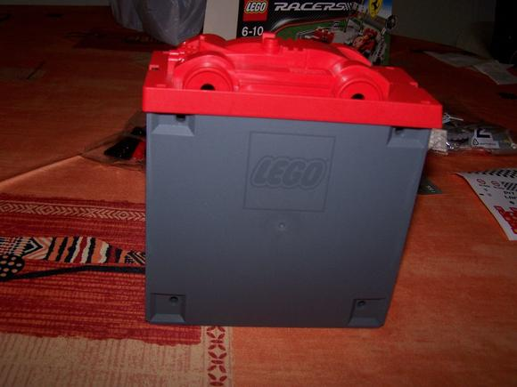
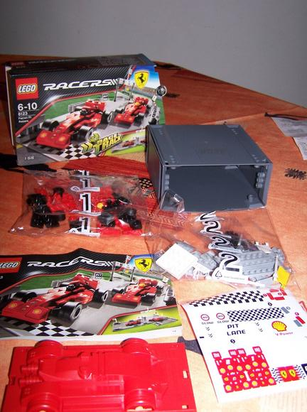
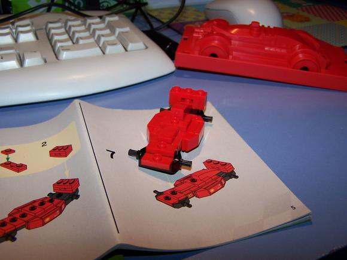
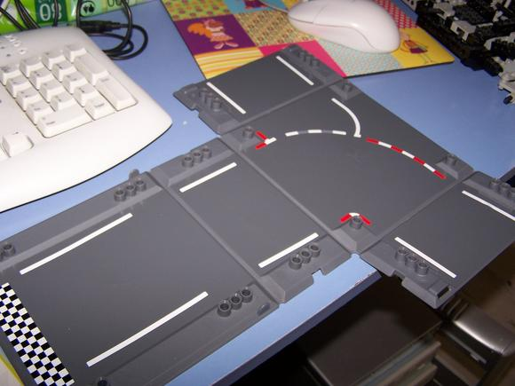
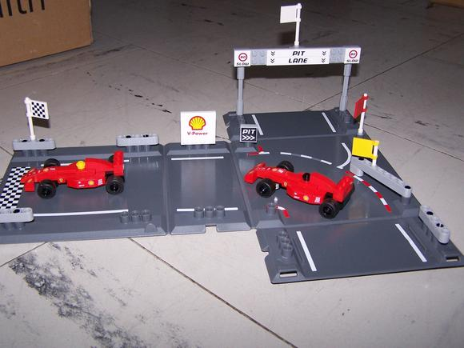
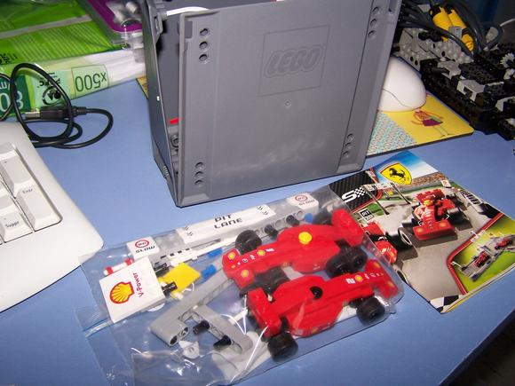

Après avoir sorti le set 8168 Ferrari Victory avec deux voitures de course intégrants des minifigs, voici un deuxième set à l’échelle 1.55, sous la référence Ferrari F1 Racers n°8123.

Dans la nouvelle gamme Racers, on trouve aussi un set dédié à Ferrari avec ce nouveau format de boîtes de stockage dont on verra l’utilité ensuite.

Car, on trouve sous la couverture représentant le produit une boite en plastique et une voiture stylisée sur le couvercle fermant la boîte.

Après ouverture, se trouve à l’intérieur deux sachets numérotés : l’un contient les briques et roues pour assembler les deux F1, l’autre le décors, ainsi que la notice de montage et une planche d’autocollant.

Après déballage et un petit tri express, commence le montage de petites Formule 1. Assez facile mais il y a beaucoup de petites pièces, dû à la petite taille de la voiture.

On passe au montage de la piste, il s’agit de la boîte que l’on déplie, on colle dessus les autocollants, la pose des accessoires se fait avec des éléments Technic.

Une fois tous ces éléments montés, on découvre une petite piste sympa permettant quelques phases de jeu sympas.  
Les deux voitures se différencient par la couleur noir ou jaune des casques des pilotes.

Après avoir joué avec ce set plutôt sympa, on peut démonter et ranger tout les éléments dans la piste qu’on aura replié et fermé.

Pour ma part, j’ai mis tout ça dans un sachet afin d’éviter que des petites pièces passent à travers les fentes de la boîte qui est simplement repliée puis fermée par le couvercle.

