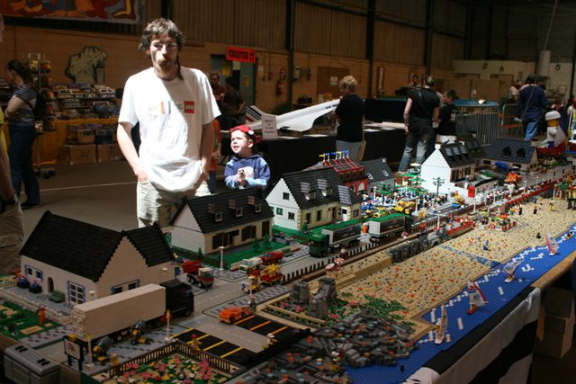
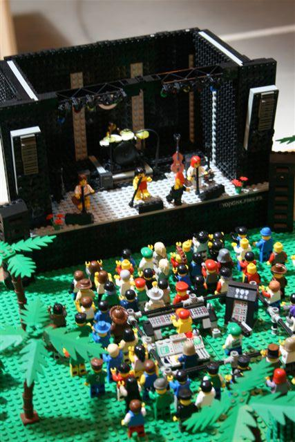
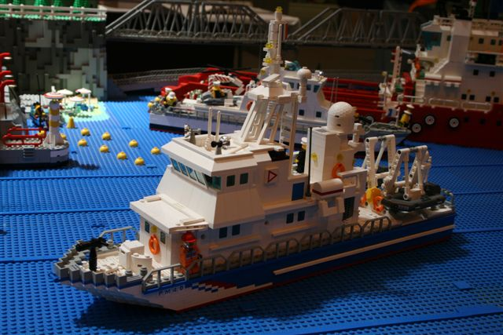
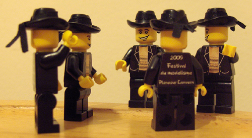

Repéré et contacté en octobre 2006 lors du [Salon de Relecq-Kerhuon](/articles/542/) prés de Brest, j’ai donné mon accord aux organisateurs de Plonéour-Lanvern pour leur 2e Salon qui s’est déroulé les 30 et 31 mai 2009.

Entre temps, le réseau (trains et ferries), que vous connaissez bien, a évolué, la section finistérienne de FreeLUG s’est enrichie de nouveaux membres (Ronan de Concarneau en particulier, depuis Quimper 2007), les autres se remettent sérieusement aux briques...

Dans ces conditions, il me paraissait naturel que la représentation legotique s’élargisse à de nouveaux membres, j’ai donc invité Ronan, et... Vincent Meew de BeLUG. Ce dernier, plus breton que belge, m’a fait l’amitié de venir et montrer au public un superbe diorama breton (10m2).

Le stand FreeLUG avait donc une surface de 30m2 avec au programme : trains et ferries, diorama breton belge, collection minifigs et scène de festival rock. Plus de 1800 visiteurs sont venus nous voir, un chiffre remarquable malgré la crise et surtout le beau temps.

Le public avec nos réalisations legotiques a vivement apprécié tous les détails. Durant les 2 jours, nous avons reçu de futurs membres (Yann, Dominick, Mickael...), nous serons dans la dizaine pour la rentrée. Notons la présence fort sympathique de Boris et son fils venus spécialement de Redon.

J’ai présenté en avant première un nouveau bateau, un patrouilleur des Affaires Maritimes de Lorient "IRIS". En marge du salon, j’ai eu des contacts avec Reims pour un salon vers la mi-mai 2010. A voir !!!

En conclusion,les organisateurs ont été ravis de notre prestation, vive Plonéour-Lanvern 2012.

**–** [Galerie photos](http://photos.freelug.org/main.php/v/barr__/expositions/2009/Ploneour2009/)  
**–** [Article dans Ouest France](http://www.ouest-france.fr/actu/actuLocale_-Le-Festival-du-modelisme-tient-sa-place-_29174-avd-20090606-56180075_actuLocale.Htm)

jean-marc

* * *

Belle expo, beaucoup de rencontres, et une organisation au top !  
5 minifigs en costume breton Bigouden ont été réalisées pour l’occasion

et merci à vincent de Belug pour ça magnifique ville de Ploemeur et sa plage.

Ronan

* * *

Durant le week-end du 30-31 mai 2009, s’est tenu un salon à Plonéour-Lanvern, dans le Finistère (sud), non loin de Quimper où Jean-Marc Barre, Ronan Coïc et Vincent Meeuw ont présenté plusieurs maquettes.

Quelques 1800 visiteurs ont pu admirer nos réalisations durant ces deux jours de salon avec une nocturne du samedi jusqu’à 23h, tout cela dans une ambiance amicale et joviale.

Pour la première fois, mon diorama "Bretagne" a pu être exposé en "BRETAGNE" ! Les réactions ont été nombreuses tout comme ceux de la maquette à Jean-Marc. Ronan avec ses minifigs n’était pas en reste.

L’organisateur a mis les petits plats dans les grands pour qu’un traiteur nous prépare nos repas et faire de ce salon une très belle réussite mais aussi de donner l’envie d’y retourner.

Vincent Meeuw de BELUG (invité d’honneur)
