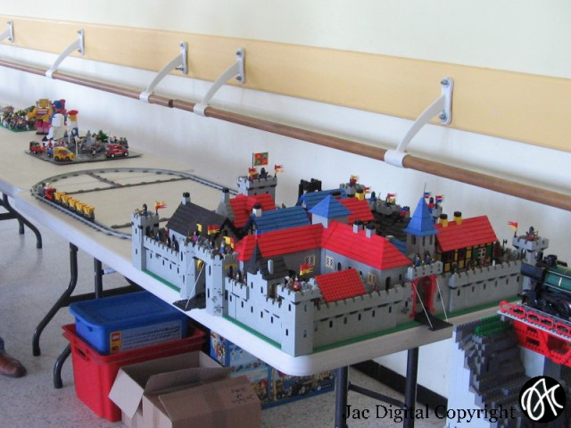
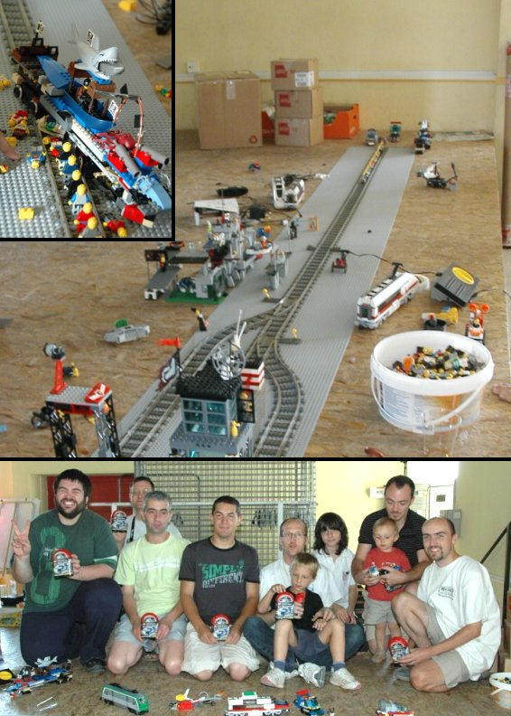
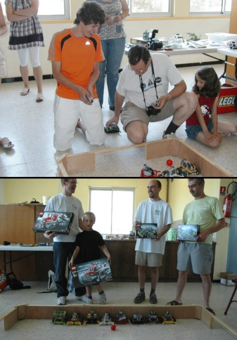
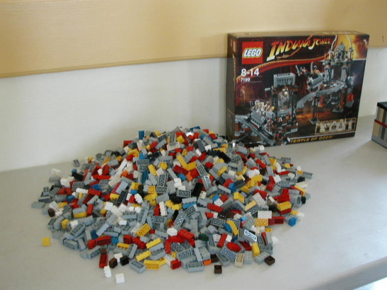
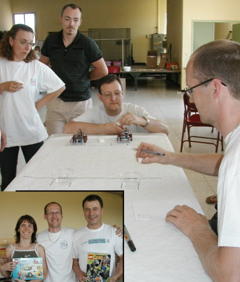
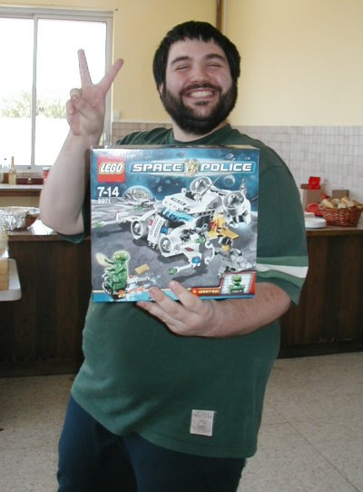
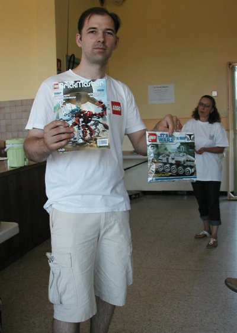
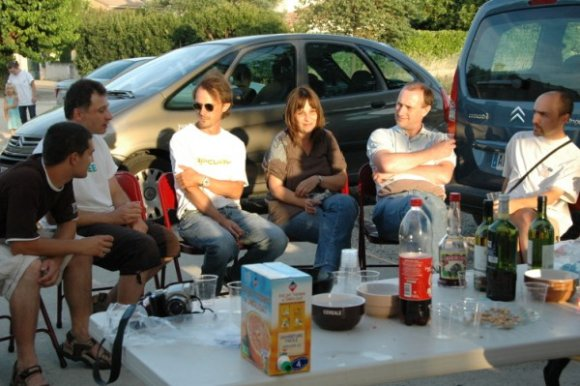
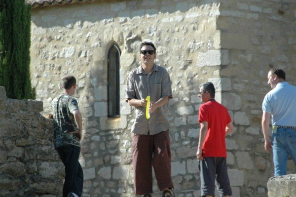

Comme chaque année, la rencontre estivale est l’occasion de se retrouver dans une nouvelle région, le temps d’un week-end qui fut certainement trop court.

## Les participants

On aurait pu souhaiter plus de monde, peut-être que l’éloignement de la rencontre, la date ou alors la concurrence féroce du concert de U2 au Stade de France y sont pour quelque chose. Toujours est-il que ce sont seize AFOLs qui se sont retrouvés, certains en famille, pour ce week-end du 14 juillet dans le sud de la France.

Une rencontre loin des préoccupations quotidiennes, permettant de se remettre pour la plupart de leur participation à [Fanabriques](/articles/948/) (ou encore la [Japan-Expo](/articles/949/)) dans une ambiance détendue, conviviale et familiale.

Un coucou également aux passionnés qui sont passés en visiteur pour partager quelques instants, notamment Jean-Yves ([voir sa maquette](http://jyd.maquette.free.fr/)), Gilles de BeLUG ou ce jeune passionné venant spécialement de la région de Montpellier.

## Les réalisations

La REF, c’est l’occasion de venir montrer ce que l’on a envie, que ce soit des créations finies ou non, quelque soit le thème, la taille. Ou même venir les mains dans les poches :)

Jac est venu avec sa vallée traversée par un pont rail, ainsi que quelques créations. Avec beaucoup d’efforts, il a réussi à faire venir un ami passionné discret, Frank, qui a proposé une ville médiévale fortifiée intégrant les éléments de la gamme moyen-âge des années 80, ainsi qu’un train motorisé en voie étroite.

**Stand de Franck**

Village médiéval, et train de la mine

Julien proposait un petit diorama Fabuland, Xavier des modules GBB. Pierre avait, lui, pensé à préparer des éléments pour un _Où est Charlie_. Quant à Pierrick, il a eu la flemme d’installer ses jardins du Taj Mahal.

## Le bull-train

Premier concours officiel de [bull-train](/articles/933/), les participants s’affrontaient avec des créations réalisées à l’avance ou à l’aide du stock de pièces mis à disposition par Pierrick. Nolanne nous a construit un superbe gabarit permettant la vérification de la taille des bull-trains avant le départ.

Classement (basé sur la somme des minifigs renversées des 2 runs de seconde manche)

| Participant | Manche 1 | Manche 2 | Total |
| --- | --- | --- | --- |
| David | 13-16 | 29-15 | 44 |
| Sylvain | 6-8 | 16-24 | 40 |
| Marc | \- | 16-21 | 37 |
| Pierrick | 20-19 | 17-16 | 33 |
| Killian | 11-21 | 10-15 | 25 |
| Jac | 11-11 | \- | 22 |
| Pierre | 3-2 | 12-8 | 20 |
| Nicolas | \- | 9-10 | 19 |
| Erik | 8-12 | 9-9 | 18 |
| Bastien | 5-11 | 6-7 | 13 |

Chaque participant repart avec un Racers 8120.

## Le tournoi de Techball

Là où va Pierrick, le Techball fait la part belle au Technic. Un tournoi de [Techball](/articles/862/) était en effet à nouveau proposé. Pierrick a bien fait puisque, [comme à l’AG](/articles/879/), il remporte avec son fils le tournoi face à l’équipe constituée d’Erik et Christophe. Pour les vainqueurs, la nouvelle dameuse Technic 8263, pour les seconds, le kart Technic 8256.

Classement du tournoi de techball

**Quart**

- Pierre - Guss  
  4
- Marc - Alexandre  
  0
- Christophe - Erik  
  4
- Xavier - Sylvie  
  0
- Nicolas - Jean-Yves  
  1
- Julien - Xavier  
  4
- Sylvain - Renaud  
  1
- Pierrick - Bastien  
  3

**Demi-finale**

- Pierre - Guss  
  1
- Christophe - Erik  
  3
- Julien - Xavier  
  2
- Pierrick - Bastien  
  5

**Finale**

- Christophe - Erik  
  3
- Pierrick - Bastien  
  4

## Le Tas de Briques

Une activité simple consistait à évaluer le nombre de briques d’un tas de briques dont la valeur était inconnue de tous.

**Tas de briques**

Le tas de briques, très dur de trouver la quantitée, même pour les experts.....

Des volontaires se sont donc chargés de compter les 3008 briques du lot.

Aux questions subsidiaires, les réponses sont :  
**–** Nombre de briques 2x4 : 1933  
**–** Nombre de briques 2x2 : 1075  
**–** Nombre de briques bleues : 164

Celui qui s’est approché le plus de la bonne valeur fut David avec 2800 briques. Il remporte la nouvelle mine d’Indiana Jones (désolé Marc pour la fausse joie, le bulletin de David s’étant bien caché au fond de l’urne...).

## Le sucrage de café

Sur les 10 sucres à catapulter, un seul participant a atteint la barre fatidique de trois lancés réussis :)

En tête, nous avions donc Nicolas (3 sucres), Jac et Sylvie avec 2 sucres. Neuf participants n’ont mis qu’un seul sucre, tandis que 13 autres n’y parvenaient pas du tout ! Pas facile d’être un bon nain catapulteur.

Sylvie finit par remporter le tournoi tandis que Jac et Nicolas s’éternisait sur une mort subite, où les tasses se multipliaient sur la table afin de faciliter le jeu !

## Le tirage au sort

Le chanceux du jour fut encore David, qui repart avec un 5971.

## Les enchères

Didier proposait des pièces et sets Technic, ainsi que des modèles exclusifs Brickmaster, à la vente aux enchères dont les recettes serviront à financer d’autres événements FreeLUG.

Si les enchères étaient plus calmes au début, les participants ont joué le jeu sur les exclusivités StarWars !

## Les repas

Samedi soir, Jean-Yves nous a préparé sa spécialité, la paella.

Dimanche midi (enfin, après-midi), Jean-Yves, aidé de Sylvain et d’un Pierrick dépassé par un barbecue fait maison, a remis la main à la cuisine pour nous servir viandes et saucisses.

Un grand merci aussi à Stéphanie et aux autres compagnes pour la préparation des buffets.

## La ballade

Samedi en fin d’après-midi, une ballade dans Vénéjan nous permettait de découvrir ce charmant village provincial adossé à un flanc de montagne. Félicitations aux mariés que nous avons croisés dans les ruines ;)

## Les prolongations

Le choix du week-end prolongé du 14 juillet était l’occasion pour certains de rester un peu plus de temps. Nous nous sommes donc retrouvés pour la moitié le lundi pour découvrir la région, notamment une visite au village du Barry et à l’inévitable Pont du Gard. La journée s’est achevée par un barbecue tardif chez Sylvain qui faisait découvrir les entrailles de sa boutique 1001bricks aux nouveaux venus, au lieu de s’occuper des côtelettes qui sont sorties du congélateur à 22 heures...

Un grand merci à Pierrick et Stéphanie pour l’organisation du week-end, à Jan Beyer pour les lots des activités, et à tous les participants !

## Galeries photos

Toutes les photos pour essayer d’illustrer ce week-end  
**–** [Galerie d’Erik](http://photos.freelug.org/main.php/v/brickerik/expositions/2009/REF2009/)  
**–** [Galerie de Xavier](http://photos.freelug.org/main.php/v/XavierD/REF2009/)  
**–** [Galerie de David](http://photos.freelug.org/main.php/v/guss/evenements/REF2009/)  
**–** [Galerie de Jac](http://photos.freelug.org/main.php/v/JAC/REF/REF-2009/)
