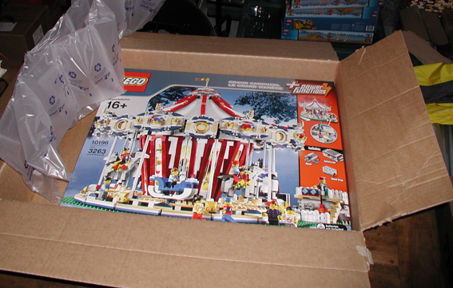
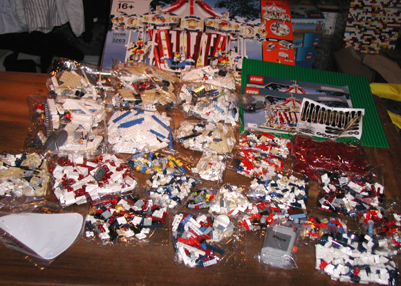
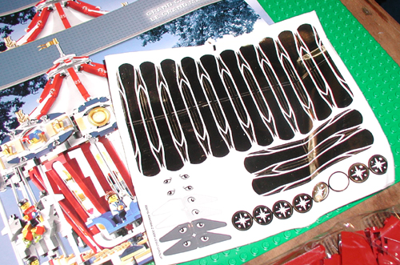
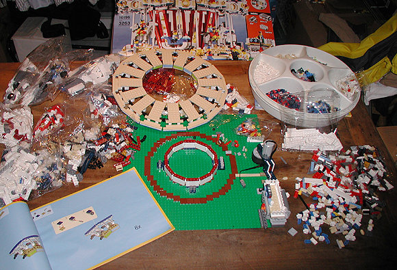
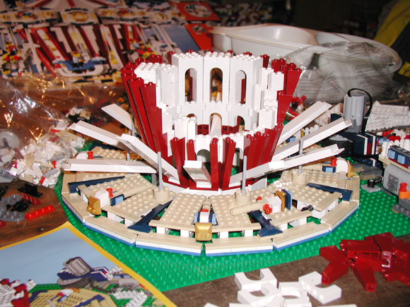
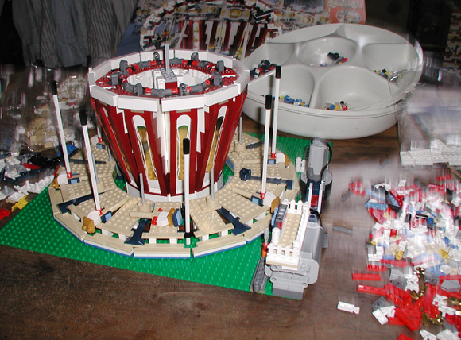
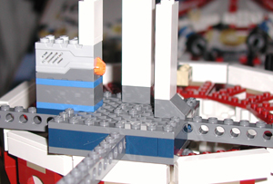
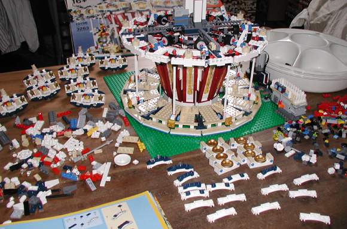
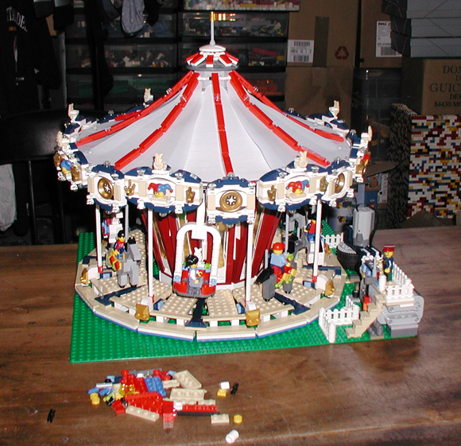

Pour la [prochaine exposition de Saint-Rambert](/articles/913/), j’avais dans l’idée de faire "un truc" pour agrémenter le parvis du nouveau quartier des affaires. Et voici que LEGO propose une nouveauté qui pourrait faire l’affaire. Ni une ni deux, hop une p’tite commande pour voir ça de plus près. Et puis une boîte de plus de 3000 pièces ça devrait être sympa à monter (et au pire, ça fera des pièces ;-) ).

Aussitôt, je passe commande et quelques jours plus tard je reçois le (gros) colis.

Puis ouverture et étalage des 28 sachets de pièces et de la notice de montage de 120 pages en deux fascicules. Les sachets sont bien dotés !

Mais premier problème : la planche d’autocollants est froissée et, pire , 3 autocollants manquent (retrouvé collés dans l’intérieur du carton mais inutilisable). Pour une boîte à 250 euros, je trouve que sur ce point là, LEGO peut mieux faire (il va falloir que j’appelle le service consommateur de LEGO pour avoir une planche propre et complète) ! Mais bon il y a aussi une plaque 48x48 verte !

Après avoir soigneusement trié les pièces, le montage commence : facile on commence par le bas :

Et après il suffit d’empiler les briques...

Jusqu’à la boîte à musique qui joue vraiment une petite musique quand le manège tourne.

Enfin un peu de montage en série pour les décorations de la bâche

Et voila, c’est fini !

Et alors ?

Franchement, j’ai eu énormément de plaisir à monter cette boîte (environ 12h de montage). Le modèle fini est magnifique et peut parfaitement se retrouver dans les expositions au milieu de MOCs : le manège tourne, les chevaux montent et descendent comme les vrais avec une mécanique à came comme les vrais, et la musique joue ! que demander de plus.

Oui, vraiment un beau modèle ’train-ville’.

Une petite critique quand même : la motorisation. Le manège tourne, mais l’entrainement n’est pas top, et c’est sûr, pour St-Rambert, il va falloir que je modifie la motorisation pour que cela soit fiable en exposition.

Conclusion : n’hésitez pas. Très beau et bon modèle (et beaucoup moins cher qu’un SW pour plus de 3000 pièces) dans un thème relativement nouveau pour LEGO, celui de la fête foraine. Vivement les prochaines attractions sur ce thème comme les autotamponeuses avec du PF ou une chenille !

CDHD
