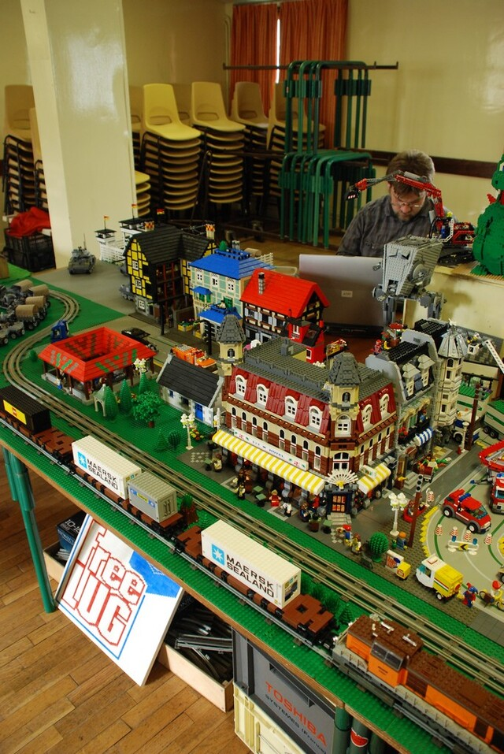
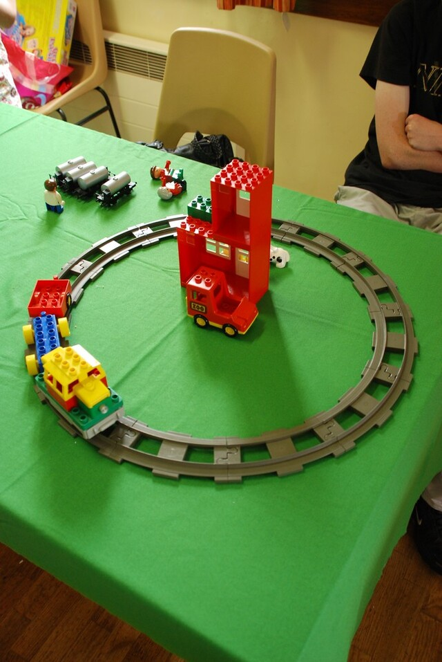
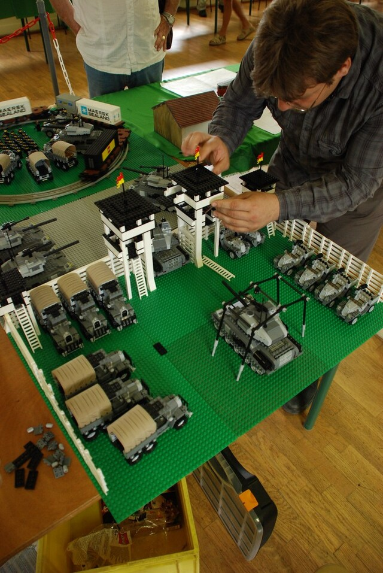

Florence, Médérik et moi, avons été contactés quelques jours auparavant pour participer à cette petite exposition locale.  
Pour sa première édition, nous étions peu nombreux, mais la bonne humeur était présente.

Faute de temps, nous n’avons pas pu préparer un "layout" complexe. Nous avons donc simplement pris des éléments de réseau précédemment présentés, et nous avons improvisé sur place en fonction des tables disponibles.

C’est donc assez rapidement que le réseau a pris forme, et qu’une locomotive 12V a tourné toute seule toute la journée. Les autres exposants trains n’ont pas fait tourner leurs machines, ou très peu, car vu l’échelle, la boucle aurait été trop grande. Ils ont donc du se contenter de faire quelques aller-retours, et de présenter de façon statique leurs machines.

La fille d’une des exposants était venue avec son train DUPLO... Peut-être une adhérente FreeLUG dans quelques années ?

Notre réseau quant à lui était très mélangé, avec une partie ville au milieu, Médérik et sa base militaire sur la gauche. Florence à droite, elle, s’est improvisée une île pirate avec la série de cette année.

Au fond, quelques modèles Technic, Créator, et StarWars ont pris place.

Peu de visiteurs, mais le plus important était leur qualité. :) J’ai en effet rencontré un spécialiste LEGO StarWars, passé par là par hasard. J’ai pris contact avec lui. Sa collection doit être impressionnante, car il collectionne les boites neuves de la série StarWars, non ouvertes, et donc jamais montées (MISB pour les connaisseurs). C’est une autre forme de collection, que je ne connaissais pas.

Sinon, comme d’habitude, une journée d’exposition c’est trop court !

Le démontage et le rangement ont été rapides... Vivement la prochaine exposition (pour ma part LEGOWORLD si tout va bien...)

Pascal (Le Gnome)

[Les Photos](http://www.brickshelf.com/cgi-bin/gallery.cgi?f=390392)
