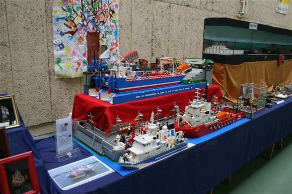

Les 18 et 19 juillet 2009 s’est tenu le premier salon estival de la maquette et du modèle réduit organisé par l’A.M.C.L à Tréflez (Finistère nord, Bretagne, France, Europe, Terre, etc.).

A cette occasion, des maquettistes indépendants, quelques grands clubs de la maquette finistérienne (Crozon, le Relecq Kerhuon, Brest, Morlaix) et... de la petite brique ont apporté leur parrainage au tout nouveau venu du modélisme.

Malgré une fréquentation honorable (350 visiteurs), le plateau concocté par les organisateurs était très varié : trains HO, maquettes de bateaux, d’avions, commerçants de l’Aisne, Allemands, et votre dévoué serviteur qui a présenté deux dioramas sur une surface d’1.50m de long : barge animée et un nouveau port qui prendra place dans mon grand réseau.

Bien évidemment, le public a vivement apprécié mes réalisations surtout le bateau qui bouge. Des questions m’ont été posées au sujet des pièces détachées LEGO en particulier (bricklink).

Pendant les 2 jours, j’ai fait la pub pour notre prochain salon en mai 2010, le stand LEGO sera agrandi, plus d’information après Cholet.

Prochain salon : la Foire Sainte Catherine à Mespaul , dimanche 26 juillet, on attend 7000 visiteurs.

[Galerie de photos de Tréflez](http://photos.freelug.org/main.php/v/barr__/expositions/2009/Treflez2009/). Regardez bien deux photos qui vous rappelleront une boîte LEGO.

Jean-Marc
