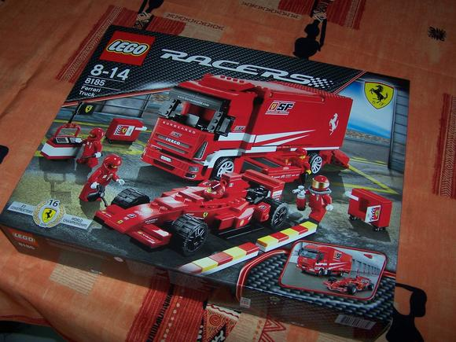
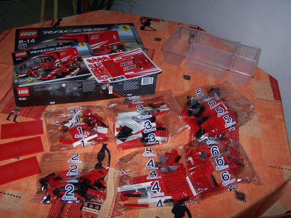
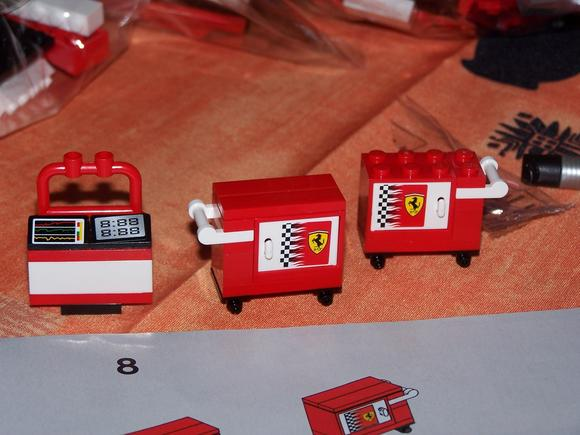
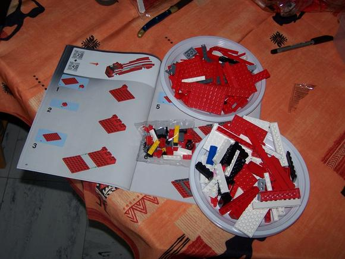
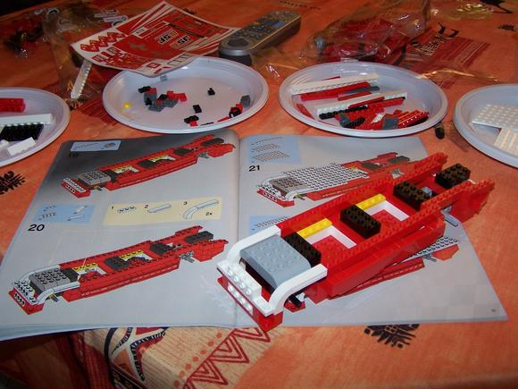
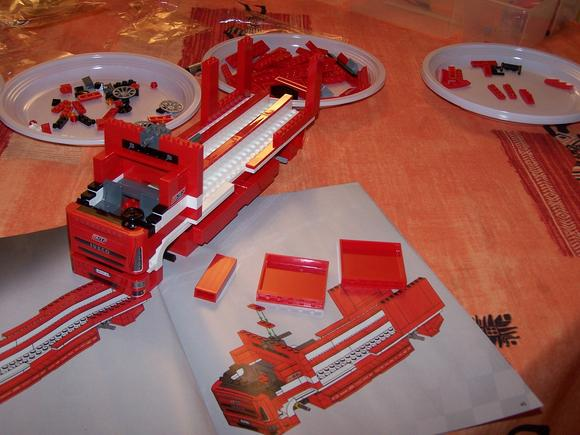
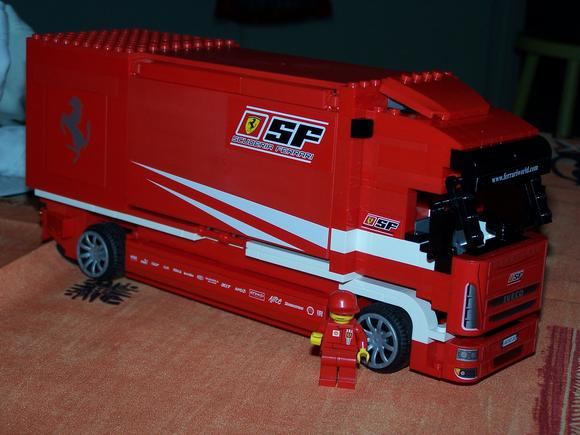
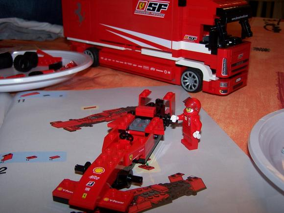
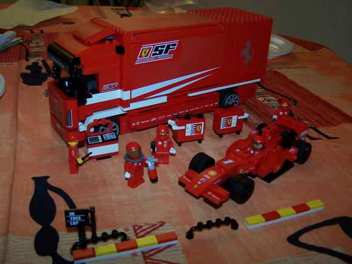

LEGO nous sort un nouveau set de la gamme racers Ferrari « le camion Ferrari ». Après le semi-remorque, il s’agit d’un camion de type porteur, avec une formule 1 et cinq minifigs.

La boîte est de grande taille et vendue 79.90eur, composée de 534 pièces regroupées dans 6 sachets.

Après un bref tri, le montage commence par le sachet n°1 qui contient les minifigs, ordinateur, servantes à outils et autres outillages.

On découvre que les roulettes des servantes sont fictives ce qui est plutôt dommage pour le jeu à mon goût.  
Les minifigs sont similaires aux autres minifigs de la série.

Après le montage des éléments extérieurs (servante, poste informatique, vibreurs), je passe au montage du camion.

Le montage semble être plutôt aisé, avec des briques classiques, grande plaques et quelques pièces Technic, avec un plan bien détaillé.

Après quelques pages, le camion prend forme. Il y a deux tiroirs entre les essieux, pour ranger les outils des minifigs.

Après quelques instants de montage et collage des différents autocollants (logo, bandes blanches, calandre et pare-chocs), on dispose d’un porteur Iveco plutôt sympa proche du précèdent modèle ([set n°8654](http://www.brickset.com/detail/?Set=8654-1)).

On passe au montage de la Formule 1. Il n’y a pas d’évolution par rapport aux dernières versions sorties. On retrouve la version destinée aux minifigs vue par exemple dans le set [8168](http://www.brickset.com/detail/?Set=8168-1).

Un set vraiment sympa dans la continuité de cette gamme racers « Ferrari ».

Deux point négatif tout de même :  
**–** C’est la sensation d’avoir de la difficulté pour ranger le matériel et les personnages, avec l’impression de tout tasser dans le camion.  
**–** Et le prix qui me semble un peu élevé.
