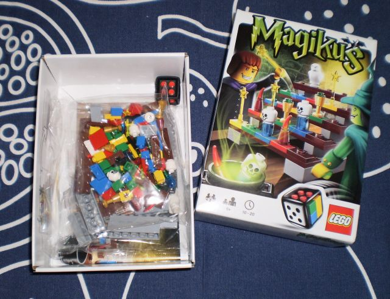
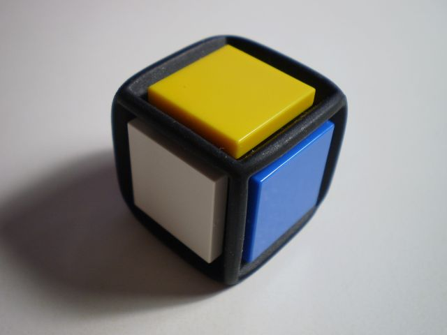
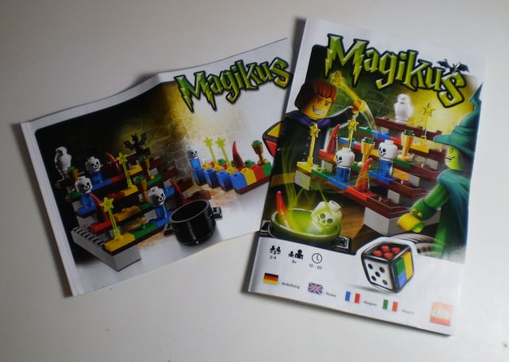
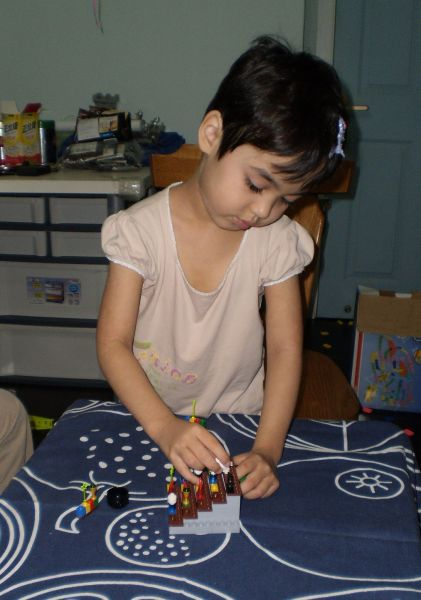
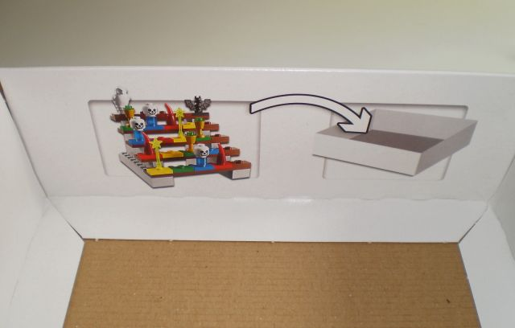

Dix jeux à tester, c’est le pied ! Mais par lequel commencer ? Je n’hésite pas trop longtemps, car bien sûr je vais commencer par les petits et me réserver les plus grands pour la fin. Je donne le choix à ma fille : Magikus ou Robo Champ ?

Ce sera Magikus, car bien sûr cette idée de potion magique a l’air bien alléchante. Même s’il s’agit d’un petit jeu annonçant 10 à 20 minutes de jeu, il s’agit tout de même du premier jeu de société LEGO que j’ouvre, aussi l’excitation est présente aussi bien chez ma fille que chez moi.

Toutes les boîtes de jeu de société LEGO sont sous blister car contrairement aux boîtes en carton des sets traditionnels, destinées à être jetées par les enfants (même si certains AFOL les gardent religieusement), les boîtes des jeux de société LEGO sont censées être conservées pour ranger tout le matériel.

Je déchire donc le plastique promptement et j’ouvre la boîte par le dessus. La boîte se présente comme une boîte classique de jeu de société, à savoir un couvercle s’emboîtant complètement sur la boîte elle-même.

**Ouverture du sésam**

Première surprise, la boîte n’est pas d’aussi bonne qualité que les boîtes de jeux de société traditionnels. Il s’agit d’une boîte faite à partir d’un carton plié et collé ; j’ai donc un peu peur pour la solidité à long terme. Il n’y a pas non plus de socle en plastique thermoformé pour ranger les pièces comme on en trouve habituellement dans les "vrais" jeux de société. M’enfin, si LEGO faisait des jeux de société, ça se saurait, non ? :-)

Bref on trouve dans la boîte deux sachets de pièces, deux notices et le fameux dé magique : je l’observe et je monte ses faces prestement, pendant que ma fille commence le montage du plateau de jeu. Deuxième surprise, le dé semble gros. Mais comme je l’indiquais dans l’[article précédent](/articles/974/), on s’y fait rapidement.

**Le dé LEGO une fois monté**

La boîte contient en fait une notice de montage tout ce qu’il y a de plus classique avec la liste des pièces à la fin, ainsi qu’un livret de règles en allemand, anglais, français et italien. Il faut dire que j’ai acheté les boîtes à un allemand, donc il se pourrait que ce livret de règle existe dans d’autres langues pour d’autres régions du monde (peut-être anglais et espagnol pour le marché américain ?).

**La notice et les règles du jeu**

Comme toujours lorsque j’achète une nouvelle boîte de LEGO, ma fille veut la monter. Je vous passerai donc les détails du montage qui est trivial, pour vous décrire succinctement les règles. Elles sont plutôt simples et même si la boîte indique que l’âge minimum est de 6 ans, ma fille de 4 ans n’a eu aucun problème à jouer.

A son tour de jeu, on effectue deux actions : d’abord on déplace la chouette blanche pour indiquer sur quelle ligne ou quelle colonne on mise, ensuite on lance le dé. On peut alors récupérer un ingrédient de la couleur indiqué par le dé sur la ligne ou la colonne où l’on a placé la chouette blanche.

**Ludivine déplançant la chouette blanche**

Le but est de récupérer les 4 couleurs d’ingrédient pour faire la potion. D’autre part, si le dé s’arrête sur le blanc, c’est un joker on peut prendre la couleur qu’on veut, s’il s’arrête sur le noir, on peut alors voler un ingrédient à un autre joueur.

Les règles précisent aussi qu’une fois qu’un joueur a les quatre couleurs il doit les mettre dans le chaudron pour gagner. Autant dire que la présence du chaudron dans cette boîte est purement décorative. Mais puisque TLC nous invite à modifier les règles, j’ai aussi exiger que le joueur touille son chaudron en prononçant les mots "Magikus Mordicus". Non mais !

Justement, parlons du changement des règles. TLC fidèle à son esprit de jeu de construction, communique sur le fait que les joueurs peuvent "construire" de nouvelles règles. Est-ce réellement réalisable ?

La règle du jeu se présente en trois pages intitulées : CONSTRUIRE, JOUER, CHANGER. La page CHANGER propose quelques conseils pour adapter les règles, comme le faire tous ensemble, ne changer qu’une règle à la fois, tester et garder les meilleures règles, etc.

Cette page propose aussi des variantes, comme l’utilisation de la chauve souris comme bloqueur de ligne ou bien comme ingrédient supplémentaire. La boite possède aussi des briques 1x1 supplémentaires, permettant de piocher les recettes au hasard (au lieu de tous avoir la même composée des 4 couleurs différentes). Ces recettes pouvant rester secrète ou non, etc.

Finalement les possibilités de variantes s’avèrent beaucoup plus diversifiées que je ne l’avais imaginé. Le livre de règles nous invite d’ailleurs à publier nos propres règles sur le site de [LEGO](http://jeux.lego.fr/).

**Un conseil à l’intérieur de la boîte**

Après quelques parties à trois joueurs, c’est l’heure de ranger pour écrire cet article, et surprise l’intérieur de la boîte nous indique qu’on n’est pas obligé de démonter le modèle et qu’on peut le ranger tout monté dans la boîte. Sans blague ? Heureusement que LEGO est là, je n’y aurais pas pensé... <:o)

## Mon impression

Une finalement très bonne impression pour ce premier petit jeu. Rapide et très simple, il est très accessible même aux enfants très jeunes contrairement à ce qu’indique la boîte. Bien sûr les jeunes enfants ne verront pas qu’ils auront tout intérêt à choisir les lignes ou colonnes les plus remplies afin de maximiser leur chances au dé, mais comme au final c’est le hasard qui décide. Ils s’amuseront tout autant et auront aussi des occasions de gagner.

Si vous êtes frileux sur la gamme LEGO Jeux de Société, je vous le recommande donc car son "petit" prix vous permettra d’entrer en douceur dans ce nouveau monde ludique.

A bientôt pour la revue de la boîte Robo Champ.
