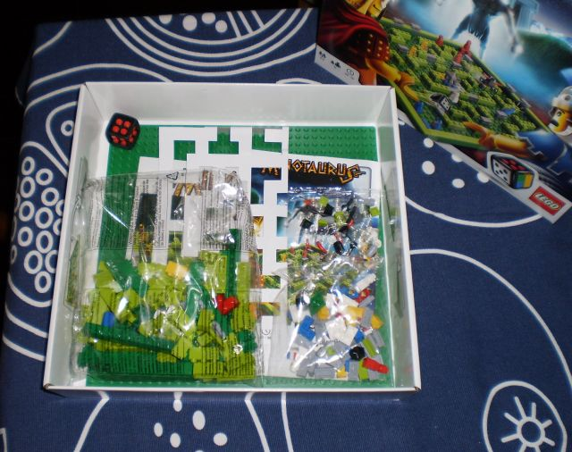
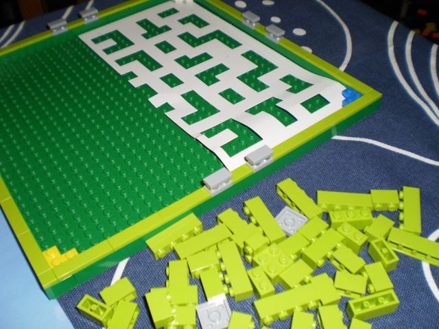
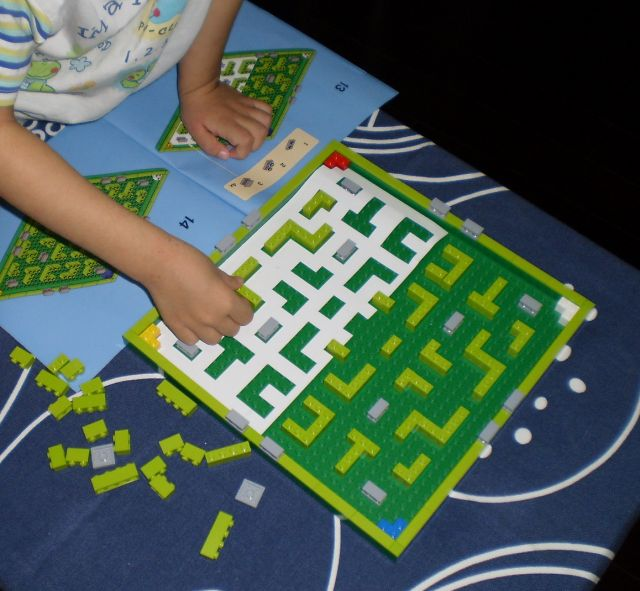
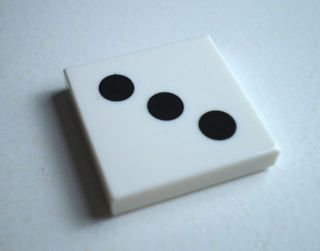
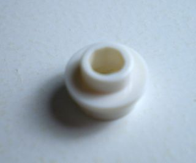
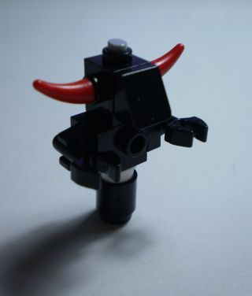
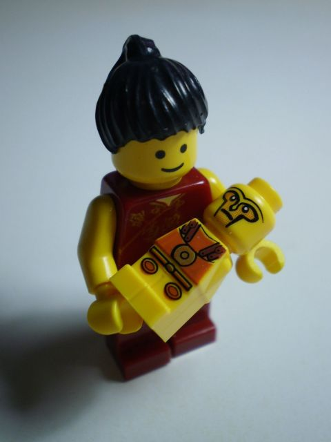
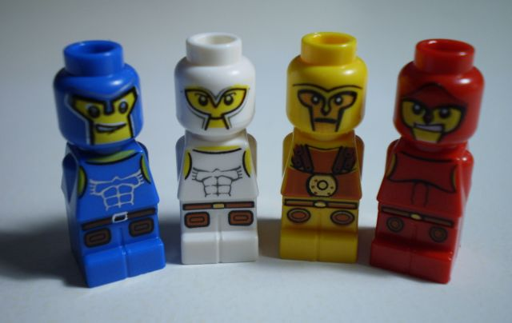
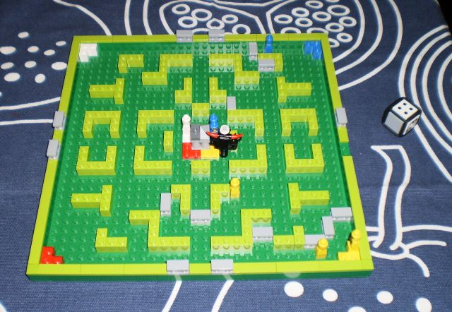
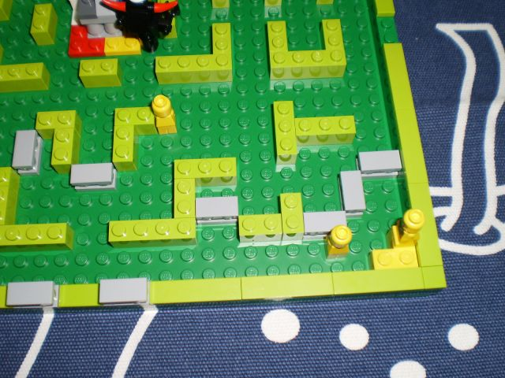

Je vous avais promis de tester Robo Champ en deuxième, malheureusement c’était sans compter le bon vouloir de ma fille. Pour éviter la crise de larme me voilà donc obligé d’ouvrir Minotaurus avec sa belle couleur vert pomme (Lime).

De toute manière, j’aime bien les labyrinthes, alors je ne vais pas bouder mon plaisir ! Comme d’habitude, voici une photo de la boîte ouverte :

**Ouverture de la boîte**

Première surprise, je remarque aussitôt la présence d’un léger carton perforé. Je me doute assez rapidement qu’il s’agit d’un gabarit pour construire plus rapidement les murs du labyrinthe. Malheureusement le carton est vraiment très léger et il s’est abimé dans la boîte. Cela n’empêche pas son utilisation mais encore une fois je doute fortement de sa durée de vie, surtout avec tous ces trous, il risque de se déchirer facilement. Je pense que je vais le recoller sur un carton plus fort.

**Gabarit pour monter les murs du labyrinthe plus vite**

Le gabarit couvre la moitié de la plaque car le labyrinthe est symétrique. A noter tout de même qu’il faut bien faire attention à respecter la notice de montage si on veut pouvoir monter tous les murs. Ma fille ayant utilisé deux briques 1x3 pour un mur en L au lieu d’une brique 1x2 et d’une brique 1x4, j’ai passé un bon bout de temps à retrouver l’erreur.

**Le gabarit est symétrique**

Cette boîte m’offre aussi la première occasion de vous montrer une tile 1x2 avec le dessin d’une face de dé classique (en l’occurrence ici un 3).

**Tile 2 x 2 servant de face de dé**

Mais ce n’est pas la pièce la plus intéressante du set, loin de là ! En effet cette boîte nous offre une nouvelle pièce extraordinaire qui va faire rêver plus d’un MOCeur, et c’est la deuxième surprise ! Une plate 1x1 ronde percée (dans laquelle on peut faire passer une barre) :

**Nouvelle pièce !!**

Cette pièce est vraiment très utile car elle permet de transformer une barre en tenon ou en tube. Il suffit d’enficher la pièce sur la barre pour pouvoir ensuite l’emboiter sur un tenon (avant on pouvait aussi utiliser une brique 1x1 ronde avec open stud, mais l’encombrement est plus important). Vivement que cette pièce soit produite massivement dans toutes les couleurs. Je lui prédis un aussi bel avenir et une aussi belle popularité que la slope 1x1 (aussi surnommée cheese part).

Et chose incroyable cette pièce n’est utilisée que pour représenter la ceinture du Minotaure, c’est à dire qu’elle est purement décorative et loin d’être essentielle au montage. Mais je pense que, comme toutes les nouvelles pièces, elle est utilisée plus largement dans d’autres boîtes de la gamme.

**Le minotaure**

Le Minotaure justement parlons-en. Il est monté sur une barre 1x4 (sabre laser) qui le traverse de tout son long. La raison est claire, c’est pour éviter que le Minotaure ne se désassemble à chaque fois qu’on le déplace. La barre le traversant dans toute la hauteur assure sa solidité.

Sinon qu’y a-t-il d’autre dans cette boîte ? Des bébés minifigs bien-sûr !

**Oh le joli bébé !**

En fait s’il s’agit de mini-minifig large de un tenon seulement, fait d’une seule pièce, et qui servent de pions dans les jeux de société LEGO. Mais avouez qu’ils feront de jolis bébés. Sauf peut-être si on s’attarde trop longtemps sur leur mine patibulaire, et si on chipote sur leur absence de bras.

**Allez, on se donne la main pour la photo !**

Bon et si on jouait maintenant ? L’âge recommandé sur la boîte est de 7 ans, mais cette fois encore ma fille de 4 ans a pu y jouer. La seule légère difficulté qu’elle a éprouvé a été dans le placement des murs amovibles pour bloquer les adversaires. En revanche aucun problème pour déplacer ses pions ou le Minotaure.

La règle de base est encore une fois simple : à son tour on lance le dé. Si on tombe sur un chiffre (3, 4, 5 ou 6) on avance un de ses pions du nombre de tenons équivalents (le déplacement en diagonal étant interdit). Si on tombe sur la face noire on déplace le Minotaure de 8 tenons. Et si on tombe sur la face grise on peut déplacer un mur gris pour le placer où on veut sur le plateau pour bloquer la progression des autres joueurs. Si le Minotaure touche un pion, le pion retourne à sa case départ et le Minotaure retourne au centre. Le but du jeu étant d’atteindre l’acropole au centre.

**Fin de partie**

Notre première partie s’est déroulée très vite, à peine un ou deux murs ont été déplacés. Comme j’ai trouvé cela un peu décevant, j’ai changé les règles pour la deuxième partie : j’ai retiré la tile 2x2 de 3 points du dé LEGO et je l’ai remplacée par une autre tile grise (en provenance de mon stock), augmentant ainsi les chances de déplacer les murs.

Et là effectivement, ma fille n’a pas arrêté de déplacer les murs, alors que mon épouse me harcelait avec le Minotaure. Bien que mon épouse était en tête de la partie et aurait dû donc être la cible des blocages, une alliance féminine m’a quasiment emmuré vivant !

**Acharnement enfantin**

Pour ce qui est des règles alternatives, la boite possède une tile 2x2 verte pour remplacer la grise, et qui permet aux pions de sauter par dessus les haies (les murs verts). Bien sûr le livre de règle suggère aussi de disposer les murs différemment afin de créer différents labyrinthes, mais qui n’y aurait pas pensé ?

Personnellement, j’ai bien aimé mon petit ajustement de probabilité, et c’est dommage que TLC n’ai pas pensé à mettre une deuxième tile grise dans la boîte. Une fois encore cela prouve que de nombreuses variantes sont possibles !

## Mon impression

Encore un jeu amusant, mais pas au premier abord. La règle de base précise qu’à 3 ou 4 joueur il suffit d’amener un seul de ses pions à l’acropole (et deux pions si on joue à deux), et je pense que c’est pour réduire la durée du jeu. Mais franchement, je trouve le jeu trop court ainsi.

Après de petites modifications, comme amener tous ses pions au centre pour gagner, ou bien augmenter les probabilités des murs sur le dé, le jeu devient un peu plus stratégique et donc plus intéressant. Aussi il vaut mieux jouer à 3 ou 4 joueurs car alors des alliances sont possibles pour bloquer un joueur qui prend trop d’avance, alors qu’en un contre un, la confrontation manque de suspens.

Mais au final si le jeu devient meilleur en construisant ses propres règles, c’est bien que TLC a réussi exactement ce qu’elle souhaitait faire avec cette gamme !

Je ne peux donc, encore une fois que vous le recommander...

A bientôt pour une nouvelle revue de set.
