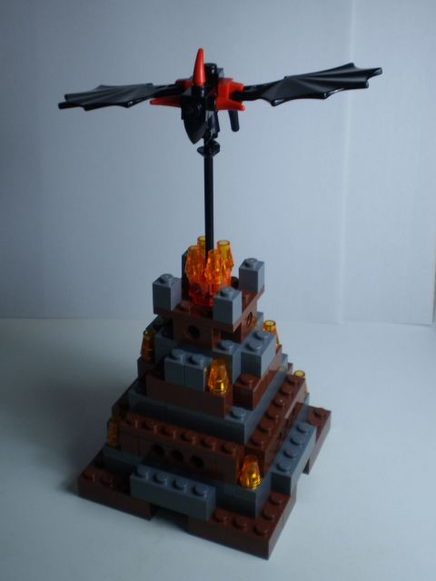
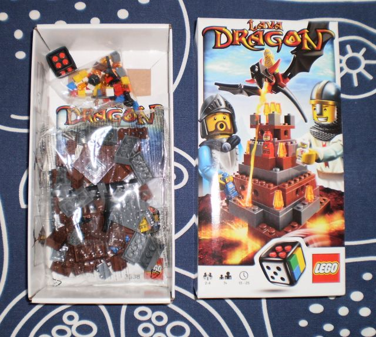
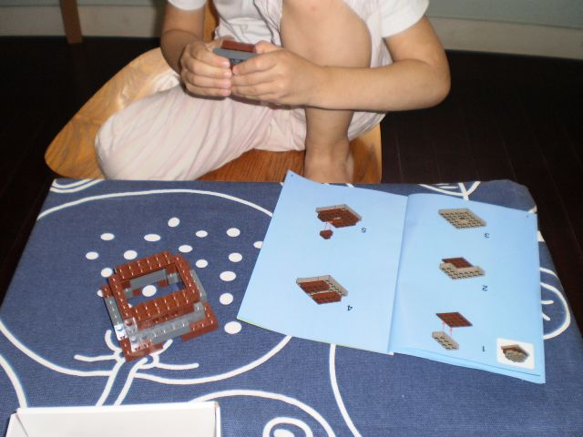
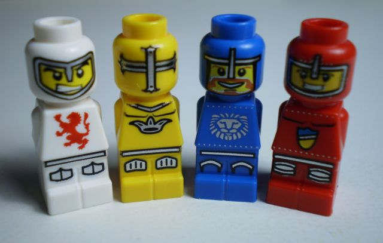
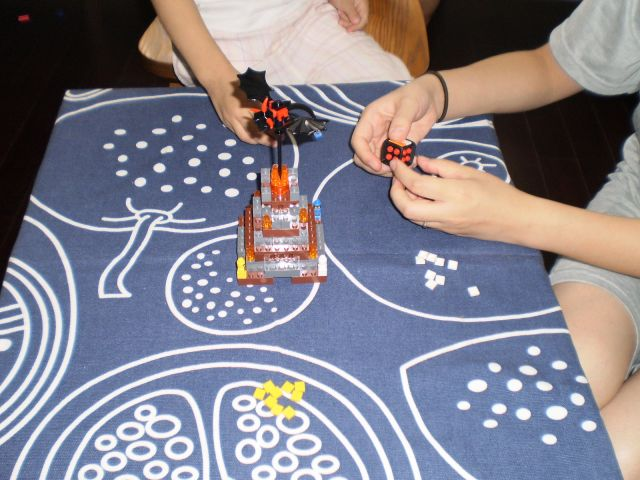
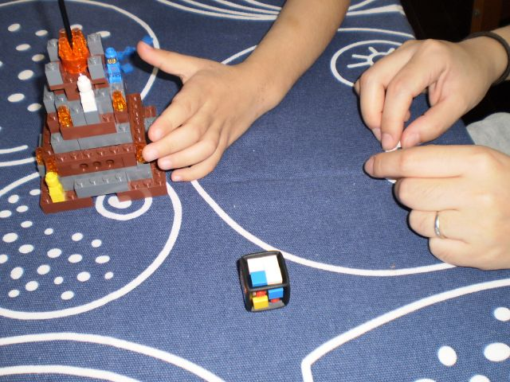

Les petites boîtes ayant été testées, montons en régime avec les boîtes moyennes. Une fois encore, c’est ma fille qui a décidé de jouer à Lava Dragon.

Autant vous le dire tout de suite, je n’étais pas très attiré par cette boîte, car je trouvais l’espèce de pyramide marron/grise plutôt hideuse. D’autant qu’à part une crotte de dinosaure, je ne voyais pas très bien ce que c’était censé représenter.

**Mais qu’est-ce que c’est que ce truc ?**

En lisant les règles, on apprend qu’il s’agit d’un volcan surmonté d’un dragon. Bon pourquoi pas, mais je le trouve particulièrement haut pour un volcan...

A l’ouverture de la boîte, cette fois-ci pas de grande surprise si ce n’est le petit sachet qui contient un nombre impressionnant de tiles 1x1.

**Ouverture de la boîte**

Comme à son habitude, ma fille attaque le montage du volcan, et là je dois dire que c’est plutôt désastreux. Au lieu d’utiliser des grandes briques de 2x10 ou 2x8, les designers ont utilisé des briques plus modestes à emboîter en décalé ; autant dire que ce n’est pas vraiment solide et ma fille m’a finalement laissé monter la base.

**Construction du volcan**

Les designers ont dû rajouter des plates pour renforcer la solidité, ce qui fait que certains niveaux de la pyramide sont plus hauts que d’autres (jusqu’à deux plates de plus), or les niveaux ont une certaine importance dans le jeu. C’est d’ailleurs pour cela qu’ils ont alterné les couleurs grise et marron afin d’aider le joueur à mieux repérer les niveaux.

Tant bien que mal, on arrive à la fin du montage, et je dois dire que le dragon est lui plutôt pas mal réussi avec si peu de pièces et à cette échelle.

Avant de commencer à vous détailler les règles, voici une photo de famille des chevaliers qui vont se lancer à l’escalade de ce volcan. Vous noterez que la sérigraphie est différente de ceux de la boîte Minotaurus. Combien de mini-minifig différentes TLC a-t-elle produit ? Sont-ils tous différents dans toutes les boîtes ? Nous le verrons au fur et à mesure que j’ouvrirai les boîtes...

**Les chevaliers du volcan carré...**

Qu’en est-il du jeu maintenant ? Et bien c’est une très belle surprise ! Dans Lava Dragon, on construit le dé au fur et à mesure que la partie se déroule. Du coup, la configuration du dé est différente à chaque partie. Cette construction de dé m’a fait pensé à un jeu de cartes de société qui s’appelle [Dominion](http://en.wikipedia.org/wiki/Dominion_\(game\)), où les joueurs construisent leur propre pile de cartes au cours du jeu. Dominion est célèbre pour le plaisir qu’il procure aux joueurs de choisir leur probabilité de gagner.

**Modification du dé**

Au début d’une partie de Lava Dragon, les joueurs placent devant eux toutes les tiles 1x1 de leur couleur.

Lorsqu’ils lancent le dé, s’il reste une place libre sur la face du dé qui sort, ils peuvent placer une de leur tile. Ensuite les joueurs déplacent leur pion du nombre de tiles de leur couleur visible sur la face du dé qui est sortie. Certaines faces peuvent devenir très avantageuses pour un joueur, par exemple dans cette partie, le joueur blanc a pu placer 3 tiles blanches et pouvait donc se déplacer de 3 tenons à chaque fois que le dé s’arrêtait sur cette face :

**Trois tiles blanche sur la même face !**

Le dé possède aussi deux tiles 1x2 orange qui servent à déplacer les blocs de lave (les briques coniques 1x1 orange transparent) pour bloquer la progression des adversaires. L’ordre des actions est le suivant :  
**–** le joueur dont c’est le tour lance le dé  
**–** s’il y a une tile orange, il déplace un bloc de lave  
**–** s’il reste de la place sur la face, il ajoute une tile de sa couleur  
**–** ensuite il peut déplacer son pion s’il y a des tiles de sa couleur sur la face du dé  
**–** les joueurs suivants dans le sens horaire peuvent aussi déplacer leur pions s’ils ont des tiles de leur couleur sur la face du dé (tous les joueurs sont concernés par le résultat du dé, et pas seulement celui qui a lancé le dé).

On peut déplacer son pion d’un tenon ou d’un niveau pour chaque tile visible sur la face du dé. Les pions sont bloqués par les blocs de lave et les autres pions. Pour gagner il faut grimper en haut du volcan et ensuite d’obtenir une tile orange au lancé de dé.

J’avoue que ce principe de jeu est plutôt sympa. Néanmoins je ne suis pas fan du plateau de jeu. Je pense que le jeu aurait été plus cool avec un autre habillage. Par exemple j’aime beaucoup le plateau de jeu de Minotaurus. D’ailleurs, il serait tout à fait possible d’utiliser le système de construction de dé de Lava Dragon pour le jeu Minotaurus, faisant ainsi un singulier cross-over entre deux jeux de société LEGO. Il suffirait de remplacer la tile orange qui sert à déplacer les blocs de lave par une tile 1x2 grise qui servirait à déplacer les murs.

Les règles alternatives proposent l’utilisation d’une barre technique pour simuler une éruption volcanique et faire tomber les adversaires en cas de tile orange. D’où la présence des briques techniques à trou dans le volcan. Nous avons essayé et en pratique, cela s’avère difficile d’avoir un pion en face d’un trou, ou alors il y a un bloc de lave qui bouche le trou de l’autre coté. Bref, ça ne marche pas très bien.

Les règles alternatives proposent aussi d’ajouter une tile de cordée permettant aux joueurs de grimper plusieurs niveaux d’un seul coup.

## Mon impression

Je ne suis clairement pas fan du plateau de jeu (le volcan), mais vous l’aurez compris, j’aime beaucoup le système du jeu. A vos briques donc, pour construire une zone de jeu un peu plus fun ! L’achat du set s’avère tout de même intéressant, car il vous donnera le dé, les tiles 1x1 et les pions ! Je vous le recommande donc chaudement.

A bientôt pour un nouveau test !
