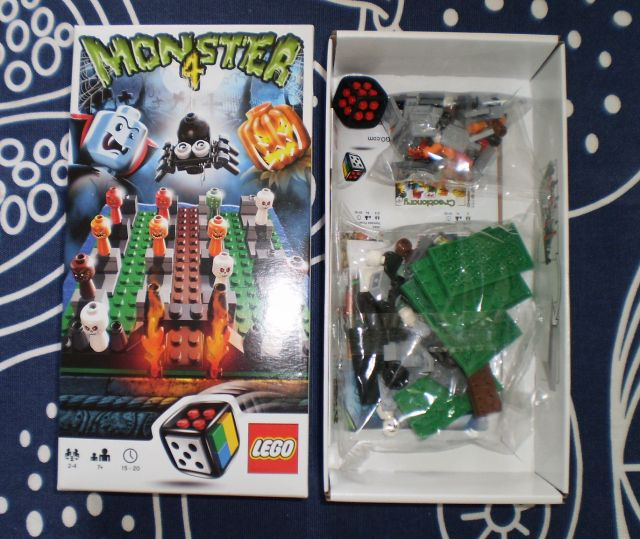
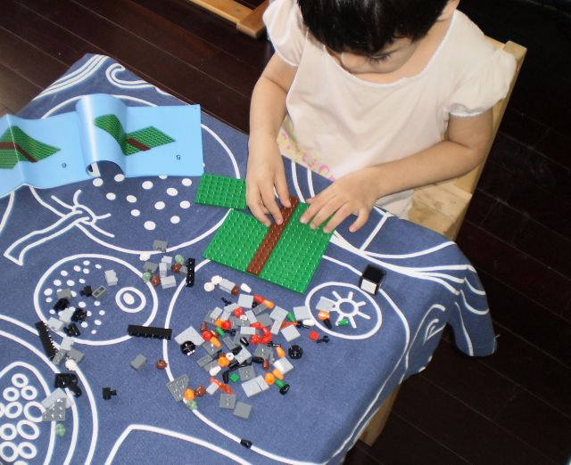
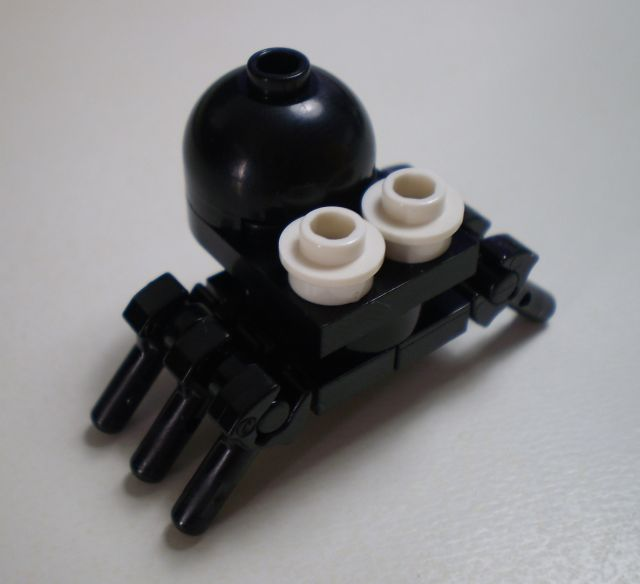
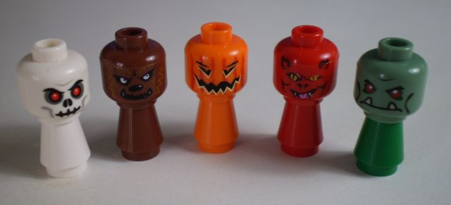
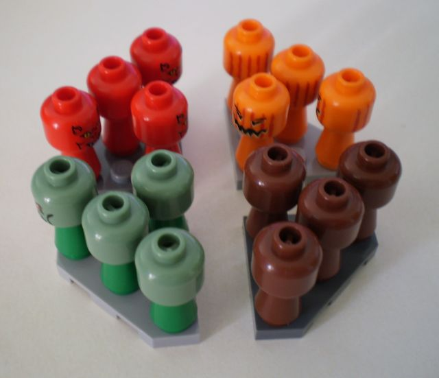
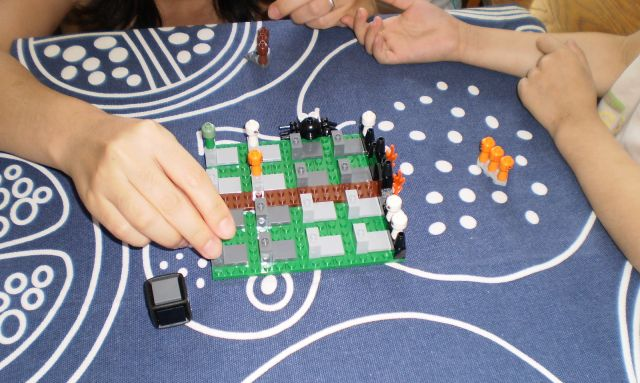
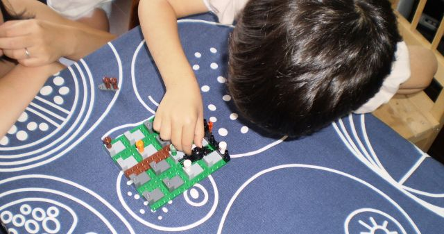
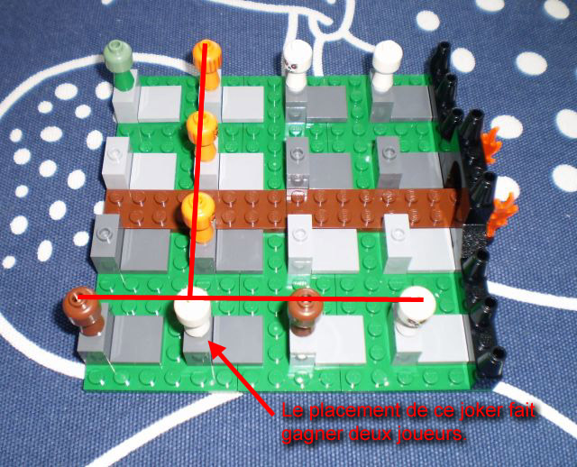

Aujourd’hui nous allons tester Monster 4 ! "Monster", j’arrive encore à deviner pourquoi, mais pourquoi 4 ? Je n’en comprendrai la raison qu’après avoir lu les règles.

Car en effet Monster 4 est à la base un "Puissance 4" ou un morpion si vous voulez. Vous me direz, quoi de plus normal, car les morpions et les monstres font partie de la même famille, non ?

Mais pour l’instant, commençons par ouvrir la boîte :

**Ouverture de la boîte**

Apparemment rien d’exceptionnel, mais où est la plaque de base ? Et bien non, curieusement, au lieu de construire le cimetière sur une plaque 16x16 verte, TLC nous demande d’assembler des plaques vertes standard :

**Construction du cimetière**

C’est d’autant plus étrange que la surface finale du cimetière fait bien 16 x 16 tenons, et que par ailleurs TLC a mis des plaques de base 16 x 16 dans d’autres jeux de société de la gamme (comme par exemple Race 3000). Cet assemblage de plates n’est finalement pas très solide, ce qui est dommage pour un plateau de jeu censé rester monté et être manipulé.

Le cimetière en lui même est assez sommaire, mais il fera l’affaire pour les besoins du jeu. En revanche j’aime bien l’araignée avec son gros abdomen.

**Une belle araignée**

Noter que dans cette boîte, les pions sont faits de tête de minifig monté sur un cône 1x1. Si la tête blanche de squelette et la verte sont déjà connues, je pense que les tête de diable rouge, de loup-garoup (ou ours ?) marron, et de citrouille oranges (différente de la citrouille existante) sont nouvelles.

**De nouvelles têtes en ville...**

Nul doute que ces nouvelles têtes seront réutilisées pour des minifigs custom, peut-être dans un nouveau diorama d’[ApocaLEGO](/articles/809/) de notre président...

Au cours de la partie, lorsque les pions ne sont pas encore placés sur le plateau, ils peuvent être regroupés sur une plate triangulaire, ce qui est assez original.

**Les pions rangés sur une plate triangulaire**

Parlons du jeu maintenant. Je vous ai indiqué au début de l’article qu’il s’agit d’un morpion, et peut-être craignez vous que l’intérêt du jeu soit vraiment limité. Mais à vrai dire deux éléments perturbent sérieusement le déroulement de la partie :  
**–** d’abord les squelettes blancs qui sont des jokers servant à tous les joueurs ;  
**–** puis la présence de l’araignée qui fait fuir tout le monde (sauf les squelettes).

Remarquez que le cimetière est découpé en quatre zones, deux zones gris clair et deux zones gris foncé. Le dé possède aussi des faces gris clair et gris foncé, le lancé le dé permet d’indiquer sur quelle zone du cimetière on peut poser un de ses pions.

**Au cours de la partie.**

Le dé possède aussi une face blanche permettant de placer ou déplacer un squelette, et une face noire qui fait sauter l’araignée sur une zone ce qui permet de retirer tous les pions de cette zone. Enfin le dé possède aussi une face multicolore permettant l’échange d’un pion du plateau avec un de ses pions.

**Saut de l’araignée !**

Le but du jeu étant, vous l’avez compris, d’aligner quatre pions de sa couleur (avec ou sans l’aide des jokers) horizontalement, verticalement ou en diagonal. Certaines situations amusantes peuvent survenir, lorsque par exemple ma fille a fait gagner sa mère en même temps qu’elle (encore une coalition féminine).

**Combo !**

## Mon impression

Avec cette boîte les designers ont réussi à dépoussiérer le jeu du morpion. Il y a beaucoup de rebondissements durant une partie, et c’est assez difficile de prévoir qui va gagner. Le résultat du dé, bien qu’important, n’est pas primordial, car l’idée est d’essayer de préparer plusieurs lignes gagnantes.

Les règles alternatives sont variées (par exemple faire du squelette un bloqueur de place plutôt qu’un joker, ou bien en faire un protecteur contre les sauts de l’araignée).

Même si je regrette l’absence de la plaque 16 x 16 verte qui aurait donnée une finition soignée, je trouve cette boîte plutôt bien réussie.

A bientôt pour une nouvelle boîte.
