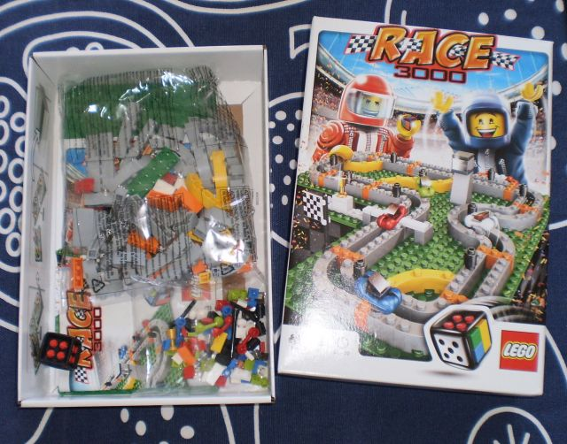
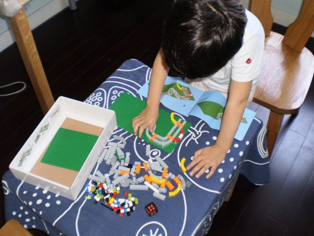
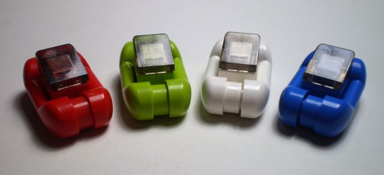
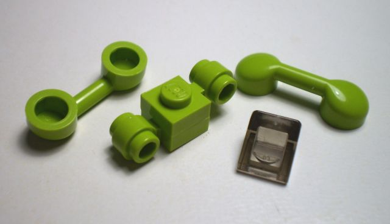
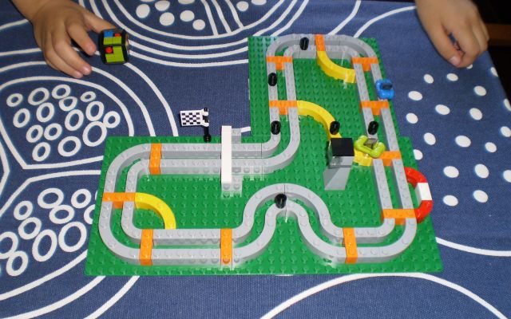
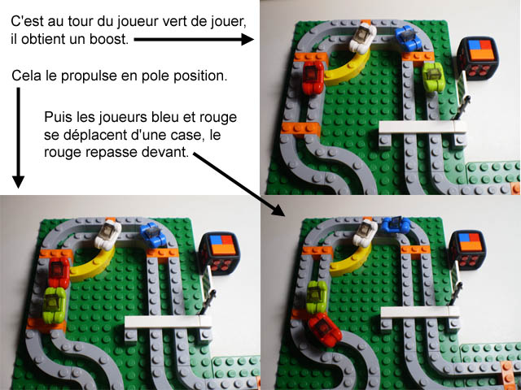
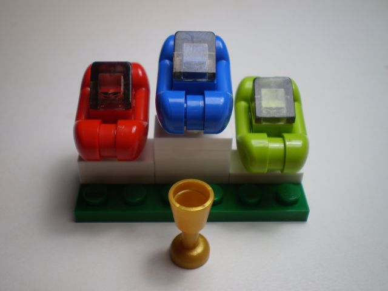

Le test des jeux de société LEGO se poursuit, et aujourd’hui il s’agit de Race 3000, un jeu de course automobile, donc à priori plutôt orienté garçon, mais ma fille n’y prêtera pas attention.

Comme à mon habitude, je commence par vous dévoiler la boîte une fois ouverte.

**Ouverture de la boîte**

Et je laisse ma fille se lancer dans le montage pendant que je lis avec avidité le livre de règles.

**Montage du circuit**

Youpi ! Le système de jeu est similaire à la boîte [Lava Dragon](/articles/978/), à savoir construction du dé en cours de partie, système que j’avais tant apprécié dans cette boîte. De plus, cette fois-ci le plateau de jeu m’attire beaucoup plus que le simili-volcan de Lava Dragon.

Et puis aussi les petites voiture sont adorables, je vous laisse en juger par vous-même :

**Les voiture-pions**

Et tout cela astucieusement monté avec des combinés téléphoniques et deux plates 1x1 avec clip rond :

**Une voiture en pièces détachées**

Le circuit se monte très vite et très facilement, et vous vous doutez bien que les règles alternatives nous suggèrent de créer d’autres circuits, voire de s’inspirer des modèles que l’on peut voir au dos de la notice. Malheureusement, il n’y a aucun modèle alternatif au dos de la notice. Ils ont sans doute été remplacés par des pages de publicité venant du département marketing de chez TLC. Tant pis, on s’en remettra à notre imagination.

Le circuit est composé de deux voix construites avec des briques grises 1x4 et courbes, ainsi que des briques 1x3 oranges. Ces dernières ont une double utilité : d’abord elles permettent aux voitures de changer de voie, ensuite elles servent de borne limite pour le boost des voitures.

**En pleine course !**

En effet, le dé possède deux tiles 1x2 orange, lorsqu’on les obtient, cela boost sa voiture, et on peut la déplacer jusqu’à la prochaine brique orange.

Le circuit possède aussi des raccourcis jaunes et un stand rouge et blanc qui n’est utilisé que dans les règles alternatives.

Le principe du jeu, vous vous en doutez, est très simple : il s’agit de faire un tour de circuit pour gagner. Au début de la partie le dé est vide. Le joueur dont c’est le tour lance le dé, place une de ses tiles sur un emplacement libre de la face du dé, et déplace sa voiture du nombre de tenons indiqué par le dé. Les autres joueurs déplacent ensuite leur voiture en fonction de ce qu’indique le dé.

Le circuit possède aussi des briques rondes 1x1 noires qui représentent des flaques d’huile. Lorsqu’une voiture touche une flaque d’huile, elle doit s’arrêter à cet endroit, la flaque d’huile est retirée et le joueur doit enlever une de ses tiles du dé.

Mais vous avez remarqué que les voitures font trois tenons de long, deux voitures ne peuvent donc pas être placées sur deux tenons successifs du circuit. Donc lorsqu’une voiture est bloquée par une autre voiture, elle la dépasse et doit être placée juste devant elle. **Cette règle est à mon avis ce qui anéanti le jeu**. D’une part parce qu’il est toujours discutable de savoir s’il y a la place ou non, et d’autre part parce que cela conduit à mettre trop de distance entre les joueurs. En effet si deux voitures se suivent de près, elles se dépassent et se redépassent continuellement, les faisant progresser très rapidement par rapport aux autres joueurs qui se trainent. Prenez cet exemple :

**Des voitures sur-vitaminées**

Le joueur vert dont c’est le tour de jouer, a obtenu une tile orange et pourrait booster sur la voie de droite. Mais il peut réclamer de vouloir changer de voie et vouloir booster sur la voie de gauche. Comme il n’y a pas de place derrière la voiture bleue, il va se retrouver en pôle position, simplement parce qu’il n’y a pas de place pour lui entre la voiture bleue et la blanche ni entre la blanche et la rouge.

L’idée des flaques d’huile pourrait sembler intéressante, mais en pratique totalement inutile, car comme le changement de voie est gratuit, tous les concurrents zigzaguent en empruntant à chaque fois la voie qui ne possède pas de flaque d’huile (entre deux briques oranges). Les raccourcis sont aussi systématiquement pris parce qu’il n’y a aucune pénalité. En particulier le raccourcis en forme de S est tellement avantageux, que je doute de voir un jour un joueur emprunter le chemin normal...

Bref, pour moi ce jeu n’est pas vraiment jouable et plutôt mal conçu. C’est vraiment dommage vu que je trouvais les voitures super mignonnes et que le principe de construction du dé reste tout de même sympa. Allez pour se consoler, on peut admirer le podium également fourni dans la boîte.

**Le podium**

## Mon impression

Vous l’aurez compris, pour la première fois, je ne recommande pas l’achat de cette boîte, car le jeu lui-même n’est pas vraiment jouable. On ne sait jamais jusqu’où avancer sa voiture. Y-a-t’il la place ? Il arrive que dans les virages, les voitures se touchent un peu, doit-on alors autoriser le dépassement ? Je me demande même s’il est rattrapable en modifiant les règles. Sans doute faudrait-il ajouter une pénalité à la prise de raccourcis, afin de réellement donner le choix au joueur de le prendre ou non. Sans doute faudrait-il rajouter une pénalité au changement de voie afin d’éviter que les joueurs ne progressent trop facilement et évitent les flaques d’huile comme si elle n’existaient pas.

Mais à mon avis, il faudrait carrément repenser le plateau de jeu. Il existe un jeu de plateau de formule 1 qui s’appelle [Formule Dé](http://fr.wikipedia.org/wiki/Formule_D%C3%A9). Je n’y ai pas joué personnellement, mais j’ai entendu dire qu’il était très tactique (on peut choisir d’accélérer dans les virages, mais cela augmente les probabilité de sortie de piste, etc.). Peut-être que les designers de cette boîte auraient pu s’en inspirer au lieu de nous pondre un ersatz de "petit chevaux" dont les cases de déplacement ne sont pas clairs...

Faire des voitures mignonnes, je suis pour à 100%, mais puisqu’elles font 3 tenons de long, il faut leur donner une piste qui permettent de les accueillir sans ambiguïté.

En espérant que le prochain jeu sera plus réussi, je vous dis à bientôt pour le prochain test !
