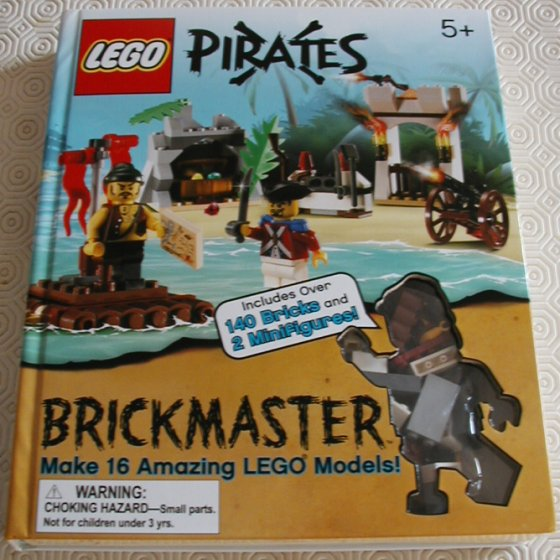
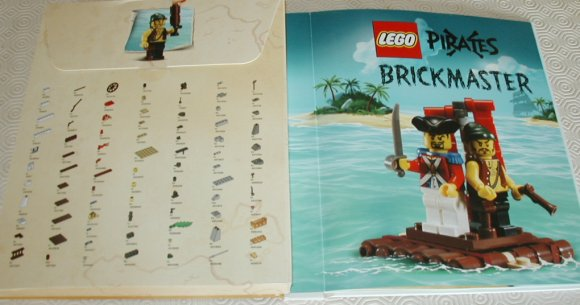
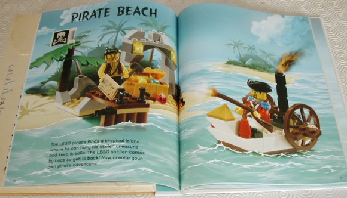
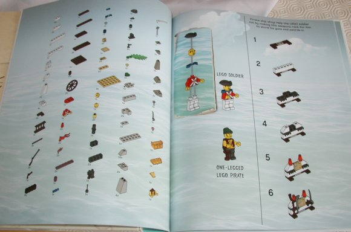
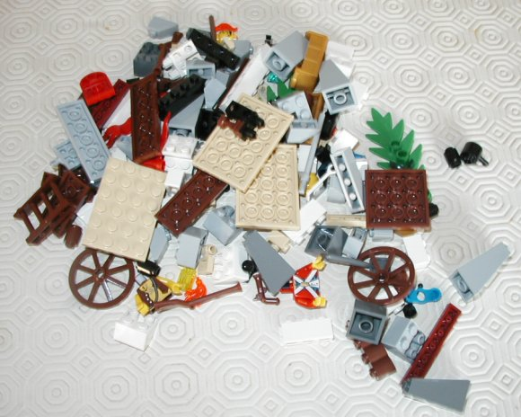
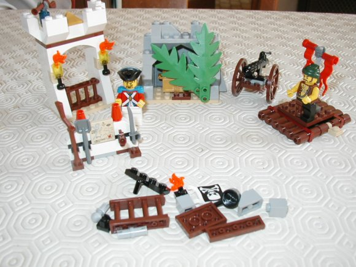
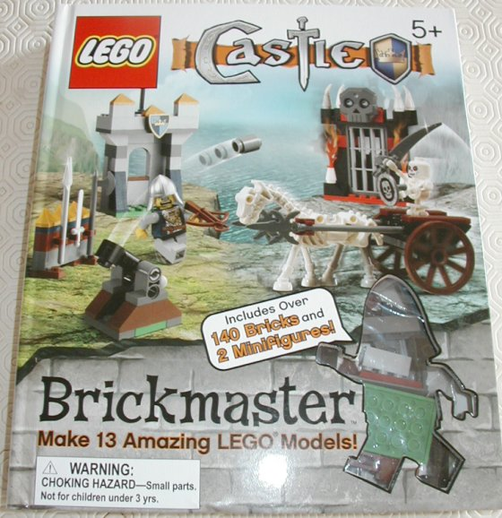

A mi chemin entre livre, boîte de LEGO, notice, DK Publishing nous offre ici un joli produit bien fini.

**Résumé**  
**–** _ISBN :_ 0756655196  
**–** _Prix :_ 25$ ([17,51 euro sur amazon](http://www.amazon.fr/dp/0756655196/ref=cm_sw_su_dp))  
**–** _Nombre de pièces :_ 140  
**–** _Nombre de pages :_ 48

Le livre, assez épais car il cache un compartiment pour les briques, est un recueil d’instructions pour 16 modèles sur le thème Pirates.

La couverture laisse apparaitre le contenu en briques à travers une perforation en forme de minifig Pirates.

A l’intérieur de la couverture, le compartiment contenant un sachet de briques et l’inventaire de la boîte.

Le livre est richement illustré pour présenter l’ensemble des 16 modèles.

Tous les modèles ne peuvent être construits simultanément, mais cependant, on peut en construire plusieurs à la fois.  
Les modèles sont regroupés en six ensembles. Chaque ensemble débute par l’inventaire des pièces nécessaires. Chaque modèle est accompagné d’un petit texte (en anglais) situant le contexte du modèle. Par exemple :  
**–** "Le trésor a besoin d’être caché ! Cette grotte tropicale sera parfaite."  
**–** "Regardez ! Les pirates sont prêts à attaquer ! Aide le soldat LEGO à défendre l’île tropicale avec ce canon."

Les briques sont variées et de petites tailles. Deux minifigs, un pirate et un soldat, sont incluses. Tous les éléments nécessaires pour ce thème sont présents : fusils, sabre, pistolet, carte au trésor, trésor, pelle, et des feuilles de palmier, des rondins de bois, des flammes, des plaques couleur sable, etc.

Les modèles proposés sont de petites tailles, mais permettent de mettre en situation nos personnages.

Ce livre permet de montrer aux enfants qu’avec quelques pièces et de l’imagination, on peut construire beaucoup de choses différentes et inventer de nombreuses histoires.

Et pour ceux qui préfèreraient le moyen-âge aux pirates, il existe aussi [la version Castle](http://www.amazon.fr/dp/0756655188/ref=cm_sw_su_dp), qui propose 13 modèles dont deux sets promotionnels ([5372](http://www.brickset.com/detail/?Set=5372-1) et [5373](http://www.brickset.com/detail/?Set=5373-1)).

