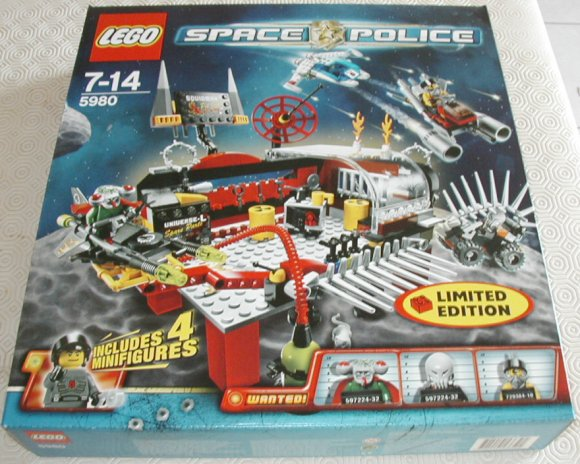
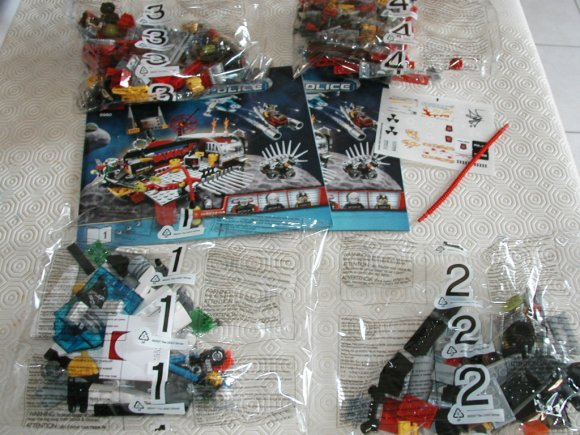
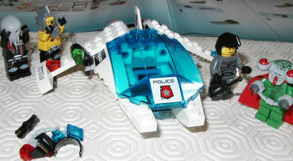
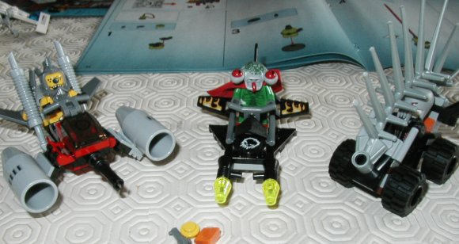
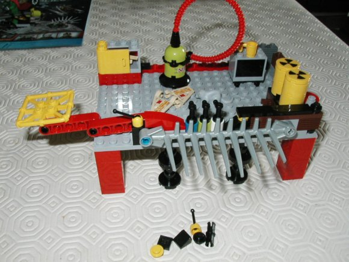
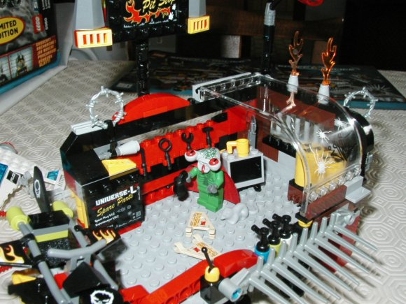
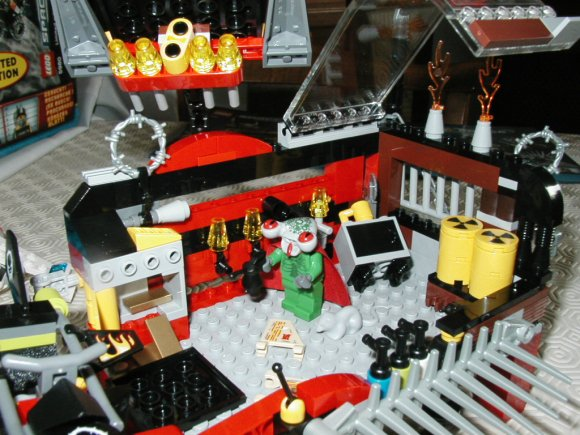
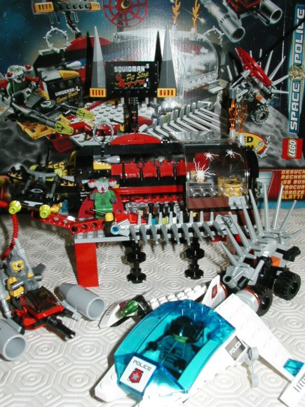
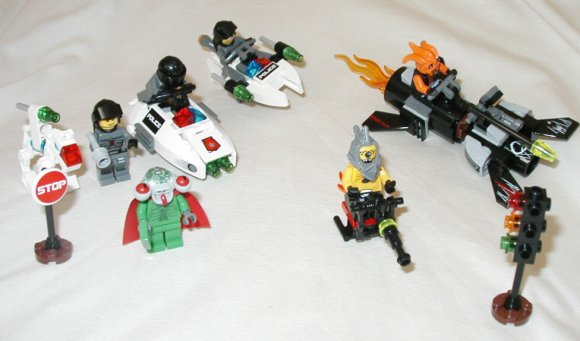

Bien qu’aux premiers abords, cette boîte peut sembler inintéressante, je l’ai prise, d’une part pour compléter la collection, et d’autre part parce qu’il s’agit d’une édition limitée (comprendre vendue en exclusivité dans une chaîne de magasin, ici toys’R’us).

**Résumé**  
**–** _Référence :_ 5980  
**–** _Nom :_ L’atelier de Face-De-Calmar  
**–** _Année :_ 2009  
**–** _Nombre de pièces :_ 389  
**–** _Prix :_ 49,99 euros

La boîte, de taille moyenne, ne pèse pas bien lourd. Il faut bien justifier par la taille le prix un peu élevé pour le nombre de pièces.

La boîte contient quatre sachets numérotés, deux livrets, une planche d’autocollants et un tuyau.

Le premier sachet correspond aux quatre minifigs, et au vaisseau de police.

Nous retrouvons :  
**–** un agent de police (sans bouteille d’oxygène) ;  
**–** Snake, le cyclope torse-nu au casque punk-médiéval ;  
**–** une des deux soeurs jumelles Skull Twin ;  
**–** et bien évidemment Squidman, l’alien vert aux yeux rouges globuleux et la langue bien pendante.

Le vaisseau de police, de petite taille, est profilé pour poursuivre à toute vitesse les bandits de l’espace.

Le second sachet permet de construire les trois véhicules de nos aliens : deux vaisseaux volants, et un buggy. Rien d’extraordinaire à dire dessus.

Les deux derniers sachets sont dédiés au bâtiment. Derrière ses apparences de garage de customisation de vaisseaux et fait de bric-à-brac, se cache un véritable repère de contrebandiers.

**A la fin du sachet n°3**

Le rack à outils pivote sur lui-même pour devenir un présentoir d’armes, gadget digne de tout film de contrebande ! Le tableau cache un coffre plein de lingots tandis que l’enseigne de l’atelier dissimule des lance-roquettes.

**En conclusion**

D’un intérêt limité, j’apprécie tout de même :  
**–** le nombre de véhicules, qui permet d’équiper chaque personnage de la boîte ;  
**–** le rack à outils réversible.

J’aime moins :  
**–** le design un peu fourre-tout des trois véhicules des aliens et du garage ;  
**–** le bras de levage qui ne supporte pas la charge ;  
**–** les innombrables autocollants à apposer.

Bref, ce set n’est pas un indispensable, et si vous êtes à la recherche de personnages un peu exotiques et de policiers de l’espace, je conseillerais davantage de prendre les quatre boîtes d’entrée de gamme ([8399, 8400, 5969 et 5970](http://guide.lugnet.com/set/?q=8399%2C8400%2C5969%2C5970)) pour un budget moindre :

