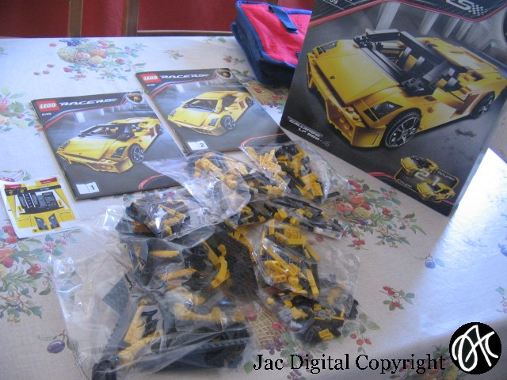
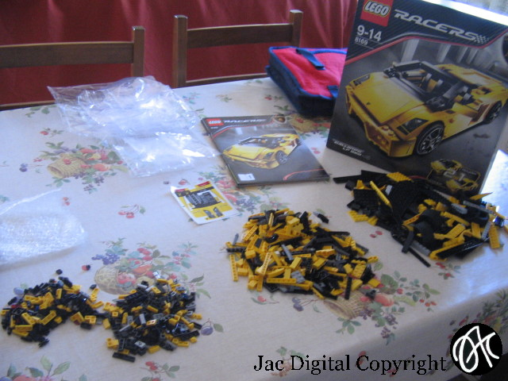
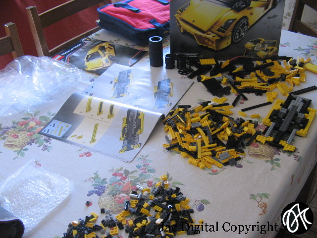
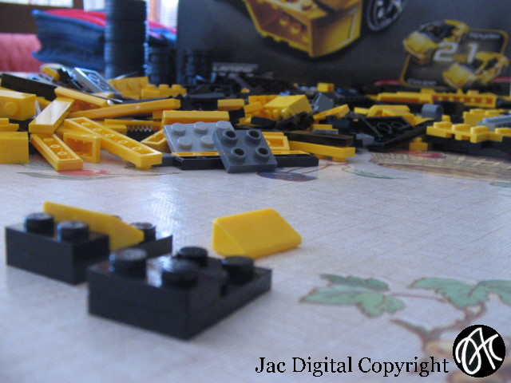
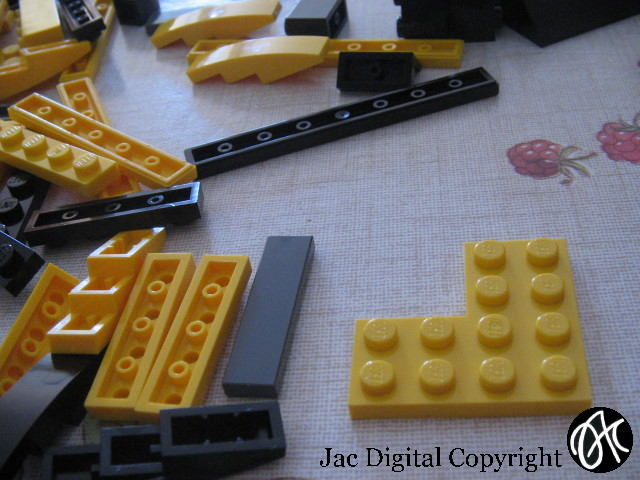
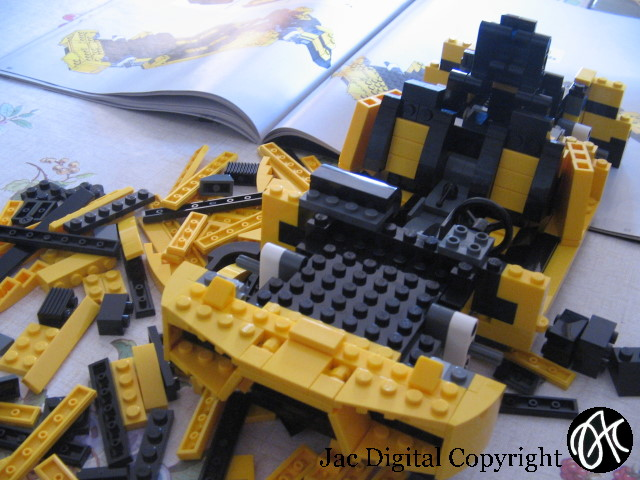
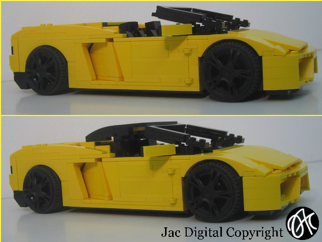

Eté 2009, je feuillette la revue du s@h, et là, surprise, une belle Lamborghini est reproduite par notre marque de construction préférée.

Lamborghini est un nom qui me fait rêver. C’est l’enfant terrible de Ferrari. « Tu ne sauras jamais faire une voiture de sport », avait dit Enzo, au constructeur de tracteur agricole italien. C’est mal connaître ce petit concurrent qui choisira le taureau cabré pour contrer le cheval Ferrari ! les voitures sont fabuleuses, et excentriques, un nom, une marque de bolides sensationnels aux prénoms mémorables : Countach, Diablo, Mucielago, Miura. Enfin, c’est mon opinion. C’est pour cela que j’en parle de cette façon...

Le nom de la Gallardo évoque une célèbre race de taureaux de combat de la région de Cadix, nom utilisé afin de rester fidèle aux voeux de Ferruccio Lamborghini. La Lamborghini Gallardo est le modèle le plus vendu de la gamme. Elle a été conçue pour concurrencer la Ferrari 360 Modena. Elle est en vente en France depuis le mois d’octobre 2003. Son prix avoisine les 180 000 €.

Vu en promotion dans une grande surface, c’est à dire à 42 euros, au lieu de 62 euros sur le Shop, plus une hésitation à avoir, le set 8169 fera parti de ma collection. Ca reste aussi bien moins cher que la vraie !

L’ouverture de la boîte n’est pas des plus simple. Surtout si comme moi, vous souhaitez la garder. Si ce n’est pas le cas, ce qui va suivre ne vous intéresse pas ! J’ai coupé les scotches délicatement, puis en soulevant légèrement, j’ai pu sortir les sachets et les notices. La boîte s’est refermée toute seule ensuite. C’est un modèle de collection pour moi. Une fois démonté, il reprendra place dans la boîte.

La boîte contient beaucoup de sachets, mais elle est quand même encore trop grande. Une belle planche d’autocollants, et deux notices qui nous donnent le choix. On peut monter le spyder, ou le coupé. Les caractéristiques techniques diffèrent. Mais pour nous, cela n’a pas beaucoup d’importance. C’est la spyder que je vais assembler, pour le montage du toit escamotable.

**Déballage**

J’ouvre tous les sachets, comme à mon habitude. Pas de numéro ici. Le modèle est destiné à un public plus expérimenté. Par contre, je sépare les grosses pièces, les moyennes, et les petites, cela facilite un peu la recherche, surtout au début. La planche d’autocollants sera replacée dans la notice que je n’utilise pas, pour ne pas l’abimer.

**Ouverture des sachets**

Le montage est logique, et on commence par le châssis. Au fur et à mesure, je trie les pièces imposantes, comme les pneus, jantes, et enjoliveurs, qui servent en dernier, en général.

**Le châssis.**

On découvre des pièces nouvelles, comme les pièces penchées 1X2X2/3, des plates de 1X12, de nouvelles pièces arrondies, et d’autres plus anciennes, comme les plates en angles.

**Pièce nouvelle.**

**Pièce ancienne...**

Les sièges baquets sont vraiment très bien faits, on a envie de s’assoir dedans. Ou d’y mettre sa minifig, sauf que c’est pas à son échelle. D’ailleurs, rien n’est inscrit à ce sujet sur la boîte.

**Les sièges.**

La construction se poursuit sans encombres. Il me faudra 2h 1/4 pour la compléter, en comptant la prise des photos. Mais sans mettre les autocollants. L’extase est pratiquement égal que lors de la découverte de la gamme Star Wars, c’est vous dire. Par contre, j’ai noté quelques détails pas top :  
**–** sans autocollants, ce n’est pas chouette. Il vaut mieux les coller, mais du coup, où est l’amusement ? Si on veut détruire pour faire l’autre modèle ? Même si c’est pratiquement pareil, c’est dommage.  
**–** le moteur est invisible, mais, c’est sûrement dû à la version spyder.  
**–** le montage des jantes est compliqué. Il serait plus pratique de faire des jantes toutes moulées, comme les vraies. L’enjoliveur est fragile, et si on l’enfonce pas correctement, il dépasse de la roue. L’astuce, emboîter la roue entière sur l’axe. Placer l’enjoliveur en butée. Ressortir la roue, enfoncer à fond l’enjoliveur, et remettre la roue...

J’ai comparé avec la Racer Enzo Ferrari 8652. Je l’ai aussi monté sans autocollants, la version est un peu plus réussie. Pour moi qui préfère Lamborghini, c’est dommage.

Mis à par cela, le modèle est très beau. Les roues rendent très bien, le museau est agressif comme la vraie, l’intérieur est superbe. Le choix de la couleur jaune est très réaliste. On attend le vrombissement du V10, et de sentir son souffle par les 4 sorties d’échappements chromées. J’espère une sortie prochaine d’un autre modèle de cette marque prestigieuse. Messieurs les Designers LEGO, lequel choisirez-vous, pour me faire rêver un peu plus ?

Un petit tour sur le net vous permettra de découvrir quelques versions hallucinantes de la Lamborghini Gallardo. Et là, vous aurez quelques idées pour modifier votre modèle.

**La Spyder, avec et sans le toit.**
