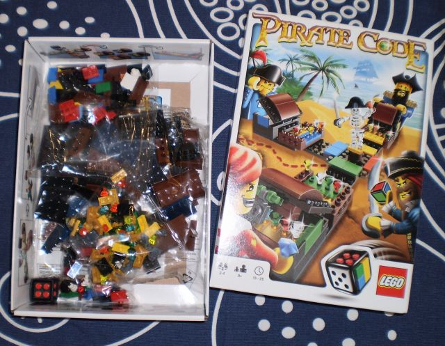
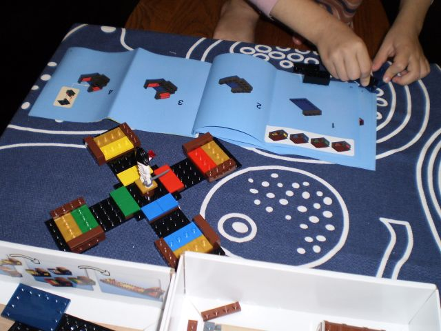
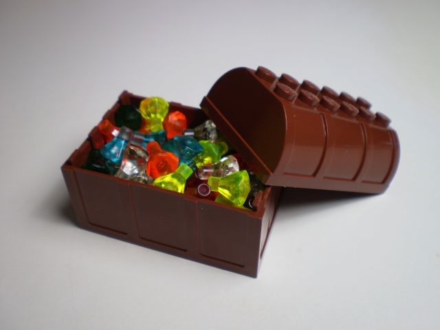
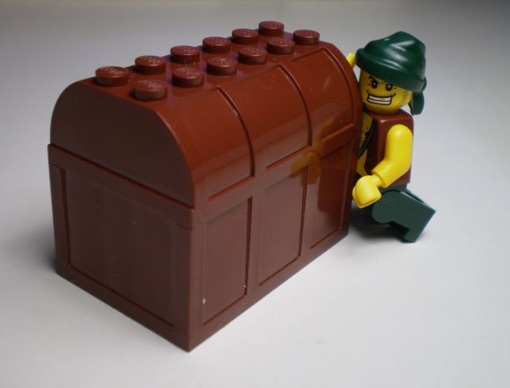
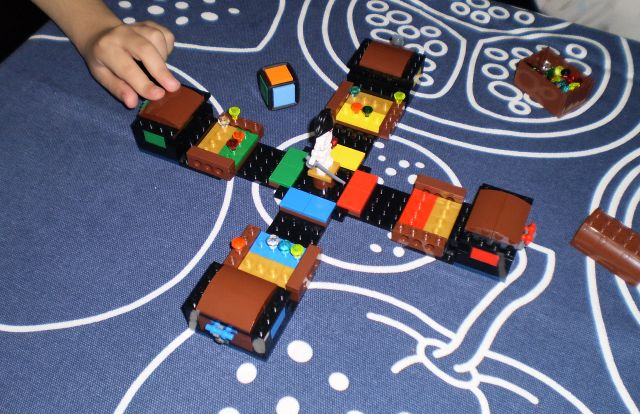

Voici la dernière revue des jeux de société de taille moyenne. Après cela il nous restera les grosses boîtes beaucoup plus prometteuses.

Voilà donc un jeu de société dans l’univers des Pirates, un thème particulièrement cher à de nombreux AFOLs. Ne traînons donc pas pour ouvrir la boîte.

**Ouverture de la boîte**

On peut remarquer la présence de nombreuses pierres précieuses de différentes couleurs (6 couleurs en tout, 12 de chaque). En regardant l’image de la boîte on comprend tout de suite qu’elles serviront à créer votre code secret.

La construction s’avère répétitive, vu qu’il faut créer 4 coffres identiques (à l’exception de quelques couleurs) :

**Construction à la chaîne**

Tous les joyaux sont regroupés dans un grand coffre qui sert de pioche, ce qui est une excellente idée.

**Le rêve de tout pirate !**

Le coffre en question est la [pièce numéro x516](http://www.bricklink.com/catalogItemIn.asp?P=x516&in=S) qui apparait dans peu de sets (surtout en marron) et surtout des sets Belville ou Scala, tout simplement parce qu’il est un peu disproportionné pour des minifigs...

**Il est à moi ! Je l’ai vu le premier !**

Qu’en est-il du jeu maintenant ? Vous l’aurez peut-être deviné, Pirate Code est un jeu inspiré du [Mastermind](http://fr.wikipedia.org/wiki/Mastermind). Mais bien sûr les règles ont été simplifiées pour être accessibles aux enfants.

Tout d’abord on ne peut choisir que des couleurs différentes pour son code secret, ce qui réduit grandement les possibilités. Ensuite les indices données aux autres joueurs qui tentent de deviner votre code sont beaucoup plus précis que les indices du Mastermind (qui, rappelons-le, était seulement le nombre de bonnes couleurs bien placées et le nombre de bonnes couleurs mal placées).

Alors que le Mastermind se joue à deux avec un joueur qui choisit un code secret et l’autre joueur qui tente de deviner, dans Pirate Code, tous les joueurs choisissent un code et cherchent à deviner le code des autres. C’est un premier point positif du jeu et tant mieux car il n’y en aura pas beaucoup...

Le gagnant est celui dont le code a résisté le plus longtemps. Le déroulement du jeu est assez simple : à son tour, le joueur lance le dé qui indique une des six couleurs de pierre précieuse. Il peut donc prendre une pierre de la couleur indiquée par le dé en provenance de la réserve et en prendre une autre de son choix, puis il peut placer les deux pierres devant le coffre d’un ou deux adversaires. Ou bien encore il peut s’abstenir de lancer le dé, et réarranger la positions des pierres déjà présentes devant le coffre d’un adversaire.

Une fois qu’un nouveau code est testé, il y a alors trois possibilités :  
**–** si la pierre est de la bonne couleur et bien placée, alors l’adversaire déplace la pierre sur la ligne dorée ;  
**–** si la pierre est de la bonne couleur mais mal placée, alors l’adversaire la laisse à sa place ;  
**–** si la pierre n’est pas de la bonne couleur alors il la déplace sur le côté.

**Au cours de la partie.**

De cette façon en un clin d’oeil, les joueurs peuvent voir quelles sont les pierres déjà trouvées, celles mal placées et celles déjà essayées mais ne faisant pas partie du code.

Hélas, j’ai beau chercher, je ne comprends pas l’intérêt du dé. La seule raison qui me vient à l’esprit est une raison marketing. Le dé LEGO devait absolument être présent dans **toutes** les boîtes de la gamme. Mais franchement les joueurs n’ont vraiment pas envie que le hasard leur impose une couleur à tester, surtout à la fin de la partie, car au début, à la rigueur on a besoin de tester toutes les couleurs.

Ayant lu les règles trop rapidement pour la première partie, j’ai cru qu’on ne pouvait choisir ou déplacer que la couleur indiquée par le dé. Cette mauvaise interprétation des règles à conduit à un blocage des lignes de test au cours de cette partie. C’est pour éviter ce blocage que les règles précisent qu’on peut choisir librement une couleur en plus de celle indiquée par le dé.

Franchement à la fin on se demande vraiment pourquoi on lance le dé...

Mais le coté artificiel du dé n’est rien comparé au problème de manipulation. En effet **le plateau de jeu n’est pas solide !**  
**–** les coffres des joueurs se détachent sans arrêt ;  
**–** la charnière qui sert à l’ouverture du couvercle ne tient pas, ce qui fait que le couvercle vous reste dans la main ;  
**–** souvent quand on retire une pierre précieuse, le jumper (plate 1x2 avec un tenon) se détache.

Franchement c’est une horreur à jouer...

Notez au passage que ma fille à cette fois-ci eu un peu de mal à jouer (elle a cru avoir gagné quand on a trouvé son code), mais cela est sans doute normal vu que l’âge conseillé est de 8 ans.

Je vous dispenserai de mes commentaires sur les règles alternatives qui sont sans intérêt.

D’autre part, si vous vous demandez pourquoi il y a une tile 1x4 à droite, c’est simplement pour bloquer une ligne et rendre le jeu plus facile (le code n’est fait alors que de trois couleurs).

## Mon Impression

Franchement, achetez-vous un Mastermind...

En un peu plus détaillé, je vous dirais que l’utilisation du dé LEGO n’a aucun intérêt ici. Mais vous l’aurez compris, la présence du dé LEGO dans **toutes** les boîtes de la gamme était sans doute une décision marketing.

De plus le plateau de jeu se manipule très difficilement. Je ne vous recommande donc pas l’achat de ce set sauf si souhaitez enrichir votre collection de pierres précieuses...

A bientôt pour le test d’un des trois derniers jeux, qui tous les trois sont plutôt bons (je peux dors et déjà vous le dire car je les ai déjà testés).
